<p align="center">
  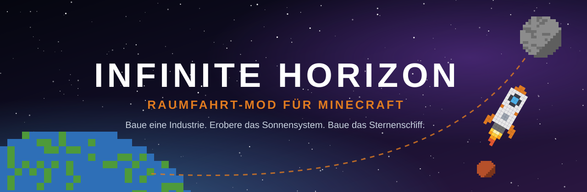
</p>

<p align="center">
  <b>Raumfahrt-Mod für Minecraft 26.3</b> · NeoForge &amp; Fabric · im echten Sonnensystem
</p>

<p align="center">
  <a href="https://github.com/nillim007/Minecraft-Infinite-Horizon/actions/workflows/build.yml"></a>
  
  
  
  
  
</p>

<p align="center">
  <a href="docs/wiki/README.md"><b>📖 Wiki</b></a> ·
  <a href="docs/wiki/Erste-Schritte.md"><b>🚀 Erste Schritte</b></a> ·
  <a href="docs/wiki/Alle-Rezepte.md"><b>🛠️ Alle Rezepte</b></a> ·
  <a href="#entwicklungsstand"><b>📍 Stand</b></a>
</p>

---

## Worum geht es?

Du beginnst mit einer Werkbank und ein paar Eisenbarren. Am Ende steuerst du ein **interplanetares Frachtnetz** und baust in deiner **Orbitalwerft das Sternenschiff**.

Dazwischen liegt eine Reise durch das echte Sonnensystem: Du baust auf der Erde eine Industrie auf, förderst Erdöl und raffinierst Raketentreibstoff. Du schickst Sonden voraus, landest auf dem Mond und überlebst unter Kuppeln auf dem Mars. Du trotzt der Säurehölle der Venus und tauchst unter das Eis von Europa. Ganz draußen bei Pluto wartet ein Signal, das niemand erklären kann.

<p align="center">
  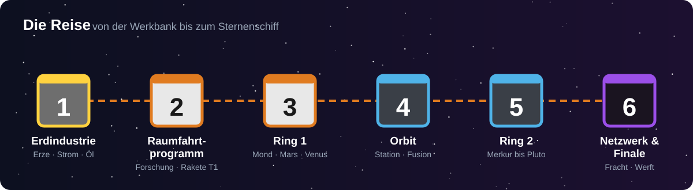
</p>

## Was dich erwartet

| | |
| --- | --- |
| 🏭 **Echte Industrie** | Erze zerkleinern und verdoppeln, Metalle pressen, Erdöl raffinieren, Wasser spalten. Maschinen mit Strom, Upgrades, Rohren und Multiblöcken. |
| 🚀 **Raketen, die man baut** | Raketen aus Einzelteilen auf einer Startrampe. Treibstoff, Schub und Reichweite hängen vom Ziel ab. Proben und Sonden schalten neue Ziele frei. |
| 🪐 **20 Ziele im Sonnensystem** | Mond, Mars, Venus, Merkur, Asteroidengürtel, Ceres, Io, Europa, Titan, Enceladus, Triton, Pluto und die Orbits der Planeten, jedes mit eigener Schwerkraft, Atmosphäre und Gefahr. |
| 🧑‍🚀 **Überleben im All** | Raumanzüge in drei Stufen, Sauerstoff, Hitze, Kälte und Strahlung. Kuppeln machen fremde Welten bewohnbar. |
| 🛰️ **Raumstationen** | Eigene Stationen im Orbit mit Schwerelosigkeit, Solarflügeln, Fusionsreaktor und Schwerelos-Fertigung. |
| 📦 **Logistik-Netz** | Außenposten, Bohrtürme und Frachtraketen versorgen deine Kolonien, auch wenn du nicht vor Ort bist. |
| 🤝 **Mehrspieler** | Agenturen teilen Forschung, Atlas und Frachtnetz. Handel zwischen Agenturen. |
| 📖 **Handbuch im Spiel** | Das Ingenieurs-Handbuch erklärt jede Maschine mit Rezepten und Links. Es ist dasselbe wie das [Wiki](docs/wiki/README.md). Taste **H** über einem Item öffnet seine Seite. Alle Maschinenrezepte stehen auch in **JEI** und **REI**. |

<p align="center">
  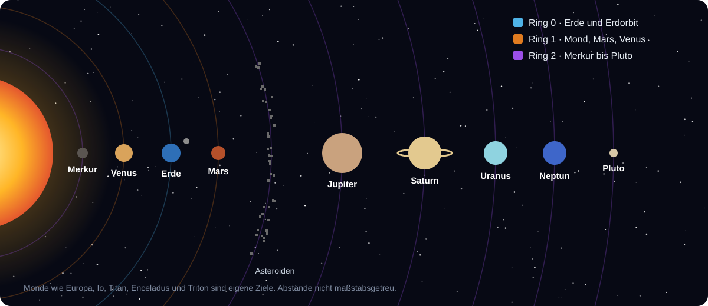
</p>

## So fängt es an

<p align="center">
  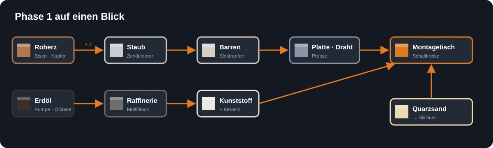
</p>

1. **Maschinenrahmen** aus Eisen, Kupfer und Redstone bauen.
2. **Verbrennungsgenerator** und **Kupferkabel** für den ersten Strom.
3. Im **Zerkleinerer** wird aus jedem Roherz doppelt so viel Metall.
4. Die **Presse** macht Platten, Stangen und Draht, der **Elektroofen** Silizium aus Quarzsand.
5. Am **Montagetisch** entstehen Schaltkreise. Kunststoff dafür liefert die **Raffinerie**, dein erster Multiblock.

Der ganze Ablauf mit allen Rezepten steht im Wiki unter [Erste Schritte](docs/wiki/Erste-Schritte.md).

## Einblicke

> Die Bilder zeigen den aktuellen Entwicklungsstand. Die Texturen sind noch Platzhalter.

<p align="center">
  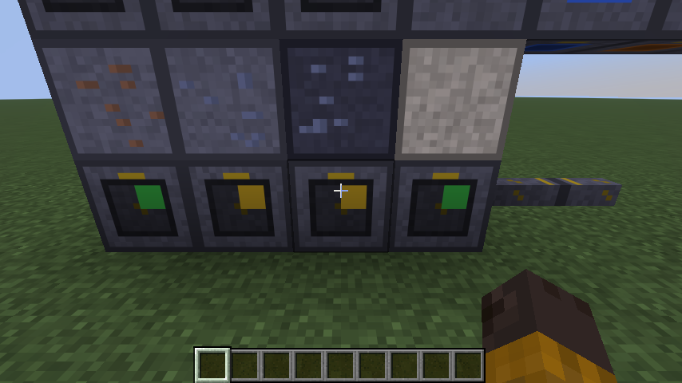
  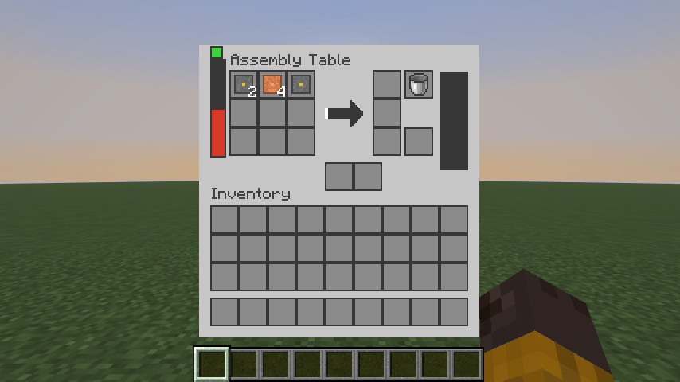
  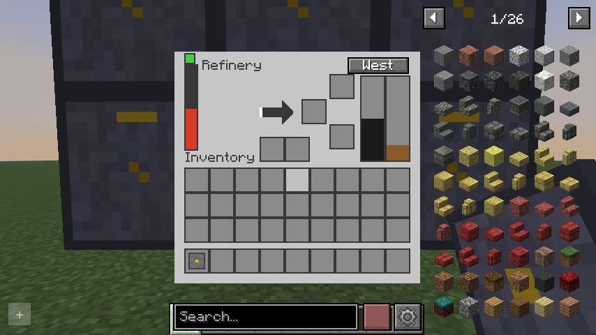
</p>

<p align="center">
  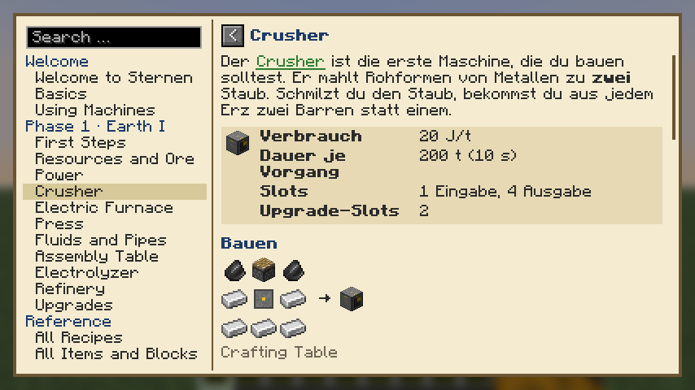
  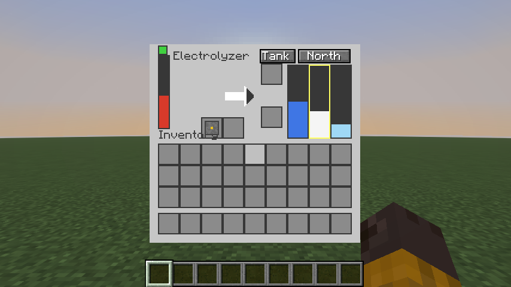
  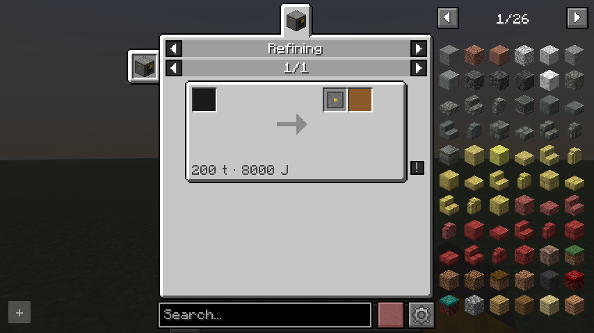
</p>

<p align="center">
  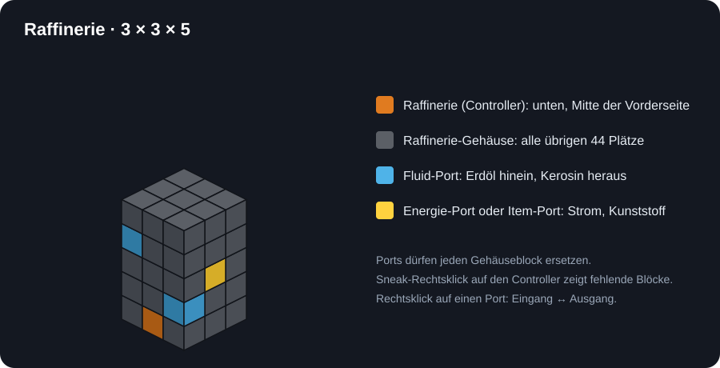
</p>

## Entwicklungsstand

Infinite Horizon wird Meilenstein für Meilenstein nach einer festen [Spezifikation](docs/spec/README.md) gebaut. Den Code schreibt eine KI. Jeder Meilenstein muss auf beiden Loadern bauen und seine automatischen Tests im Spiel bestehen.

<!-- stand:start (erzeugt von tools/gen_wiki.py aus common/implemented_ids.json) -->
| Meilenstein | Inhalt | Stand |
| --- | --- | --- |
| 1 | Grundgerüst: Multiloader, Energie, erste Maschine | ✅ fertig |
| 2 | Erdindustrie: Maschinen, Erze, Fluide, Raffinerie, Montagetisch, Handbuch | ✅ fertig |
| 3 | Erste Welt: Mond, Anzug, Kuppel | 🔨 in Arbeit (3a–3c fertig, 3d–3e offen) |
| 4 | Erster Flug: Forschung, Sonde, Rakete T1 · **erste spielbare Version** | ⏳ geplant |
| 5 | Ring 1: Mars, Venus, Rover, Kreaturen | ⏳ geplant |
| 6 | Orbit: Station, Fusion | ⏳ geplant |
| 7 | Ring 2: Merkur bis Pluto | ⏳ geplant |
| 8 | Netzwerk und Finale: Logistik, Werft, Sternenschiff | ⏳ geplant |
| 9 | Feinschliff: Mehrspieler, Erfolge, Klang, Balancing | ⏳ geplant |
<!-- stand:end -->

> [!NOTE]
> Bis Meilenstein 4 gibt es noch keine spielbare Version zum Herunterladen. Wer mitprobieren möchte, baut die Mod selbst (siehe unten).

## Wiki und Ingenieurs-Handbuch

Das **[Wiki](docs/wiki/README.md)** beschreibt den Ablauf, alle Rezepte und viele Tipps. Es entsteht aus derselben Quelle wie das **Ingenieurs-Handbuch** im Spiel (`docs/handbook/`):

- Rezepte, Werte und Item-Listen kommen direkt aus den Daten der Mod und sind immer aktuell.
- Mit jedem Meilenstein kommen neue Seiten dazu. Seiten für noch nicht eingebaute Inhalte bleiben verborgen.
- Links zwischen den Seiten funktionieren im Wiki und im Buch im Spiel.

```bash
python tools/gen_wiki.py
```

## Selbst bauen

Voraussetzungen: **JDK 25** (z. B. Eclipse Temurin) und **Python 3.11+** (nur Standardbibliothek). Gradle kommt über den Wrapper.

```bash
./gradlew build
```

Die fertigen Mod-Dateien liegen danach in `neoforge/build/libs/` und `fabric/build/libs/`.

## Für Mitwirkende

| Ort | Inhalt |
| --- | --- |
| [`docs/spec/`](docs/spec/README.md) | Spezifikation in Kapiteln, mit Meilenstein-Matrix |
| [`spec/data/`](spec/data/SCHEMA.md) | maßgebliche Daten: IDs, Rezepte, Forschung, Planeten, Balance |
| [`docs/handbook/`](docs/handbook/README.md) | Quelle für Wiki und Ingenieurs-Handbuch |
| [`docs/wiki/`](docs/wiki/README.md) | erzeugtes Spieler-Wiki (nicht von Hand ändern) |
| [`docs/dev/`](docs/dev/) | Entwicklernotizen, Testberichte, Addon-Schnittstelle |
| [`docs/spec-gaps.md`](docs/spec-gaps.md) | offene Annahmen aus der Umsetzung |
| [`tools/`](tools/) | Prüf- und Generator-Skripte |
| [`CLAUDE.md`](CLAUDE.md) | Arbeitsanweisung für KI-Sitzungen |

```bash
python tools/validate_spec.py
```

```bash
python tools/gen_resources.py
```

Addons sind ausdrücklich erwünscht: Fast alle Werte stehen in Datenpaketen, und unter `de.infinitehorizon.api` gibt es eine öffentliche Schnittstelle. Details in [`docs/dev/addon-api.md`](docs/dev/addon-api.md).

## Lizenz

MIT, siehe [LICENSE](LICENSE).
