<!-- Erzeugt von tools/gen_wiki.py aus docs/handbook/ und spec/data. Nicht von Hand ändern. -->

[📖 Wiki](README.md) › Nachschlagen › **Alle Rezepte**

# Alle Rezepte

Hier stehen alle Rezepte, die es im aktuellen Stand gibt. Die Werte kommen direkt aus den Daten der Mod. Dauer und Energie gelten ohne [Upgrades](Upgrades.md).

## Werkbank

| Rezept | Zutaten → Ergebnis | Wo | Dauer |
| --- | --- | --- | --- |
| 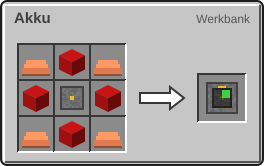 | 4 × Redstone-Block, 4 × Kupferbarren, 1 × [Maschinenrahmen](Erste-Schritte.md) → 1 × [Akku](Strom.md) | Werkbank | – |
| 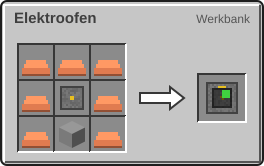 | 7 × Kupferbarren, 1 × Ofen, 1 × [Maschinenrahmen](Erste-Schritte.md) → 1 × [Elektroofen](Elektroofen.md) | Werkbank | – |
|  | 1 × Buch, 1 × Kupferbarren → 1 × [Ingenieurs-Handbuch](Willkommen-bei-Infinite-Horizon.md) | Werkbank (formlos) | – |
| 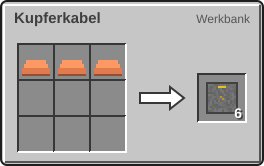 | 3 × Kupferbarren → 6 × [Kupferkabel](Strom.md) | Werkbank | – |
| 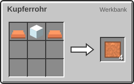 | 2 × Kupferbarren, 1 × Glas → 4 × [Kupferrohr](Fluide-und-Rohre.md) | Werkbank | – |
| 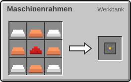 | 4 × Kupferbarren, 4 × Eisenbarren, 1 × Redstone-Staub → 1 × [Maschinenrahmen](Erste-Schritte.md) | Werkbank | – |
| 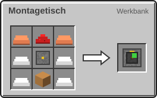 | 2 × Kupferbarren, 4 × Eisenbarren, 1 × [Maschinenrahmen](Erste-Schritte.md), 1 × Redstone-Staub, 1 × Werkbank → 1 × [Montagetisch](Montagetisch.md) | Werkbank | – |
|  | 1 × Buch, 1 × Kompass → 1 × [Planetenatlas](Der-Planetenatlas.md) | Werkbank (formlos) | – |
| 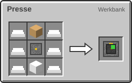 | 6 × Eisenbarren, 1 × [Maschinenrahmen](Erste-Schritte.md), 1 × Kolben, 1 × Eisenblock → 1 × [Presse](Presse.md) | Werkbank | – |
| 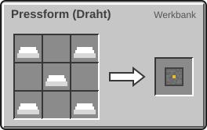 | 5 × Eisenbarren → 1 × [Pressform (Draht)](Presse.md) | Werkbank | – |
| 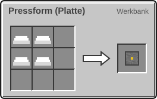 | 4 × Eisenbarren → 1 × [Pressform (Platte)](Presse.md) | Werkbank | – |
| 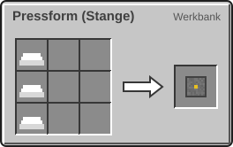 | 3 × Eisenbarren → 1 × [Pressform (Stange)](Presse.md) | Werkbank | – |
| 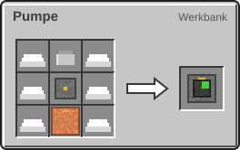 | 1 × Eimer, 6 × Eisenbarren, 1 × [Maschinenrahmen](Erste-Schritte.md), 1 × [Kupferrohr](Fluide-und-Rohre.md) → 1 × [Pumpe](Fluide-und-Rohre.md) | Werkbank | – |
| 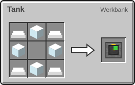 | 4 × Glas, 4 × Eisenbarren → 1 × [Tank](Fluide-und-Rohre.md) | Werkbank | – |
| 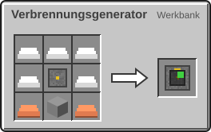 | 2 × Kupferbarren, 5 × Eisenbarren, 1 × Ofen, 1 × [Maschinenrahmen](Erste-Schritte.md) → 1 × [Verbrennungsgenerator](Strom.md) | Werkbank | – |
| 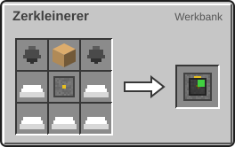 | 2 × Feuerstein, 5 × Eisenbarren, 1 × [Maschinenrahmen](Erste-Schritte.md), 1 × Kolben → 1 × [Zerkleinerer](Zerkleinerer.md) | Werkbank | – |

## Ofen und Elektroofen

| Rezept | Zutaten → Ergebnis | Wo | Dauer |
| --- | --- | --- | --- |
|  | 1 × [Bauxit](Rohstoffe-und-Erze.md) → 1 × [Aluminiumbarren](Elektroofen.md) | Ofen oder Elektroofen | – |
| 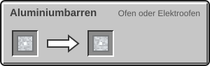 | 1 × [Aluminiumstaub](Zerkleinerer.md) → 1 × [Aluminiumbarren](Elektroofen.md) | Ofen oder Elektroofen | – |
| 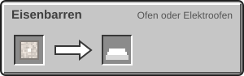 | 1 × [Eisenstaub](Zerkleinerer.md) → 1 × Eisenbarren | Ofen oder Elektroofen | – |
| 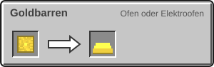 | 1 × [Goldstaub](Zerkleinerer.md) → 1 × Goldbarren | Ofen oder Elektroofen | – |
| 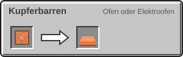 | 1 × [Kupferstaub](Zerkleinerer.md) → 1 × Kupferbarren | Ofen oder Elektroofen | – |
|  | 1 × [Rohtitan](Rohstoffe-und-Erze.md) → 1 × [Titanbarren](Elektroofen.md) | Ofen oder Elektroofen | – |
| 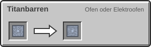 | 1 × [Titanstaub](Zerkleinerer.md) → 1 × [Titanbarren](Elektroofen.md) | Ofen oder Elektroofen | – |

## Elektroofen

| Rezept | Zutaten → Ergebnis | Wo | Dauer |
| --- | --- | --- | --- |
| 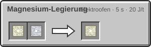 | 1 × [Magnesiumbarren](Der-Mars.md), 1 × [Aluminiumbarren](Elektroofen.md) → 1 × [Magnesium-Legierung](Der-Hochtemperaturofen.md) | Elektroofen | 100 t (5 s) 20 J/t |
| 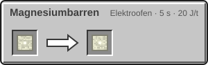 | 1 × [Rohmagnesium](Der-Mars.md) → 1 × [Magnesiumbarren](Der-Mars.md) | Elektroofen | 100 t (5 s) 20 J/t |
|  | 1 × [Magnesiumstaub](Der-Mars.md) → 1 × [Magnesiumbarren](Der-Mars.md) | Elektroofen | 100 t (5 s) 20 J/t |
|  | 1 × [Rohnickel](Der-Mars.md) → 1 × [Nickelbarren](Der-Mars.md) | Elektroofen | 100 t (5 s) 20 J/t |
| 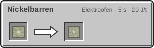 | 1 × [Nickelstaub](Der-Mars.md) → 1 × [Nickelbarren](Der-Mars.md) | Elektroofen | 100 t (5 s) 20 J/t |
| 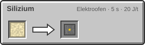 | 1 × [Quarzsand](Rohstoffe-und-Erze.md) → 1 × [Silizium](Elektroofen.md) | Elektroofen | 100 t (5 s) 20 J/t |

## Zerkleinerer

| Rezept | Zutaten → Ergebnis | Wo | Dauer |
| --- | --- | --- | --- |
| 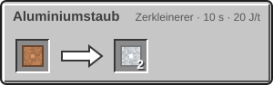 | 1 × [Bauxit](Rohstoffe-und-Erze.md) → 2 × [Aluminiumstaub](Zerkleinerer.md) | Zerkleinerer | 200 t (10 s) 20 J/t |
| 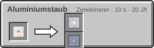 | 1 × [Metallkonzentrat](Kreaturen-des-inneren-Sonnensystems.md) → 1 × [Aluminiumstaub](Zerkleinerer.md), 1 × [Titanstaub](Zerkleinerer.md) | Zerkleinerer | 200 t (10 s) 20 J/t |
|  | 1 × Roheisen → 2 × [Eisenstaub](Zerkleinerer.md) | Zerkleinerer | 200 t (10 s) 20 J/t |
|  | 1 × Rohgold → 2 × [Goldstaub](Zerkleinerer.md) | Zerkleinerer | 200 t (10 s) 20 J/t |
| 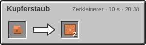 | 1 × Rohkupfer → 2 × [Kupferstaub](Zerkleinerer.md) | Zerkleinerer | 200 t (10 s) 20 J/t |
| 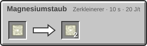 | 1 × [Rohmagnesium](Der-Mars.md) → 2 × [Magnesiumstaub](Der-Mars.md) | Zerkleinerer | 200 t (10 s) 20 J/t |
| 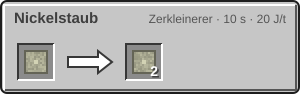 | 1 × [Rohnickel](Der-Mars.md) → 2 × [Nickelstaub](Der-Mars.md) | Zerkleinerer | 200 t (10 s) 20 J/t |
|  | 1 × [Meteoritenerz](Weltraumwetter-und-Ereignisse.md) → 2 × Roheisen, 1 × [Rohnickel](Der-Mars.md), 1 × [Rohplatin](Weltraumwetter-und-Ereignisse.md) (10 %), 1 × [Rohiridium](Weltraumwetter-und-Ereignisse.md) (5 %) | Zerkleinerer | 200 t (10 s) 20 J/t |
| 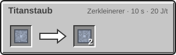 | 1 × [Rohtitan](Rohstoffe-und-Erze.md) → 2 × [Titanstaub](Zerkleinerer.md) | Zerkleinerer | 200 t (10 s) 20 J/t |
| 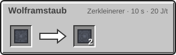 | 1 × [Rohwolfram](Die-Venus.md) → 2 × [Wolframstaub](Die-Venus.md) | Zerkleinerer | 200 t (10 s) 20 J/t |

## Presse

| Rezept | Zutaten → Ergebnis | Wo | Dauer |
| --- | --- | --- | --- |
| 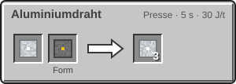 | 1 × [Aluminiumbarren](Elektroofen.md), Form: [Pressform (Draht)](Presse.md) → 3 × [Aluminiumdraht](Presse.md) | Presse | 100 t (5 s) 30 J/t |
| 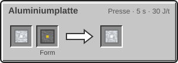 | 1 × [Aluminiumbarren](Elektroofen.md), Form: [Pressform (Platte)](Presse.md) → 1 × [Aluminiumplatte](Presse.md) | Presse | 100 t (5 s) 30 J/t |
| 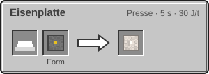 | 1 × Eisenbarren, Form: [Pressform (Platte)](Presse.md) → 1 × [Eisenplatte](Presse.md) | Presse | 100 t (5 s) 30 J/t |
| 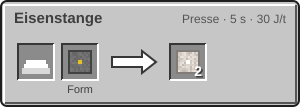 | 1 × Eisenbarren, Form: [Pressform (Stange)](Presse.md) → 2 × [Eisenstange](Presse.md) | Presse | 100 t (5 s) 30 J/t |
| 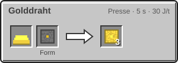 | 1 × Goldbarren, Form: [Pressform (Draht)](Presse.md) → 3 × [Golddraht](Presse.md) | Presse | 100 t (5 s) 30 J/t |
| 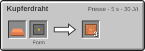 | 1 × Kupferbarren, Form: [Pressform (Draht)](Presse.md) → 3 × [Kupferdraht](Presse.md) | Presse | 100 t (5 s) 30 J/t |
| 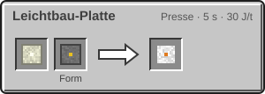 | 1 × [Magnesium-Legierung](Der-Hochtemperaturofen.md), Form: [Pressform (Platte)](Presse.md) → 1 × [Leichtbau-Platte](Der-Hochtemperaturofen.md) | Presse | 100 t (5 s) 30 J/t |
| 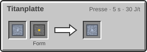 | 1 × [Titanbarren](Elektroofen.md), Form: [Pressform (Platte)](Presse.md) → 1 × [Titanplatte](Presse.md) | Presse | 100 t (5 s) 30 J/t |
| 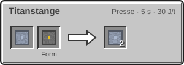 | 1 × [Titanbarren](Elektroofen.md), Form: [Pressform (Stange)](Presse.md) → 2 × [Titanstange](Presse.md) | Presse | 100 t (5 s) 30 J/t |
| 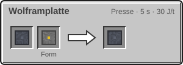 | 1 × [Wolframbarren](Der-Hochtemperaturofen.md), Form: [Pressform (Platte)](Presse.md) → 1 × [Wolframplatte](Die-Rakete-T2.md) | Presse | 100 t (5 s) 30 J/t |

## Montagetisch

| Rezept | Zutaten → Ergebnis | Wo | Dauer |
| --- | --- | --- | --- |
|  | 2 × [Aluminiumplatte](Presse.md), 1 × [Kunststoff](Raffinerie.md) → 4 × [Aerostat-Plattform](Die-Venus.md) | Montagetisch | 200 t (10 s) 30 J/t |
| 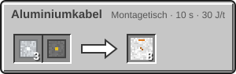 | 3 × [Aluminiumdraht](Presse.md), 1 × [Kunststoff](Raffinerie.md) → 8 × [Aluminiumkabel](Strom-im-All.md) | Montagetisch | 200 t (10 s) 30 J/t |
| 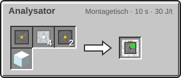 | 1 × [Maschinenrahmen](Erste-Schritte.md), 4 × [Aluminiumplatte](Presse.md), 2 × [Schaltkreis](Montagetisch.md), 1 × Glas → 1 × [Analysator](Forschung.md) | Montagetisch | 200 t (10 s) 30 J/t |
| 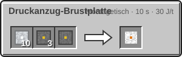 | 10 × [Aluminiumplatte](Presse.md), 3 × [Kunststoff](Raffinerie.md), 1 × [Schaltkreis](Montagetisch.md) → 1 × [Druckanzug-Brustplatte](Der-Druckanzug.md) | Montagetisch | 200 t (10 s) 30 J/t |
| 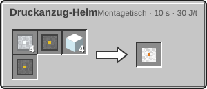 | 4 × [Aluminiumplatte](Presse.md), 1 × [Kunststoff](Raffinerie.md), 4 × Glas, 1 × [Schaltkreis](Montagetisch.md) → 1 × [Druckanzug-Helm](Der-Druckanzug.md) | Montagetisch | 200 t (10 s) 30 J/t |
| 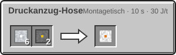 | 6 × [Aluminiumplatte](Presse.md), 2 × [Kunststoff](Raffinerie.md) → 1 × [Druckanzug-Hose](Der-Druckanzug.md) | Montagetisch | 200 t (10 s) 30 J/t |
| 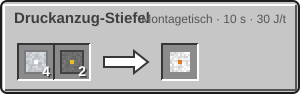 | 4 × [Aluminiumplatte](Presse.md), 2 × [Kunststoff](Raffinerie.md) → 1 × [Druckanzug-Stiefel](Der-Druckanzug.md) | Montagetisch | 200 t (10 s) 30 J/t |
| 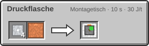 | 4 × [Aluminiumplatte](Presse.md), 1 × [Kupferrohr](Fluide-und-Rohre.md) → 1 × [Druckflasche](Sauerstoff-speichern.md) | Montagetisch | 200 t (10 s) 30 J/t |
| 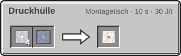 | 4 × [Aluminiumplatte](Presse.md), 1 × [Titanplatte](Presse.md) → 1 × [Druckhülle](Sauerstoffgenerator.md) | Montagetisch | 200 t (10 s) 30 J/t |
| 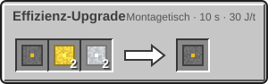 | 1 × [Schaltkreis](Montagetisch.md), 2 × [Golddraht](Presse.md), 2 × [Aluminiumplatte](Presse.md) → 1 × [Effizienz-Upgrade](Upgrades.md) | Montagetisch | 200 t (10 s) 30 J/t |
| 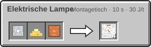 | 1 × [Aluminiumplatte](Presse.md), 1 × Glowstonestaub, 1 × [Kupferdraht](Presse.md) → 4 × [Elektrische Lampe](Leben-ohne-Luft.md) | Montagetisch | 200 t (10 s) 30 J/t |
|  | 1 × [Maschinenrahmen](Erste-Schritte.md), 4 × [Kupferdraht](Presse.md), 2 × [Eisenplatte](Presse.md), 2 × [Kupferrohr](Fluide-und-Rohre.md), 1 × Glas → 1 × [Elektrolyseur](Elektrolyseur.md) | Montagetisch | 200 t (10 s) 30 J/t |
|  | 4 × [Eisenplatte](Presse.md), 1 × [Kupferkabel](Strom.md) → 1 × [Energie-Port](Raffinerie.md) | Montagetisch | 200 t (10 s) 30 J/t |
|  | 2 × [Aluminiumplatte](Presse.md), 1 × [Schaltkreis](Montagetisch.md), 1 × Glas, 1 × Redstone-Staub → 1 × [Feldscanner](Kreaturen-des-inneren-Sonnensystems.md) | Montagetisch | 200 t (10 s) 30 J/t |
|  | 4 × [Eisenplatte](Presse.md), 1 × [Kupferrohr](Fluide-und-Rohre.md) → 1 × [Fluid-Port](Raffinerie.md) | Montagetisch | 200 t (10 s) 30 J/t |
|  | 1 × [Maschinenrahmen](Erste-Schritte.md), 4 × [Aluminiumplatte](Presse.md), 4 × [Schaltkreis](Montagetisch.md), 2 × Glas, 1 × Buch → 1 × [Forschungsterminal](Forschung.md) | Montagetisch | 200 t (10 s) 30 J/t |
|  | 2 × [Schaltkreis](Montagetisch.md), 4 × [Golddraht](Presse.md), 2 × [Silizium](Elektroofen.md) → 1 × [Fortgeschrittener Schaltkreis](Der-Hochtemperaturofen.md) | Montagetisch | 200 t (10 s) 30 J/t |
|  | 8 × [Aluminiumplatte](Presse.md), 2 × [Druckhülle](Sauerstoffgenerator.md) → 1 × [Gastank](Helium-und-Kryotechnik.md) | Montagetisch | 200 t (10 s) 30 J/t |
|  | 1 × [Schaltkreis](Montagetisch.md), 4 × Redstone-Staub, 2 × [Kupferdraht](Presse.md) → 1 × [Geschwindigkeits-Upgrade](Upgrades.md) | Montagetisch | 200 t (10 s) 30 J/t |
|  | 2 × [Sauerstoffflasche](Sauerstoff-speichern.md), 1 × [Titanplatte](Presse.md) → 1 × [Große Sauerstoffflasche](Sauerstoff-speichern.md) | Montagetisch | 200 t (10 s) 30 J/t |
|  | 2 × [Aluminiumplatte](Presse.md), 1 × Glowstonestaub, 1 × [Schaltkreis](Montagetisch.md) → 1 × [Helmlampe](Der-Druckanzug.md) | Montagetisch | 200 t (10 s) 30 J/t |
|  | 1 × [Druckanzug-Brustplatte](Der-Druckanzug.md), 6 × [Keramikplatte](Der-Hochtemperaturofen.md), 2 × [Titanplatte](Presse.md), 2 × [Kühlsystem](Helium-und-Kryotechnik.md) → 1 × [Hitzeanzug-Brustplatte](Der-Hitzeanzug.md) | Montagetisch | 200 t (10 s) 30 J/t |
|  | 1 × [Druckanzug-Helm](Der-Druckanzug.md), 3 × [Keramikplatte](Der-Hochtemperaturofen.md), 2 × [Titanplatte](Presse.md) → 1 × [Hitzeanzug-Helm](Der-Hitzeanzug.md) | Montagetisch | 200 t (10 s) 30 J/t |
|  | 1 × [Druckanzug-Hose](Der-Druckanzug.md), 4 × [Keramikplatte](Der-Hochtemperaturofen.md), 2 × [Titanplatte](Presse.md) → 1 × [Hitzeanzug-Hose](Der-Hitzeanzug.md) | Montagetisch | 200 t (10 s) 30 J/t |
|  | 1 × [Druckanzug-Stiefel](Der-Druckanzug.md), 3 × [Keramikplatte](Der-Hochtemperaturofen.md), 2 × [Titanplatte](Presse.md) → 1 × [Hitzeanzug-Stiefel](Der-Hitzeanzug.md) | Montagetisch | 200 t (10 s) 30 J/t |
|  | 4 × [Wolframplatte](Die-Rakete-T2.md), 2 × [Titanplatte](Presse.md) → 1 × [Hitzeschild](Die-Rakete-T2.md) | Montagetisch | 200 t (10 s) 30 J/t |
|  | 1 × [Elektroofen](Elektroofen.md), 8 × [Titanplatte](Presse.md), 4 × Ziegel, 2 × [Fortgeschrittener Schaltkreis](Der-Hochtemperaturofen.md) → 1 × [Hochtemperaturofen](Der-Hochtemperaturofen.md) | Montagetisch | 200 t (10 s) 30 J/t |
|  | 4 × [Eisenplatte](Presse.md), 1 × Trichter → 1 × [Item-Port](Raffinerie.md) | Montagetisch | 200 t (10 s) 30 J/t |
|  | 1 × [Maschinenrahmen](Erste-Schritte.md), 8 × [Aluminiumplatte](Presse.md), 4 × [Kupferrohr](Fluide-und-Rohre.md), 2 × [Fortgeschrittener Schaltkreis](Der-Hochtemperaturofen.md), 1 × [Druckhülle](Sauerstoffgenerator.md) → 1 × [Kryo-Verflüssiger](Helium-und-Kryotechnik.md) | Montagetisch | 200 t (10 s) 30 J/t |
|  | 16 × [Aluminiumplatte](Presse.md), 8 × [Titanplatte](Presse.md), 4 × [Schaltkreis](Montagetisch.md), 4 × Glas → 1 × [Kuppelgenerator I](Die-Kuppel.md) | Montagetisch | 200 t (10 s) 30 J/t |
|  | 4 × [Kupferrohr](Fluide-und-Rohre.md), 1 × [Druckhülle](Sauerstoffgenerator.md), 1.000 mB [Flüssiges Helium](Helium-und-Kryotechnik.md) → 1 × [Kühlsystem](Helium-und-Kryotechnik.md) | Montagetisch | 200 t (10 s) 30 J/t |
|  | 2 × [Aluminiumplatte](Presse.md), 1 × [Schaltkreis](Montagetisch.md), 1 × Redstone-Lampe → 1 × [Landefeuer](Das-Landefeuer.md) | Montagetisch | 200 t (10 s) 30 J/t |
|  | 2 × [Titanstange](Presse.md), 1 × [Eisenplatte](Presse.md) → 1 × [Probenzange](Forschung.md) | Montagetisch | 200 t (10 s) 30 J/t |
|  | 1 × [Maschinenrahmen](Erste-Schritte.md), 16 × [Eisenplatte](Presse.md), 8 × [Kupferrohr](Fluide-und-Rohre.md), 4 × Redstone-Staub → 1 × [Raffinerie](Raffinerie.md) | Montagetisch | 200 t (10 s) 30 J/t |
|  | 2 × [Eisenplatte](Presse.md), 1 × [Kupferrohr](Fluide-und-Rohre.md) → 4 × [Raffinerie-Gehäuse](Raffinerie.md) | Montagetisch | 200 t (10 s) 30 J/t |
|  | 16 × [Aluminiumplatte](Presse.md), 2 × [Titanplatte](Presse.md), 1 × Truhe → 1 × [Raketen-Frachtraum](Die-Rakete.md) | Montagetisch | 200 t (10 s) 30 J/t |
|  | 8 × [Aluminiumplatte](Presse.md) → 1 × [Raketenflosse T1](Die-Rakete.md) | Montagetisch | 200 t (10 s) 30 J/t |
|  | 3 × [Leichtbau-Platte](Der-Hochtemperaturofen.md) → 1 × [Raketenflosse T2](Die-Rakete-T2.md) | Montagetisch | 200 t (10 s) 30 J/t |
|  | 40 × [Aluminiumplatte](Presse.md), 16 × [Titanplatte](Presse.md), 16 × [Schaltkreis](Montagetisch.md) → 1 × [Raketenkapsel T1](Die-Rakete.md) | Montagetisch | 200 t (10 s) 30 J/t |
|  | 32 × [Leichtbau-Platte](Der-Hochtemperaturofen.md), 16 × [Hitzeschild](Die-Rakete-T2.md), 16 × [Fortgeschrittener Schaltkreis](Der-Hochtemperaturofen.md) → 1 × [Raketenkapsel T2](Die-Rakete-T2.md) | Montagetisch | 200 t (10 s) 30 J/t |
|  | 30 × [Aluminiumplatte](Presse.md), 4 × [Titanplatte](Presse.md), 2 × [Schaltkreis](Montagetisch.md) → 1 × [Raketentank T1](Die-Rakete.md) | Montagetisch | 200 t (10 s) 30 J/t |
|  | 12 × [Leichtbau-Platte](Der-Hochtemperaturofen.md), 4 × [Hitzeschild](Die-Rakete-T2.md) → 1 × [Raketentank T2](Die-Rakete-T2.md) | Montagetisch | 200 t (10 s) 30 J/t |
|  | 8 × [Aluminiumplatte](Presse.md), 32 × [Titanplatte](Presse.md), 8 × [Schaltkreis](Montagetisch.md) → 1 × [Raketentriebwerk T1](Die-Rakete.md) | Montagetisch | 200 t (10 s) 30 J/t |
|  | 16 × [Leichtbau-Platte](Der-Hochtemperaturofen.md), 24 × [Hitzeschild](Die-Rakete-T2.md), 16 × [Fortgeschrittener Schaltkreis](Der-Hochtemperaturofen.md), 4 × [Kühlsystem](Helium-und-Kryotechnik.md) → 1 × [Raketentriebwerk T2](Die-Rakete-T2.md) | Montagetisch | 200 t (10 s) 30 J/t |
|  | 1 × [Maschinenrahmen](Erste-Schritte.md), 8 × [Aluminiumplatte](Presse.md), 4 × [Kupferdraht](Presse.md), 2 × [Schaltkreis](Montagetisch.md), 1 × [Druckflasche](Sauerstoff-speichern.md) → 1 × [Regolith-Erhitzer](Helium-und-Kryotechnik.md) | Montagetisch | 200 t (10 s) 30 J/t |
|  | 16 × [Aluminiumplatte](Presse.md), 1 × Truhe → 1 × [Rover-Anhänger](Der-Rover.md) | Montagetisch | 200 t (10 s) 30 J/t |
|  | 32 × [Aluminiumplatte](Presse.md), 16 × [Titanplatte](Presse.md), 4 × [Schaltkreis](Montagetisch.md), 4 × [Solarpanel](Strom-im-All.md), 1 × [Akku](Strom.md) → 1 × [Rover-Bausatz](Der-Rover.md) | Montagetisch | 200 t (10 s) 30 J/t |
|  | 4 × [Titanplatte](Presse.md), 2 × [Titanstange](Presse.md), 1 × Diamant → 1 × [Rover-Bohrer](Der-Rover.md) | Montagetisch | 200 t (10 s) 30 J/t |
|  | 8 × [Aluminiumplatte](Presse.md), 4 × Glas, 2 × [Sauerstoffflasche](Sauerstoff-speichern.md), 1 × [Druckhülle](Sauerstoffgenerator.md) → 1 × [Rover-Druckkabine](Der-Rover.md) | Montagetisch | 200 t (10 s) 30 J/t |
|  | 4 × [Aluminiumplatte](Presse.md), 2 × [Fortgeschrittener Schaltkreis](Der-Hochtemperaturofen.md), 1 × Glas → 1 × [Rover-Scanner](Der-Rover.md) | Montagetisch | 200 t (10 s) 30 J/t |
|  | 2 × [Aluminiumplatte](Presse.md), 2 × Glowstonestaub → 1 × [Rover-Scheinwerfer](Der-Rover.md) | Montagetisch | 200 t (10 s) 30 J/t |
|  | 2 × [Aluminiumplatte](Presse.md), 1 × [Kupferrohr](Fluide-und-Rohre.md) → 1 × [Sauerstoffflasche](Sauerstoff-speichern.md) | Montagetisch | 200 t (10 s) 30 J/t |
|  | 8 × [Aluminiumplatte](Presse.md), 4 × [Kupferrohr](Fluide-und-Rohre.md), 2 × [Schaltkreis](Montagetisch.md), 1 × [Druckhülle](Sauerstoffgenerator.md) → 1 × [Sauerstoffgenerator](Sauerstoffgenerator.md) | Montagetisch | 200 t (10 s) 30 J/t |
|  | 2 × [Silizium](Elektroofen.md), 4 × [Kupferdraht](Presse.md), 1 × [Kunststoff](Raffinerie.md) → 1 × [Schaltkreis](Montagetisch.md) | Montagetisch | 200 t (10 s) 30 J/t |
|  | 4 × [Silizium](Elektroofen.md), 2 × [Aluminiumplatte](Presse.md), 4 × [Kupferdraht](Presse.md), 1 × Glas → 1 × [Solarpanel](Strom-im-All.md) | Montagetisch | 200 t (10 s) 30 J/t |
|  | 8 × [Aluminiumplatte](Presse.md), 2 × [Schaltkreis](Montagetisch.md), 1 × [Solarpanel](Strom-im-All.md), 16.000 mB [Kerosin](Raffinerie.md) → 1 × [Sonde](Startrampe-und-Sonde.md) | Montagetisch | 200 t (10 s) 30 J/t |
|  | 1 × [Maschinenrahmen](Erste-Schritte.md), 4 × [Schaltkreis](Montagetisch.md), 4 × [Aluminiumplatte](Presse.md), 2 × Glas → 1 × [Startkontrolle](Startrampe-und-Sonde.md) | Montagetisch | 200 t (10 s) 30 J/t |
|  | 2 × [Eisenplatte](Presse.md), 1 × [Titanplatte](Presse.md) → 2 × [Startrampe](Startrampe-und-Sonde.md) | Montagetisch | 200 t (10 s) 30 J/t |
|  | 4 × [Eisenstange](Presse.md), 1 × [Eisenplatte](Presse.md) → 2 × [Startturm](Startrampe-und-Sonde.md) | Montagetisch | 200 t (10 s) 30 J/t |
|  | 3 × [Titanplatte](Presse.md), 1 × Glas → 4 × [Titanrohr](Der-Hochtemperaturofen.md) | Montagetisch | 200 t (10 s) 30 J/t |
|  | 4 × [Aluminiumplatte](Presse.md), 1 × [Druckhülle](Sauerstoffgenerator.md) → 1 × [Transporttank](Sauerstoff-speichern.md) | Montagetisch | 200 t (10 s) 30 J/t |
|  | 1 × [Maschinenrahmen](Erste-Schritte.md), 1 × [Verbrennungsgenerator](Strom.md), 4 × [Kupferrohr](Fluide-und-Rohre.md), 4 × [Eisenplatte](Presse.md) → 1 × [Treibstoffgenerator](Strom.md) | Montagetisch | 200 t (10 s) 30 J/t |
|  | 1 × [Maschinenrahmen](Erste-Schritte.md), 4 × [Kupferrohr](Fluide-und-Rohre.md), 2 × [Aluminiumplatte](Presse.md), 1 × [Schaltkreis](Montagetisch.md) → 1 × [Treibstoffpumpe](Startrampe-und-Sonde.md) | Montagetisch | 200 t (10 s) 30 J/t |
|  | 8 × [Aluminiumplatte](Presse.md), 4 × [Titanplatte](Presse.md), 2 × [Schaltkreis](Montagetisch.md), 1 × [Kunststoff](Raffinerie.md) → 1 × [Wolkenaufzug](Die-Venus.md) | Montagetisch | 200 t (10 s) 30 J/t |

## Raffinerie

| Rezept | Zutaten → Ergebnis | Wo | Dauer |
| --- | --- | --- | --- |
|  | 1.000 mB [Erdöl](Fluide-und-Rohre.md) → 1 × [Kunststoff](Raffinerie.md), 600 mB [Kerosin](Raffinerie.md) | Raffinerie | 200 t (10 s) 40 J/t |

## Elektrolyseur

| Rezept | Zutaten → Ergebnis | Wo | Dauer |
| --- | --- | --- | --- |
|  | 200 mB Wasser → 200 mB [Wasserstoff](Elektrolyseur.md), 100 mB [Sauerstoff](Elektrolyseur.md) | Elektrolyseur | 40 t (2 s) 40 J/t |

> [!NOTE]
> Server können die Rezeptmengen über die Einstellung `recipe_amount_multiplier` ändern. Dann gelten im Montagetisch andere Mengen als hier.

---

_Diese Seite steht auch im Spiel im **Ingenieurs-Handbuch**._

[Alle Items und Blöcke](Alle-Items-und-Bloecke.md) →
