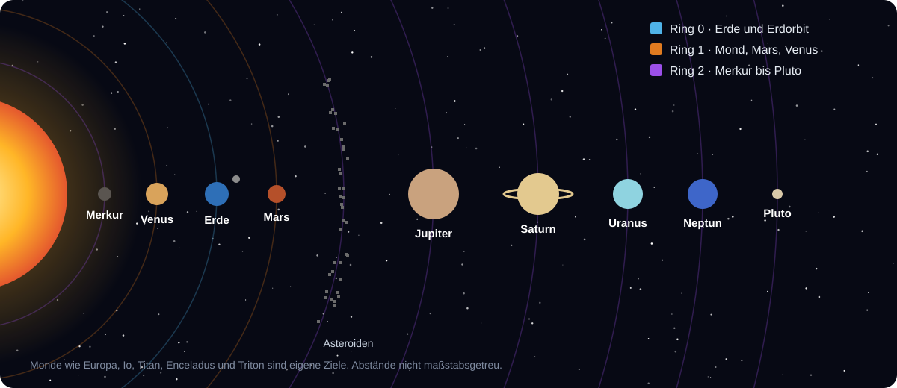

<!-- Erzeugt von tools/gen_wiki.py aus docs/handbook/ und spec/data. Nicht von Hand ändern. -->

[📖 Wiki](README.md) › Willkommen › **Ausblick – was noch kommt**

# Ausblick – was noch kommt

Infinite Horizon entsteht Meilenstein für Meilenstein. Dieses Wiki zeigt immer nur, was im aktuellen Stand **schon spielbar** ist. Hier ein Blick auf das, was geplant ist.

## Geplante Phasen

- **Phase 2 – Raumfahrtprogramm:** Forschungsterminal, Proben und Analysator, die erste Sonde, Startrampe und Rakete T1. Ziel ist der Mond.
- **Phase 3 – Ring 1:** Mond, Mars und Venus. Raumanzug, Sauerstoffgenerator und Kuppeln machen fremde Welten bewohnbar. Auf dem Mars fährst du Rover, die Venus prüft dich mit Säureregen und einer Hitze, die in Minuten tötet.
- **Phase 4 – Orbit:** Deine eigene Raumstation mit Schwerelosigkeit, Solarflügeln und einem Fusionsreaktor.
- **Phase 5 – Ring 2:** Merkur, Asteroidengürtel, Ceres, die Monde Io, Europa, Titan, Enceladus und Triton und schließlich Pluto. Jedes Ziel braucht eigene Ausrüstung.
- **Phase 6 – Netzwerk und Finale:** Außenposten, Bohrtürme, Frachtraketen und ein Logistik-Computer verbinden deine Kolonien. In der Orbitalwerft baust du das Sternenschiff.

## Meilensteine der Entwicklung

| Meilenstein | Inhalt |
| --- | --- |
| 1 | Grundgerüst: Energie, erste Maschine |
| 2 | Erdindustrie (Phase 1) |
| 3 | Erste Welt: Mond, Anzug, Kuppel |
| 4 | Erster Flug: Forschung, Sonde, Rakete T1 – **erste spielbare Version** |
| 5 | Ring 1: Mars, Venus, Rover, Kreaturen |
| 6 | Orbit: Station, Fusion |
| 7 | Ring 2: Merkur bis Pluto |
| 8 | Netzwerk und Finale |
| 9 | Feinschliff: Mehrspieler, Erfolge, Klang, Balancing |

> [!NOTE]
> Der aktuelle Stand steht oben auf der [Wiki-Startseite](README.md). Mit jedem Meilenstein kommen neue Seiten in dieses Wiki und ins Handbuch im Spiel.

← [Maschinen bedienen](Maschinen-bedienen.md)
