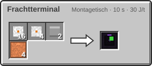

<!-- Erzeugt von tools/gen_wiki.py aus docs/handbook/ und spec/data. Nicht von Hand ändern. -->

[📖 Wiki](README.md) › Phase 6 · Netzwerk und Finale › **Außenposten und Frachtterminal**

# Außenposten und Frachtterminal

Ein Außenposten ist ein Frachtterminal mit allen Produzenten im Umkreis von 16 Blöcken. Produzenten sind [Bohrturm und Pumpstation](Bohrturm-und-Pumpstation.md), der Gassammler und die Magnetfalle. Sie geben ihre Ausbeute direkt ins Terminal, du musst nichts verbinden.

## Das Frachtterminal

Das Terminal hat 216 Lagerslots. Mit dem Mausrad oder der Leiste neben dem Lager blätterst du durch alle Zeilen. Rechts stehen die Tanks: ganz links der Treibstofftank, daneben die Frachttanks.

- Der Treibstofftank nimmt nur Methan auf. Eingehendes Methan füllt immer zuerst ihn, erst der Rest geht in die Frachttanks.
- Ein Klick auf eine Tankleiste wählt den Tank, aus dem der Füllslot leere Behälter füllt.
- Trichter und Rohre dürfen Items hinein- und herausholen. Über seine Ausgangsseite gibt das Terminal nur Fracht ab, nie den Treibstoff.

> [!TIP]
> Gehört ein Produzent zu zwei Terminals, liefert er immer an das nähere.

## Produktion, während du fort bist

Ist der Außenposten nicht geladen, weil du auf einem anderen Planeten bist, rechnet das Spiel die Förderung nach, sobald du zurückkommst. Du bekommst dann das 0,5-Fache der normalen Menge für die vergangene Zeit.

- Es zählt nur ein Produzent, der beim Verlassen lief. Strom wird dabei nicht gerechnet, also sorg vorher für eine sichere Versorgung, zum Beispiel mit dem [Kernreaktor](Der-Kernreaktor.md).
- Die Förderung endet, wenn das Terminal voll ist oder die Eingaben fehlen, etwa leere Antimaterie-Zellen in der Magnetfalle.

> [!WARNING]
> Auf Servern kann die Offline-Produktion abgeschaltet sein (Einstellung `outposts_offline`).

## Herstellung

16 × [Leichtbau-Platte](Der-Hochtemperaturofen.md), 4 × [Fortgeschrittener Schaltkreis](Der-Hochtemperaturofen.md), 2 × Truhe, 4 × [Kupferrohr](Fluide-und-Rohre.md) → 1 × Frachtterminal

---

_Diese Seite steht auch im Spiel im **Ingenieurs-Handbuch**._

← [Bohrturm und Pumpstation](Bohrturm-und-Pumpstation.md)
