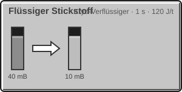
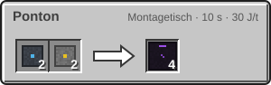
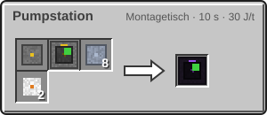
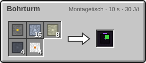

<!-- Erzeugt von tools/gen_wiki.py aus docs/handbook/ und spec/data. Nicht von Hand ändern. -->

[📖 Wiki](README.md) › Phase 6 · Netzwerk und Finale › **Bohrturm und Pumpstation**

# Bohrturm und Pumpstation

Bohrturm und Pumpstation sind die Produzenten deiner Außenposten. Sie fördern ohne Ende, ohne die Welt zu verändern.

## Der Bohrturm

Der Bohrturm zählt beim Aufstellen alle Erzblöcke im Chunk unter sich, bis hinunter zum Grund der Welt. Danach erzeugt er alle 100 t (5 s) ein Erz, zufällig gewichtet nach diesen Anzahlen: Liegt unter ihm viel Eisen und wenig Titan, kommt meist Eisen heraus. Die Lagerstätte erschöpft sich nie.

| Steckbrief: Bohrturm |  |
| --- | --- |
| Verbrauch | 200 J/t |
| Dauer je Vorgang | 100 t (5 s) |
| Upgrade-Slots | 2 |
| Ort | {"dimension_type": null, "dimensions": [], "excluded_dimensions": ["minecraft:overworld"]} |

> [!WARNING]
> Auf der Erde arbeitet der Bohrturm nicht. Findet er keine Erze unter sich, leuchtet seine Lampe rot.

> [!TIP]
> Stell den Bohrturm über ein Gebiet mit den Erzen, die du brauchst, zum Beispiel ins dunkle Hochland auf Pluto für Uran.

## Die Pumpstation

Die Pumpstation fördert aus dem Block direkt unter sich, alle 20 t (1 s) 100 mB. Die Quelle bleibt erhalten.

| Unter der Pumpstation | Fluid |
| --- | --- |
| [Ammoniak-Geysir](Enceladus.md) (Enceladus) | Ammoniak |
| [Stickstoff-Geysir](Triton.md) (Triton) | Stickstoff |
| Quellblock aus Wasser, Lava, Erdöl oder Methan | dasselbe Fluid |

Im Methanregen auf Titan fördert sie 1,5-mal so viel.

| Steckbrief: Pumpstation |  |
| --- | --- |
| Verbrauch | 100 J/t |
| Dauer je Vorgang | 20 t (1 s) |
| Tanks | 16.000 mB |
| Upgrade-Slots | 2 |

## Der Ponton

Auf einem See kannst du die Pumpstation nicht direkt aufstellen. Setz zuerst einen Ponton auf das Fluid, wie eine Seerose. Eine Pumpstation auf dem Ponton fördert aus dem Fluid darunter.

## Stickstoff

Im [Kryo-Verflüssiger](Helium-und-Kryotechnik.md) wird aus Stickstoff Flüssiger Stickstoff. Er kühlt den [Kernreaktor](Der-Kernreaktor.md) mit viel weniger Menge als Wasser.

40 mB Stickstoff → 10 mB Flüssiger Stickstoff

## Herstellung

| Rezept | Zutaten → Ergebnis | Wo | Dauer |
| --- | --- | --- | --- |
|  | 2 × [Läuferbein](Titan.md), 2 × [Kunststoff](Raffinerie.md) → 4 × Ponton | Montagetisch | 200 t (10 s) 30 J/t |
|  | 1 × [Maschinenrahmen](Erste-Schritte.md), 1 × [Pumpe](Fluide-und-Rohre.md), 8 × [Titanplatte](Presse.md), 2 × [Fortgeschrittener Schaltkreis](Der-Hochtemperaturofen.md) → 1 × Pumpstation | Montagetisch | 200 t (10 s) 30 J/t |
|  | 1 × [Maschinenrahmen](Erste-Schritte.md), 16 × [Titanplatte](Presse.md), 8 × [Nickelplatte](Der-Hitzeanzug.md), 4 × [Wolframplatte](Die-Rakete-T2.md), 4 × [Fortgeschrittener Schaltkreis](Der-Hochtemperaturofen.md) → 1 × Bohrturm | Montagetisch | 200 t (10 s) 30 J/t |

---

_Diese Seite steht auch im Spiel im **Ingenieurs-Handbuch**._

← [Der Kernreaktor](Der-Kernreaktor.md) · [Außenposten und Frachtterminal](Aussenposten-und-Frachtterminal.md) →
