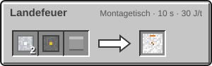

<!-- Erzeugt von tools/gen_wiki.py aus docs/handbook/ und spec/data. Nicht von Hand ändern. -->

[📖 Wiki](README.md) › Phase 3 · Ring 1 › **Das Landefeuer**

# Das Landefeuer

Das Landefeuer markiert einen Landeplatz. In der Navigationskarte ([Der Flug](Der-Flug.md)) erscheint es als Landeort für alle Mitglieder deiner Agentur.

## Aufstellen und benennen

1. Setz das Landefeuer an die Stelle, an der deine Raketen landen sollen. Es gehört der Agentur dessen, der es setzt.
2. **Rechtsklick** öffnet ein Namensfeld (bis zu 50 Zeichen). Ohne eigenen Namen heißt es wie das am Amboss umbenannte Item oder „Landefeuer X/Z“.
3. Unter freiem Himmel zeigt ein roter Strahl bis zur Höhe 256, wo es steht.

Die Navigationskarte kennt alle Landefeuer deiner Agentur, auch auf Himmelskörpern, auf denen gerade niemand ist. Baust du es ab, verschwindet es aus der Liste.

## Landen

Wählst du ein Landefeuer als Landeort, landet die Rakete höchstens 3 Blöcke davon entfernt, aber nie auf dem Landefeuer selbst. Ist dort kein Platz, sucht sie wie üblich im weiteren Umkreis.

> [!TIP]
> Lass um das Landefeuer etwas Platz auf ebenem, festem Boden. Dann steht die Rakete nach der Landung direkt daneben.

## Herstellung

2 × [Aluminiumplatte](Presse.md), 1 × [Schaltkreis](Montagetisch.md), 1 × Redstone-Lampe → 1 × Landefeuer

---

_Diese Seite steht auch im Spiel im **Ingenieurs-Handbuch**._

← [Leben ohne Luft](Leben-ohne-Luft.md) · [Der Mars](Der-Mars.md) →
