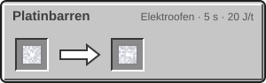
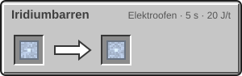
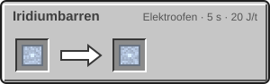
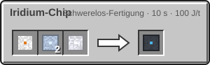
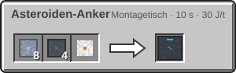

<!-- Erzeugt von tools/gen_wiki.py aus docs/handbook/ und spec/data. Nicht von Hand ändern. -->

[📖 Wiki](README.md) › Phase 5 · Ring 2 › **Der Asteroidengürtel**

# Der Asteroidengürtel

Im Asteroidengürtel gibt es keinen Boden, nur Felsbrocken im leeren Raum. Die Schwerkraft beträgt 0,03 g: Ein Sprung trägt dich weit, und wer danebenspringt, treibt davon.

## Asteroiden

Die kleinen Asteroiden haben einen Radius von 3 bis 12 Blöcken, dazu gibt es große mit 13 bis 20 Blöcken. Sie bestehen aus Asteroidengestein, darin stecken Erze:

- Asteroiden-Platinerz (4 % der Blöcke),
- Asteroiden-Iridiumerz (2 %),
- Asteroiden-Nickelerz (6 %).

Beim Spawn bei X/Z 0/0 schwebt immer ein großer Asteroid mit allen drei Erzen.

> [!WARNING]
> Fällst du unter Höhe 0, holt dich die Navigation mit Langsamem Fall auf den Spawn-Asteroiden zurück. Was du dabei fallen lässt, ist verloren.

## Platin und Iridium

Platin und Iridium verarbeitest du wie andere Erze: Zerkleinerer und Elektroofen. Der Iridium-Chip entsteht im [Schwerelos-Fertiger](Fertigung-im-Orbit.md) und steckt in vielen Geräten der fünften Phase.

| Rezept | Zutaten → Ergebnis | Wo | Dauer |
| --- | --- | --- | --- |
|  | 1 × [Rohplatin](Weltraumwetter-und-Ereignisse.md) → 1 × Platinbarren | Elektroofen | 100 t (5 s) 20 J/t |
|  | 1 × Platinstaub → 1 × Platinbarren | Elektroofen | 100 t (5 s) 20 J/t |
|  | 1 × [Rohiridium](Weltraumwetter-und-Ereignisse.md) → 1 × Iridiumbarren | Elektroofen | 100 t (5 s) 20 J/t |
|  | 1 × Iridiumstaub → 1 × Iridiumbarren | Elektroofen | 100 t (5 s) 20 J/t |
|  | 1 × [Fortgeschrittener Schaltkreis](Der-Hochtemperaturofen.md), 2 × Iridiumbarren, 1 × Platinbarren → 1 × Iridium-Chip | Schwerelos-Fertigung | 200 t (10 s) 100 J/t |

## Asteroidenanker

Der Asteroiden-Anker wird auf einen Asteroiden gesetzt. Im Umkreis von 16 Blöcken gilt dann für Spieler 1 g: So baust du eine Basis, ohne davonzuschweben.

8 × [Titanstange](Presse.md), 4 × [Wolframplatte](Die-Rakete-T2.md), 1 × [Fortgeschrittener Schaltkreis](Der-Hochtemperaturofen.md) → 1 × Asteroiden-Anker

## Driftmilben

Um Asteroiden mit Platinerz schweben Schwärme von Driftmilben. Sie sind harmlos und zeigen dir, wo Platin steckt. Sie entstehen nur mit der Welt und kommen nicht wieder.

> [!TIP]
> Folge einem Driftmilbenschwarm: Er verrät den Asteroiden mit Platin, noch bevor du ihn abbaust.

---

_Diese Seite steht auch im Spiel im **Ingenieurs-Handbuch**._

← [Lithium](Lithium.md) · [Ceres](Ceres.md) →
