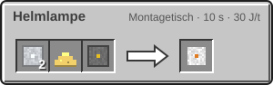
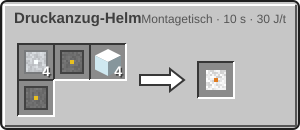
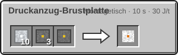
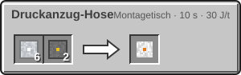
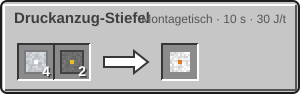

<!-- Erzeugt von tools/gen_wiki.py aus docs/handbook/ und spec/data. Nicht von Hand ändern. -->

[📖 Wiki](README.md) › Phase 2 · Raumfahrtprogramm › **Der Druckanzug**

# Der Druckanzug

Ohne Anzug überlebst du auf dem Mond nur Sekunden. Der **Druckanzug** ist die erste Stufe und schützt dich vor Vakuum, Hitze und Kälte, solange er Sauerstoff hat.

## Vier Teile, ein Anzug

Der Anzug wirkt nur, wenn du **alle vier Teile** trägst: Druckanzug-Helm, Druckanzug-Brustplatte, Druckanzug-Hose und Druckanzug-Stiefel. Fehlt ein Teil, bist du ungeschützt.

| Schutz | Druckanzug |
| --- | --- |
| Temperatur | -180 bis 150 °C |
| Druck | Vakuum bis normal |
| Strahlung | bis Stufe 1 |
| Rüstung | wie Eisenrüstung |

Repariert wird der Anzug am Amboss mit [Aluminiumplatte](Presse.md).

## Der Sauerstoffvorrat

Die Brustplatte trägt bis zu 1.200 mB Sauerstoff. Eine neue Brustplatte ist leer. Wie viel noch drin ist, zeigt der Tooltip und, sobald du draußen bist, eine Leiste im HUD.

- **Verbrauch:** 1 mB alle 20 t (1 s), aber nur außerhalb atembarer Luft.
- **Nachfüllen:** Trägst du die Brustplatte und hast eine [Sauerstoffflasche](Sauerstoff-speichern.md) im Inventar, füllt sich der Vorrat von selbst aus der ersten Flasche.
- **Unter Wasser** hält der Anzug deinen Luftvorrat voll, solange er Sauerstoff hat.

> [!WARNING]
> Ist der Sauerstoff aufgebraucht, schützt der Anzug weiter vor Druck und Temperatur, aber du erstickst. Behalte die Anzeige im Blick.

## Module

Jedes Anzugteil hat 2 Modulslots. Module bauen sich im [Montagetisch](Montagetisch.md) ein und aus, Strom braucht er dafür wie für jedes andere Rezept:

1. **Einbau:** das Anzugteil und das passende Modul allein in die Eingänge legen. Heraus kommt das Teil mit eingebautem Modul.
2. **Ausbau:** das Anzugteil allein hineinlegen. Heraus kommen das Teil ohne Module und alle Module in den Nebenausgaben.

Eingebaute Module stehen im Tooltip des Teils und bleiben beim Aufwerten auf eine höhere Anzugstufe erhalten.

**Helmlampe:** Die Helmlampe gehört in den Helm. Solange du ihn trägst, leuchtet es an deinem Kopf mit Lichtstufe 14, auch unter Wasser. Setzt du den Helm ab, ist das Licht weg.

2 × [Aluminiumplatte](Presse.md), 1 × Glowstonestaub, 1 × [Schaltkreis](Montagetisch.md) → 1 × Helmlampe

## Herstellung

> [!NOTE]
> Herstellen kann deine Agentur die Anzugteile erst, wenn sie den Knoten **Druckanzug** erforscht hat (Stufe 1, [Forschung](Forschung.md)).

| Rezept | Zutaten → Ergebnis | Wo | Dauer |
| --- | --- | --- | --- |
|  | 4 × [Aluminiumplatte](Presse.md), 1 × [Kunststoff](Raffinerie.md), 4 × Glas, 1 × [Schaltkreis](Montagetisch.md) → 1 × Druckanzug-Helm | Montagetisch | 200 t (10 s) 30 J/t |
|  | 10 × [Aluminiumplatte](Presse.md), 3 × [Kunststoff](Raffinerie.md), 1 × [Schaltkreis](Montagetisch.md) → 1 × Druckanzug-Brustplatte | Montagetisch | 200 t (10 s) 30 J/t |
|  | 6 × [Aluminiumplatte](Presse.md), 2 × [Kunststoff](Raffinerie.md) → 1 × Druckanzug-Hose | Montagetisch | 200 t (10 s) 30 J/t |
|  | 4 × [Aluminiumplatte](Presse.md), 2 × [Kunststoff](Raffinerie.md) → 1 × Druckanzug-Stiefel | Montagetisch | 200 t (10 s) 30 J/t |

> [!TIP]
> Nimm immer eine volle Flasche mehr mit, als du zu brauchen glaubst. Rechne nach: 600 mB in einer Flasche, 1 mB Verbrauch alle 20 t (1 s).

---

_Diese Seite steht auch im Spiel im **Ingenieurs-Handbuch**._

← [Der Mond](Der-Mond.md) · [Sauerstoff speichern](Sauerstoff-speichern.md) →
