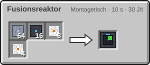
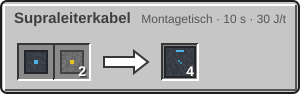
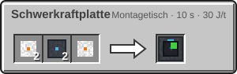

<!-- Erzeugt von tools/gen_wiki.py aus docs/handbook/ und spec/data. Nicht von Hand ändern. -->

[📖 Wiki](README.md) › Phase 4 · Orbit › **Der Fusionsreaktor**

# Der Fusionsreaktor

Der Fusionsreaktor ist das Kraftwerk der Station: 1.000 J/t aus Wasserstoff und Helium. Er ist ein großer Multiblock und braucht ständig Kühlung mit flüssigem Helium.

| Steckbrief: Fusionsreaktor |  |
| --- | --- |
| Leistung | 1.000 J/t |
| Energiepuffer | 1.000.000 J |
| Tanks | 16.000 mB, 16.000 mB, 16.000 mB, 16.000 mB |
| Brennstoff | 1 mB [Wasserstoff](Elektrolyseur.md) je 20 t |
| Brennstoff | 1 mB [Helium](Helium-und-Kryotechnik.md) je 20 t |

## Der Aufbau

Der Reaktor ist ein Würfel von 5 × 5 × 5 Blöcken mit hohlem Innenraum.

1. Setz den Controller (Fusionsreaktor). Seine Vorderseite zeigt zu dir.
2. Der Controller ist die **Mitte einer Seitenfläche**: Der Würfel reicht von ihm zwei Blöcke nach links, rechts, oben und unten und vier Blöcke nach hinten.
3. Bau die Hülle aus Fusionsreaktor-Gehäuse. Der Innenraum von 3 × 3 × 3 Blöcken bleibt Luft.
4. Ersetze einzelne Gehäuseblöcke durch **Ports**, wo Rohre und Kabel andocken sollen, wie bei der [Raffinerie](Raffinerie.md).
5. Sobald alles stimmt, springt die Statuslampe von Rot auf Gelb.

> [!TIP]
> **Sneak-Rechtsklick** mit leerer Hand auf den Controller zeigt mit roten Partikeln, wo noch Blöcke fehlen.

## Betrieb

Der Reaktor verbrennt alle 20 t (1 s) 10 mB Wasserstoff und 5 mB Helium. Zur Kühlung braucht er im selben Takt 2 mB flüssiges Helium aus dem [Kryo-Verflüssiger](Helium-und-Kryotechnik.md). Das verdampfte Helium landet im Ausgabetank und kann zurück in den Kreislauf.

> [!WARNING]
> Fehlt die Kühlung 40 t (2 s) lang, schaltet der Reaktor ab und die Lampe wird rot. Er explodiert nicht. Er startet von selbst wieder, wenn die Kühlung 100 t (5 s) ohne Unterbrechung läuft.

## Supraleiterkabel

Ein Fusionsreaktor liefert mehr Strom, als Aluminiumkabel tragen. Das Supraleiterkabel leitet 32.768 J/t.

## Schwerkraftplatte

Die Schwerkraftplatte braucht viel Strom. Dafür gilt im Orbit über ihr wieder normale Schwerkraft: in einem Bereich von 9 × 9 Blöcken und 8 Blöcken Höhe.

| Steckbrief: Schwerkraftplatte |  |
| --- | --- |
| Verbrauch | 400 J/t |
| Upgrade-Slots | 2 |

## Herstellung

| Rezept | Zutaten → Ergebnis | Wo | Dauer |
| --- | --- | --- | --- |
|  | 64 × [Titanplatte](Presse.md), 16 × [Supraleiterdraht](Fertigung-im-Orbit.md), 8 × [Kühlsystem](Helium-und-Kryotechnik.md), 4 × [Fortgeschrittener Schaltkreis](Der-Hochtemperaturofen.md) → 1 × Fusionsreaktor | Montagetisch | 200 t (10 s) 30 J/t |
|  | 2 × [Titanplatte](Presse.md), 1 × [Kupferdraht](Presse.md) → 4 × Fusionsreaktor-Gehäuse | Montagetisch | 200 t (10 s) 30 J/t |
|  | 1 × [Supraleiterdraht](Fertigung-im-Orbit.md), 2 × [Kunststoff](Raffinerie.md) → 4 × Supraleiterkabel | Montagetisch | 200 t (10 s) 30 J/t |
|  | 2 × [Leichtbau-Platte](Der-Hochtemperaturofen.md), 2 × [Supraleiterdraht](Fertigung-im-Orbit.md), 1 × [Fortgeschrittener Schaltkreis](Der-Hochtemperaturofen.md) → 1 × Schwerkraftplatte | Montagetisch | 200 t (10 s) 30 J/t |

> [!TIP]
> Stell einen Kryo-Verflüssiger neben den Ausgabeport: Er macht aus dem verdampften Helium wieder Kühlmittel.

---

_Diese Seite steht auch im Spiel im **Ingenieurs-Handbuch**._

← [Weltraumwetter-Station](Weltraumwetter-Station.md)
