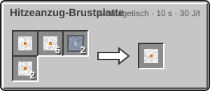

<!-- Erzeugt von tools/gen_wiki.py aus docs/handbook/ und spec/data. Nicht von Hand ändern. -->

[📖 Wiki](README.md) › Phase 3 · Ring 1 › **Der Hitzeanzug**

# Der Hitzeanzug

Der **Hitzeanzug** ist die zweite Anzugstufe. Du baust ihn aus deinem [Druckanzug](Der-Druckanzug.md): Jedes Teil wird im Montagetisch aufgewertet und behält dabei seinen Sauerstoff und seine Module.

## Schutz

- **Temperatur:** von -200 °C bis 500 °C.
- **Druck:** auch hoher Druck wie auf der Venus.
- **Sauerstoff:** wie beim Druckanzug aus der Brustplatte, Verbrauch 1 mB alle 20 t (1 s).

## Die Hitzezeit

Auf der Oberfläche der Venus, unterhalb der Wolkenschicht (y 180), hält auch der Hitzeanzug nicht ewig durch. Eine eigene Leiste im HUD zeigt die **Hitzezeit**: 3.600 t (180 s). Ist sie abgelaufen, schützt der Anzug nicht mehr vor Hitze.

Oberhalb der Wolkenschicht füllt sich die Hitzezeit in 1.200 t (60 s) wieder auf. Fahr also rechtzeitig mit dem [Wolkenaufzug](Die-Venus.md) nach oben.

> [!WARNING]
> Die Hitzezeit läuft auch, wenn du nur kurz hinunter willst. Prüf vor jedem Abstieg die Leiste.

## Herstellung

| Rezept | Zutaten → Ergebnis | Wo | Dauer |
| --- | --- | --- | --- |
|  | 1 × [Druckanzug-Helm](Der-Druckanzug.md), 3 × [Keramikplatte](Der-Hochtemperaturofen.md), 2 × [Titanplatte](Presse.md) → 1 × Hitzeanzug-Helm | Montagetisch | 200 t (10 s) 30 J/t |
|  | 1 × [Druckanzug-Brustplatte](Der-Druckanzug.md), 6 × [Keramikplatte](Der-Hochtemperaturofen.md), 2 × [Titanplatte](Presse.md), 2 × [Kühlsystem](Helium-und-Kryotechnik.md) → 1 × Hitzeanzug-Brustplatte | Montagetisch | 200 t (10 s) 30 J/t |
|  | 1 × [Druckanzug-Hose](Der-Druckanzug.md), 4 × [Keramikplatte](Der-Hochtemperaturofen.md), 2 × [Titanplatte](Presse.md) → 1 × Hitzeanzug-Hose | Montagetisch | 200 t (10 s) 30 J/t |
|  | 1 × [Druckanzug-Stiefel](Der-Druckanzug.md), 3 × [Keramikplatte](Der-Hochtemperaturofen.md), 2 × [Titanplatte](Presse.md) → 1 × Hitzeanzug-Stiefel | Montagetisch | 200 t (10 s) 30 J/t |

> [!TIP]
> Das [Kühlsystem](Helium-und-Kryotechnik.md) in der Brustplatte braucht flüssiges Helium, siehe [Helium und Kryotechnik](Helium-und-Kryotechnik.md).

---

_Diese Seite steht auch im Spiel im **Ingenieurs-Handbuch**._

← [Die Rakete T2](Die-Rakete-T2.md)
