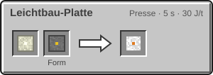
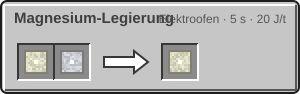
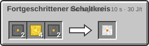
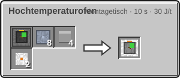
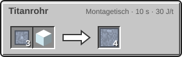

<!-- Erzeugt von tools/gen_wiki.py aus docs/handbook/ und spec/data. Nicht von Hand ändern. -->

[📖 Wiki](README.md) › Phase 3 · Ring 1 › **Der Hochtemperaturofen**

# Der Hochtemperaturofen

Wolfram schmilzt erst bei Temperaturen, die der Elektroofen nicht erreicht. Dafür baust du den Hochtemperaturofen. Er brennt auch Keramikplatte für die Hitzeanzüge.

| Steckbrief: Hochtemperaturofen |  |
| --- | --- |
| Verbrauch | 80 J/t |
| Dauer je Vorgang | 400 t (20 s) |
| Slots | 2 Eingabe, 1 Ausgabe |
| Upgrade-Slots | 2 |

## Rezepte

## Werkstoffe der Stufe 2

Leichtbau und Elektronik der zweiten Forschungsstufe entstehen im Montagetisch:

| Rezept | Zutaten → Ergebnis | Wo | Dauer |
| --- | --- | --- | --- |
|  | 1 × Magnesium-Legierung, Form: [Pressform (Platte)](Presse.md) → 1 × Leichtbau-Platte | Presse | 100 t (5 s) 30 J/t |
|  | 1 × [Magnesiumbarren](Der-Mars.md), 1 × [Aluminiumbarren](Elektroofen.md) → 1 × Magnesium-Legierung | Elektroofen | 100 t (5 s) 20 J/t |
|  | 2 × [Schaltkreis](Montagetisch.md), 4 × [Golddraht](Presse.md), 2 × [Silizium](Elektroofen.md) → 1 × Fortgeschrittener Schaltkreis | Montagetisch | 200 t (10 s) 30 J/t |
|  | 1 × [Elektroofen](Elektroofen.md), 8 × [Titanplatte](Presse.md), 4 × Ziegel, 2 × Fortgeschrittener Schaltkreis → 1 × Hochtemperaturofen | Montagetisch | 200 t (10 s) 30 J/t |
|  | 3 × [Titanplatte](Presse.md), 1 × Glas → 4 × Titanrohr | Montagetisch | 200 t (10 s) 30 J/t |

> [!TIP]
> Ein [Magnesiumbarren](Der-Mars.md), ein Wolframbarren und etwas Helium aus deinen Maschinen öffnen Forschungsstufe 3. Siehe [Forschung](Forschung.md).

---

_Diese Seite steht auch im Spiel im **Ingenieurs-Handbuch**._

← [Die Venus](Die-Venus.md) · [Helium und Kryotechnik](Helium-und-Kryotechnik.md) →
