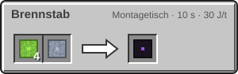
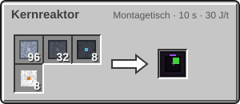
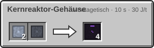

<!-- Erzeugt von tools/gen_wiki.py aus docs/handbook/ und spec/data. Nicht von Hand ändern. -->

[📖 Wiki](README.md) › Phase 6 · Netzwerk und Finale › **Der Kernreaktor**

# Der Kernreaktor

Der Kernreaktor liefert 4.000 J/t aus Brennstab. Ein Brennstab hält 48.000 t (2.400 s). Der Reaktor hat 4 Slots für Brennstäbe und nimmt sich den nächsten von selbst.

| Steckbrief: Kernreaktor |  |
| --- | --- |
| Leistung | 4.000 J/t |
| Energiepuffer | 4.000.000 J |
| Tanks | 16.000 mB |

## Der Aufbau

Der Reaktor ist ein Würfel von 5 × 5 × 5 Blöcken mit hohlem Innenraum, aufgebaut wie der [Fusionsreaktor](Der-Fusionsreaktor.md).

1. Setz den Controller (Kernreaktor). Seine Vorderseite zeigt zu dir.
2. Der Controller ist die **Mitte einer Seitenfläche**: Der Würfel reicht von ihm zwei Blöcke nach links, rechts, oben und unten und vier Blöcke nach hinten.
3. Bau die Hülle aus Kernreaktor-Gehäuse. Der Innenraum von 3 × 3 × 3 Blöcken bleibt Luft.
4. Ersetze einzelne Gehäuseblöcke durch **Ports**, wo Rohre und Kabel andocken sollen.
5. Sobald alles stimmt, springt die Statuslampe von Rot auf Gelb.

> [!TIP]
> **Sneak-Rechtsklick** mit leerer Hand auf den Controller zeigt mit roten Partikeln, wo noch Blöcke fehlen.

## Kühlung und Hitze

Solange der Reaktor arbeitet, braucht er je Tick 50 mB Wasser **oder** 5 mB flüssigen Stickstoff im Kühltank. Die Hitze ändert sich je Tick um -5 mit Kühlung und um 2 ohne. Der Fortschrittsbalken im Fenster zeigt die Hitze.

- Ab 800 warnt er mit einem Ton, und die Statuslampe blinkt.
- Bei 1.000 schaltet er sich ab. Er explodiert nicht, aber im Umkreis von 16 Blöcken herrscht für 72.000 t (3.600 s) Strahlung der Stufe 3.
- Sobald die Hitze wieder unter 200 liegt, startet er von selbst.

> [!WARNING]
> Nach einer Notabschaltung brauchst du für die Strahlungszone einen Anzug mit Strahlenschild oder eine Kuppel der Stufe 3. Ohne Schutz nimmst du dort Schaden.

> [!TIP]
> Eine Wasserpumpe über einer Quelle neben dem Reaktor hält den Kühltank zuverlässig voll.

## Herstellung

| Rezept | Zutaten → Ergebnis | Wo | Dauer |
| --- | --- | --- | --- |
|  | 4 × [Uranbarren](Pluto.md), 1 × [Titanplatte](Presse.md) → 1 × Brennstab | Montagetisch | 200 t (10 s) 30 J/t |
|  | 96 × [Titanplatte](Presse.md), 32 × [Wolframplatte](Die-Rakete-T2.md), 8 × [Iridium-Chip](Der-Asteroidenguertel.md), 8 × [Kühlsystem](Helium-und-Kryotechnik.md) → 1 × Kernreaktor | Montagetisch | 200 t (10 s) 30 J/t |
|  | 2 × [Titanplatte](Presse.md), 1 × [Wolframplatte](Die-Rakete-T2.md) → 4 × Kernreaktor-Gehäuse | Montagetisch | 200 t (10 s) 30 J/t |

---

_Diese Seite steht auch im Spiel im **Ingenieurs-Handbuch**._

← [Erste Schritte im Netzwerk](Erste-Schritte-im-Netzwerk.md) · [Bohrturm und Pumpstation](Bohrturm-und-Pumpstation.md) →
