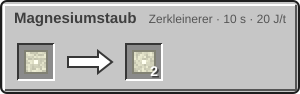
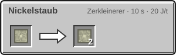
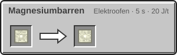
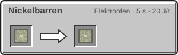

<!-- Erzeugt von tools/gen_wiki.py aus docs/handbook/ und spec/data. Nicht von Hand ändern. -->

[📖 Wiki](README.md) › Phase 3 · Ring 1 › **Der Mars**

# Der Mars

Der Mars ist kälter und weiter weg als der Mond, aber er hat eine dünne Atmosphäre und Rohstoffe, die es auf dem Mond nicht gibt: Magnesium, Nickel und Gips.

## Die Welt

- **Schwerkraft:** das 0,38-Fache der Erde.
- **Temperatur:** am Tag 20 °C, nachts -120 °C.
- **Luft:** dünn und nicht atembar. Ohne [Anzug](Der-Druckanzug.md) überlebst du nicht lange.

## Gelände und Biome

- **Rote Ebenen:** weite rote Ebenen aus Marssand, mit Magnesium und Eisen im Boden.
- **Mars-Canyon:** tiefe Schluchten bis fast zum Grund der Welt. An den Wänden liegen die Erzschichten frei.
- **Vulkanisches Hochland:** hohe Berge aus Marsgestein. Hier stehen die Riesenvulkane, und tief im Gestein verlaufen Lavaröhren.
- **Ausgetrockneter See:** flache Senken aus Gipsblock.
- **Mars-Polkappe:** selten, aus Trockeneisblock.
- **Mars-Meteoritenfeld:** kleine Krater mit Eisen-Nickel-Meteorit in der Mitte. Ein ganzes Meteoritenfeld ist ein Erkundungsziel und bringt Forschungspunkte.

## Erze

| Block | Ergibt | Höhe | Biome | Menge |
| --- | --- | --- | --- | --- |
| Mars-Magnesiumerz | 1 Rohmagnesium | y 0 bis 80 | Rote Ebenen | 5 Adern je Chunk, je bis 8 Blöcke |
| Mars-Eisenerz | 1 Roheisen | y 0 bis 80 | Rote Ebenen | 4 Adern je Chunk, je bis 8 Blöcke |
| Mars-Magnesiumerz | 1 Rohmagnesium | y 0 bis 80 | Mars-Canyon | 10 Adern je Chunk, je bis 8 Blöcke |
| Mars-Eisenerz | 1 Roheisen | y 0 bis 80 | Mars-Canyon | 8 Adern je Chunk, je bis 8 Blöcke |

Aus Eisen-Nickel-Meteorit bekommst du Rohnickel und manchmal Roheisen. Magnesium und Nickel verarbeitest du wie Eisen: im [Zerkleinerer](Zerkleinerer.md) zu Staub, im [Elektroofen](Elektroofen.md) zu Barren.

| Rezept | Zutaten → Ergebnis | Wo | Dauer |
| --- | --- | --- | --- |
|  | 1 × Rohmagnesium → 2 × Magnesiumstaub | Zerkleinerer | 200 t (10 s) 20 J/t |
|  | 1 × Rohnickel → 2 × Nickelstaub | Zerkleinerer | 200 t (10 s) 20 J/t |
|  | 1 × Rohmagnesium → 1 × Magnesiumbarren | Elektroofen | 100 t (5 s) 20 J/t |
|  | 1 × Magnesiumstaub → 1 × Magnesiumbarren | Elektroofen | 100 t (5 s) 20 J/t |
|  | 1 × Rohnickel → 1 × Nickelbarren | Elektroofen | 100 t (5 s) 20 J/t |
|  | 1 × Nickelstaub → 1 × Nickelbarren | Elektroofen | 100 t (5 s) 20 J/t |

> [!WARNING]
> Die Nächte auf dem Mars sind eisig. Plane deine Ausflüge so, dass du vor Einbruch der Dunkelheit wieder in der Kuppel bist.

> [!TIP]
> Ein Canyon spart dir viel Graben: Die Erze liegen an den Wänden offen.

---

_Diese Seite steht auch im Spiel im **Ingenieurs-Handbuch**._

← [Das Landefeuer](Das-Landefeuer.md) · [Die Venus](Die-Venus.md) →
