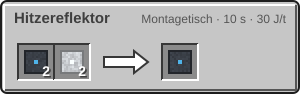
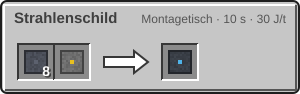

<!-- Erzeugt von tools/gen_wiki.py aus docs/handbook/ und spec/data. Nicht von Hand ändern. -->

[📖 Wiki](README.md) › Phase 5 · Ring 2 › **Der Merkur**

# Der Merkur

Der Merkur dreht sich so langsam, dass eine Seite immer glüht und die andere immer friert. Wo du landest, hängt von der X-Koordinate ab:

- **Glutebenen** (Tagseite, X über 2.000): 430 °C, mit Merkur-Titanerz.
- **Frostebenen** (Nachtseite, X unter −2.000): -180 °C, mit Merkur-Eisenerz.
- **Dämmerungsgürtel** dazwischen: angenehme 20 °C. Hier liegt Merkur-Lithiumsalz als Kruste an der Oberfläche.
- **Schattenkrater**: selten, -150 °C, mit Eis im Gestein.

Die Schwerkraft beträgt 0,38 g, die Strahlung Stufe 2.

| Block | Ergibt | Höhe | Biome | Menge |
| --- | --- | --- | --- | --- |
| Merkur-Titanerz | 1 [Rohtitan](Rohstoffe-und-Erze.md) | y 0 bis 80 | Glutebenen | 4 Adern je Chunk, je bis 6 Blöcke |
| Merkur-Eisenerz | 1 Roheisen | y 0 bis 80 | Frostebenen | 6 Adern je Chunk, je bis 8 Blöcke |
| Merkur-Lithiumsalz | 2 [Lithiumsalz](Lithium.md) | Oberflächenkruste (Scheibe im Gestein) | Dämmerungsgürtel | 3 je Chunk, Radius 3–6 |
| Eis | der Block selbst | y 40 bis 100 | Schattenkrater | 4 Adern je Chunk, je bis 16 Blöcke |

## Ausrüstung

Auf der Tagseite hilft nur der [Hitzeanzug](Der-Hitzeanzug.md). Gegen die Strahlung schützt der Anzug allein nicht: Bau den Strahlenschild in den Helm, er hält Strahlung bis Stufe 3 ab. Der Hitzereflektor in der Brustplatte verlängert die Hitzezeit auf der Venus um das 1,5-Fache.

2 × Spiegelpanzer, 2 × [Aluminiumplatte](Presse.md) → 1 × Hitzereflektor

8 × [Wolframplatte](Die-Rakete-T2.md), 1 × [Kunststoff](Raffinerie.md) → 1 × Strahlenschild

## Der Spiegelkäfer

Im Dämmerungsgürtel krabbelt der Spiegelkäfer. Er greift nur an, wenn du ihn angreifst. Sein Panzer spiegelt das Sonnenlicht: Wer ihn bei Tageslicht aus weniger als 16 Blöcken ansieht, ist 60 t (3 s) lang geblendet. Er lässt eine Spiegelpanzer fallen, aus der der Hitzereflektor entsteht.

> [!WARNING]
> Lande nicht auf der Tagseite ohne Hitzeanzug. Der Dämmerungsgürtel um X 0 ist der sichere Landeplatz.

> [!TIP]
> Schau den Spiegelkäfer nicht direkt an, sondern nähere dich von der Seite. Ein Schlag aus kurzer Entfernung genügt meist.

---

_Diese Seite steht auch im Spiel im **Ingenieurs-Handbuch**._

← [Erste Schritte im äußeren System](Erste-Schritte-im-aeusseren-System.md) · [Lithium](Lithium.md) →
