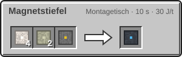

<!-- Erzeugt von tools/gen_wiki.py aus docs/handbook/ und spec/data. Nicht von Hand ändern. -->

[📖 Wiki](README.md) › Phase 4 · Orbit › **Der Orbit**

# Der Orbit

Über der Erde, dem Mars und der Venus liegt je ein Orbit. Dort gibt es keinen Boden, nur Leere, Sonne und den Planeten tief unter dir. Die Schwerkraft beträgt nur 0,005 g: Laufen auf Blöcken geht normal, aber wer springt, treibt davon.

## Ankunft

Eine Rakete T2 fliegt in den Orbit. Ohne Andockbucht schwebt sie auf Höhe 100 an der gewählten Stelle. Liegt dort schon etwas im Weg oder ist ein fremder Stationskern näher als 64 Blöcke, sucht der Bordcomputer eine freie Stelle in der Nähe. Ein Start aus dem Orbit kostet keinen Treibstoff für den Aufstieg.

## Magnetstiefel

Magnetstiefel sind ein Anzugmodul für die Stiefel. Steht ein Block direkt unter dir, gilt 1 g. Springst du ab, schwebst du wieder.

4 × [Eisenplatte](Presse.md), 2 × [Nickelplatte](Der-Hitzeanzug.md), 1 × [Schaltkreis](Montagetisch.md) → 1 × Magnetstiefel

## Absturz

> [!WARNING]
> Fällst du unter Höhe 0, stürzt du auf den Planeten darunter: auf die Erde, den Mars oder in die Wolkenschicht der Venus, an derselben Stelle. Ein Langsamer Fall von 400 t (20 s) fängt dich ab. Die Rakete und deine Station bleiben oben.

> [!TIP]
> Bau zuerst ein Geländer aus Hüllblöcken um die Plattform. Dann treibst du beim Springen nicht so leicht ab.

---

_Diese Seite steht auch im Spiel im **Ingenieurs-Handbuch**._

← [Erste Schritte im Orbit](Erste-Schritte-im-Orbit.md) · [Die Raumstation](Die-Raumstation.md) →
