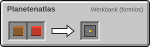

<!-- Erzeugt von tools/gen_wiki.py aus docs/handbook/ und spec/data. Nicht von Hand ändern. -->

[📖 Wiki](README.md) › Phase 2 · Raumfahrtprogramm › **Der Planetenatlas**

# Der Planetenatlas

Den Planetenatlas bekommst du beim ersten Login geschenkt. **Rechtsklick** öffnet ihn. Was darin steht, gehört deiner Agentur: Alle Mitglieder sehen denselben Atlas.

## Aufbau

Links stehen alle Ziele, nach ihrer Entfernung von der Sonne geordnet. Rechts siehst du zum gewählten Ziel:

1. **Status:** unbekannt, Sonde angekommen ([Sonde](Startrampe-und-Sonde.md)) oder besucht.
2. **Entdecker:** die erste Agentur, deren Mitglied das Ziel betreten hat. Wer zuerst ankommt, wird allen Spielern angekündigt.
3. **Umweltwerte**, sobald eine Sonde angekommen ist: Schwerkraft, Temperatur bei Tag und Nacht, Druck und Strahlung.
4. **Besuchte Biome:** Sie zählen, sobald ein Mitglied dort unterwegs ist.
5. **Erkundungsziele** mit Koordinaten, z. B. die Lavaröhren auf dem [Mond](Der-Mond.md).
6. **Landefeuer** deiner Agentur, siehe [Das Landefeuer](Das-Landefeuer.md).

> [!TIP]
> Verloren? Einen neuen Atlas stellst du an der Werkbank her. Er zeigt sofort wieder alles, was deine Agentur weiß.

## Herstellung

1 × Buch, 1 × Kompass → 1 × Planetenatlas

---

_Diese Seite steht auch im Spiel im **Ingenieurs-Handbuch**._

← [Der Flug](Der-Flug.md)
