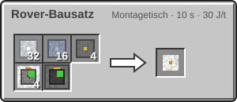
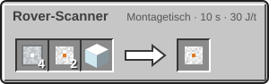
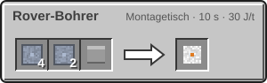
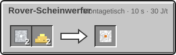
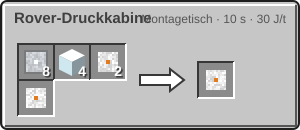
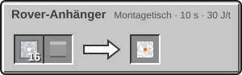

<!-- Erzeugt von tools/gen_wiki.py aus docs/handbook/ und spec/data. Nicht von Hand ändern. -->

[📖 Wiki](README.md) › Phase 3 · Ring 1 › **Der Rover**

# Der Rover

Zu Fuß sind die Wege auf Mars und Mond lang. Der Rover bringt dich und einen Mitfahrer mit 0,4 Blöcken pro Tick über das Gelände und steigt dabei bis zu 2 Blöcke hohe Stufen hinauf.

## Aufstellen und fahren

1. Rechtsklick mit dem Rover-Bausatz auf den Boden stellt den Rover auf.
2. Rechtsklick steigt ein. Wer zuerst einsteigt, fährt: Der Rover folgt deiner Blickrichtung, vorwärts und rückwärts fährst du mit den Bewegungstasten.
3. Schleichen lässt dich aussteigen.

## Energie

Der Rover speichert 100.000 J und braucht 50 J je gefahrenem Block.

- **Solardach:** unter freiem Himmel 2 J pro Tick.
- **Laden:** Park den Rover direkt neben einer [Akku](Strom.md). Sie gibt 512 J pro Tick ab.

## Frachtraum und Module

Der Frachtraum hat 27 Slots. Du öffnest ihn mit der Inventartaste im Sitz oder mit Schleichen und Rechtsklick (mit einem Item in der Hand).

Bis zu 6 Module setzt du mit Rechtsklick ein:

- Rover-Scanner: zählt alle 100 t (5 s) die Erze im Umkreis von 32 Blöcken und nennt Erkundungsziele in der Nähe.
- Rover-Bohrer: baut beim Fahren die 3 × 3 Blöcke vor dem Rover ab, die Drops landen im Frachtraum.
- Rover-Scheinwerfer: ein heller Scheinwerfer vor dem Rover.
- Rover-Druckkabine: Insassen atmen ohne Anzug bei angenehmer Temperatur, solange der Tank (1.800 mB) Sauerstoff hat. Rechtsklick mit einer gefüllten [Sauerstoffflasche](Sauerstoff-speichern.md) füllt ihn.
- Rover-Anhänger: 27 zusätzliche Frachtslots.

## Abbauen

Schleichen und Rechtsklick mit leerer Hand: Der Rover wird wieder zum Bausatz. Energie, Sauerstoff, Module und Fracht bleiben darin erhalten.

> [!WARNING]
> Auf der Venus-Oberfläche bleibt der Rover nach 3.600 t (180 s) stehen, bis er wieder über y 180 ist. Der Wolkenaufzug nimmt Rover in der Nähe mit.

## Herstellung

| Rezept | Zutaten → Ergebnis | Wo | Dauer |
| --- | --- | --- | --- |
|  | 32 × [Aluminiumplatte](Presse.md), 16 × [Titanplatte](Presse.md), 4 × [Schaltkreis](Montagetisch.md), 4 × [Solarpanel](Strom-im-All.md), 1 × [Akku](Strom.md) → 1 × Rover-Bausatz | Montagetisch | 200 t (10 s) 30 J/t |
|  | 4 × [Aluminiumplatte](Presse.md), 2 × [Fortgeschrittener Schaltkreis](Der-Hochtemperaturofen.md), 1 × Glas → 1 × Rover-Scanner | Montagetisch | 200 t (10 s) 30 J/t |
|  | 4 × [Titanplatte](Presse.md), 2 × [Titanstange](Presse.md), 1 × Diamant → 1 × Rover-Bohrer | Montagetisch | 200 t (10 s) 30 J/t |
|  | 2 × [Aluminiumplatte](Presse.md), 2 × Glowstonestaub → 1 × Rover-Scheinwerfer | Montagetisch | 200 t (10 s) 30 J/t |
|  | 8 × [Aluminiumplatte](Presse.md), 4 × Glas, 2 × [Sauerstoffflasche](Sauerstoff-speichern.md), 1 × [Druckhülle](Sauerstoffgenerator.md) → 1 × Rover-Druckkabine | Montagetisch | 200 t (10 s) 30 J/t |
|  | 16 × [Aluminiumplatte](Presse.md), 1 × Truhe → 1 × Rover-Anhänger | Montagetisch | 200 t (10 s) 30 J/t |

> [!TIP]
> Stell eine Batterie in deine Basis und park dort den Rover. So ist er vor jeder Fahrt voll.

---

_Diese Seite steht auch im Spiel im **Ingenieurs-Handbuch**._

← [Der Hitzeanzug](Der-Hitzeanzug.md)
