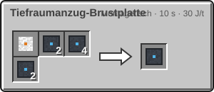

<!-- Erzeugt von tools/gen_wiki.py aus docs/handbook/ und spec/data. Nicht von Hand ändern. -->

[📖 Wiki](README.md) › Phase 5 · Ring 2 › **Der Tiefraumanzug**

# Der Tiefraumanzug

Der Tiefraumanzug ist der Raumanzug der Stufe 3. Er schützt wie der [Hitzeanzug](Der-Hitzeanzug.md) gegen Säure und Hitze, hält von -220 bis 500 °C aus und schirmt Strahlung bis Stufe 2 ab. Als Rüstung ist er so stark wie Netherit.

| Rezept | Zutaten → Ergebnis | Wo | Dauer |
| --- | --- | --- | --- |
|  | 1 × [Hitzeanzug-Helm](Der-Hitzeanzug.md), 2 × [Supraleiterdraht](Fertigung-im-Orbit.md), 2 × [Isoliergewebe](Triton.md) → 1 × Tiefraumanzug-Helm | Montagetisch | 200 t (10 s) 30 J/t |
|  | 1 × [Hitzeanzug-Brustplatte](Der-Hitzeanzug.md), 2 × [Supraleiterdraht](Fertigung-im-Orbit.md), 4 × [Lithium-Akku](Lithium.md), 2 × [Isoliergewebe](Triton.md) → 1 × Tiefraumanzug-Brustplatte | Montagetisch | 200 t (10 s) 30 J/t |
|  | 1 × [Hitzeanzug-Hose](Der-Hitzeanzug.md), 2 × [Supraleiterdraht](Fertigung-im-Orbit.md), 2 × [Isoliergewebe](Triton.md) → 1 × Tiefraumanzug-Hose | Montagetisch | 200 t (10 s) 30 J/t |
|  | 1 × [Hitzeanzug-Stiefel](Der-Hitzeanzug.md), 2 × [Supraleiterdraht](Fertigung-im-Orbit.md), 2 × [Isoliergewebe](Triton.md) → 1 × Tiefraumanzug-Stiefel | Montagetisch | 200 t (10 s) 30 J/t |

## Das Heizmodul

Das Heizmodul kommt in die Brustplatte und verschiebt die untere Temperaturgrenze um -30 °C. Auf [Triton](Triton.md) brauchst du es mit dem Tiefraumanzug, auf Pluto auch mit dem Hitzeanzug.

4 × [Kupferdraht](Presse.md), 2 × [Lithium-Akku](Lithium.md), 2 × [Isoliergewebe](Triton.md) → 1 × Heizmodul

> [!TIP]
> Für den Tiefraumanzug brauchst du Isoliergewebe von Frostkriechern. Jag sie auf Triton mit einem Hitzeanzug und Heizmodul.

---

_Diese Seite steht auch im Spiel im **Ingenieurs-Handbuch**._

← [Triton](Triton.md) · [Pluto](Pluto.md) →
