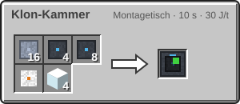

<!-- Erzeugt von tools/gen_wiki.py aus docs/handbook/ und spec/data. Nicht von Hand ändern. -->

[📖 Wiki](README.md) › Phase 5 · Ring 2 › **Die Klon-Kammer**

# Die Klon-Kammer

Weit draußen ist der Weg zurück vom Weltspawn sehr lang. Die Klon-Kammer holt dich nach dem Tod an einen Ort deiner Wahl zurück, auch in eine andere Dimension.

## So funktioniert sie

1. Stell die Klon-Kammer an einen sicheren Ort, zum Beispiel unter eine Kuppel oder in eine Station.
2. Schließ sie an Strom an. Sie braucht dauernd Strom, auch wenn gerade niemand stirbt.
3. Leg [Mikrobenkultur](Europa.md) in den Eingabeslot. Mikrobenkulturen gibt es an den hydrothermalen Quellen der [Europa](Europa.md).
4. Rechtsklick auf die Kammer bindet dich an sie. Jeder Spieler hat genau eine Kammer; eine neue Bindung ersetzt die alte.

Stirbst du, erwachst du über der Kammer, wenn sie Strom hat und mindestens eine Kultur enthält. Dabei verbraucht sie eine Kultur. Die Kammer muss dafür nicht geladen sein.

| Steckbrief: Klon-Kammer |  |
| --- | --- |
| Verbrauch | 200 J/t |
| Slots | 1 Eingabe, 0 Ausgabe |
| Upgrade-Slots | 2 |

16 × [Titanplatte](Presse.md), 4 × [Iridium-Chip](Der-Asteroidenguertel.md), 8 × [Mikrobenkultur](Europa.md), 1 × [Druckhülle](Sauerstoffgenerator.md), 4 × Glas → 1 × Klon-Kammer

> [!WARNING]
> Ist der Platz über der Kammer ohne Anzug nicht mehr sicher, etwa weil die Kuppel ausgefallen ist, erscheinst du an deinem Bett oder am Weltspawn.

> [!TIP]
> Ein Stapel Kulturen reicht für viele Ausflüge. Füll die Kammer auf, bevor du zu den äußeren Monden fliegst.

---

_Diese Seite steht auch im Spiel im **Ingenieurs-Handbuch**._

← [Europa](Europa.md) · [Saturn-Orbit](Saturn-Orbit.md) →
