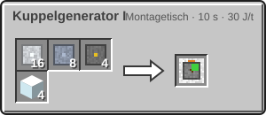
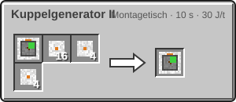
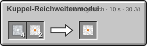
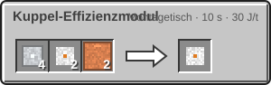
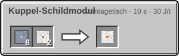

<!-- Erzeugt von tools/gen_wiki.py aus docs/handbook/ und spec/data. Nicht von Hand ändern. -->

[📖 Wiki](README.md) › Phase 3 · Ring 1 › **Die Kuppel**

# Die Kuppel

Unter einer Kuppel kannst du ohne Anzug atmen und arbeiten. Der Kuppelgenerator I spannt eine unsichtbare Halbkugel um sich auf. Darin gibt es Atemluft, normalen Druck und angenehme 20 °C.

| Steckbrief: Kuppelgenerator I |  |
| --- | --- |
| Verbrauch | 40 J/t |
| Radius | 8 Blöcke |
| O₂-Verbrauch | 50 mB je 1.200 t (60 s) |
| O₂-Tank | 2.000 mB |
| Außentemperatur | -180 bis 150 °C |
| Modul-Slots | 3 |

## So baust du eine Kuppel

1. Stell den Generator in die Mitte deiner Basis. Die Kuppel reicht 8 Blöcke weit und beginnt einen Block unter dem Generator.
2. Versorge ihn mit **Strom**: 40 J/t.
3. Füll seinen **Sauerstofftank**: über Rohre, einen angrenzenden [Sauerstoffgenerator](Sauerstoffgenerator.md) oder [Flaschen](Sauerstoff-speichern.md) im Leerslot. Ihren Verbrauch zeigt der Steckbrief oben.
4. Liegen Strom und Sauerstoff an und passt die Außentemperatur, läuft die Kuppel sofort. Die Lampe am Generator wird grün, und am Rand der Kuppel funkeln Lichtpunkte.

Die Außentemperatur misst der Generator an seinem Standort. Sie muss zwischen -180 und 150 °C liegen, sonst startet die Kuppel nicht (rote Lampe). Überlappende Kuppeln bilden einen gemeinsamen Luftraum.

## Anzüge nachfüllen

Steht in der Kuppel ein Spieler mit [Druckanzug](Der-Druckanzug.md), füllt der Generator dessen Sauerstoff aus seinem Tank nach, solange dort mindestens 500 mB liegen.

## Ausfall

Fehlen Strom oder Sauerstoff oder passt die Temperatur nicht mehr, geht die Kuppel in den **Ausfall**: Die Lichtpunkte pulsieren rot, alle Spieler darin bekommen eine Warnung mit den verbleibenden Sekunden, und ein Warnton erklingt. Die Kuppel schützt noch 600 t (30 s), dann ist sie aus. Kommt die Versorgung vorher zurück, läuft sie sofort weiter.

> [!WARNING]
> Ist die Kuppel aus, gilt dort wieder das Vakuum des Planeten. Wer dann ohne Anzug drin steht, baut sofort Belastung auf. Halte immer einen gefüllten Anzug in Reichweite.

## Herstellung

> [!NOTE]
> Den Kuppelgenerator schaltet der Knoten **Kuppel I** in Stufe 2 frei ([Forschung](Forschung.md)).

16 × [Aluminiumplatte](Presse.md), 8 × [Titanplatte](Presse.md), 4 × [Schaltkreis](Montagetisch.md), 4 × Glas → 1 × Kuppelgenerator I

## Kuppel T2

Der Kuppelgenerator II spannt eine Kuppel mit Radius 16 auf und hält Außentemperaturen von -210 bis 250 °C aus. Darunter schützt sie auch vor Staubsturm und Säureregen (siehe [Weltraumwetter](Weltraumwetter-und-Ereignisse.md)): Solarpanels liefern im Staubsturm vollen Strom.

| Steckbrief: Kuppelgenerator II |  |
| --- | --- |
| Verbrauch | 200 J/t |
| Radius | 16 Blöcke |
| O₂-Verbrauch | 200 mB je 1.200 t (60 s) |
| O₂-Tank | 2.000 mB |
| Außentemperatur | -210 bis 250 °C |
| Modul-Slots | 3 |

## Kuppelmodule

Jeder Kuppelgenerator hat 3 Modulslots. Jedes Modul passt einmal hinein.

- Kuppel-Reichweitenmodul: Radius × 1,5, dafür Strom und Sauerstoff × 2.
- Kuppel-Effizienzmodul: Sauerstoff × 0,75.
- Kuppel-Schildmodul: fängt Meteoriten ab. Monster hält es nicht auf.

| Rezept | Zutaten → Ergebnis | Wo | Dauer |
| --- | --- | --- | --- |
|  | 1 × Kuppelgenerator I, 16 × [Leichtbau-Platte](Der-Hochtemperaturofen.md), 4 × [Kühlsystem](Helium-und-Kryotechnik.md), 4 × [Fortgeschrittener Schaltkreis](Der-Hochtemperaturofen.md) → 1 × Kuppelgenerator II | Montagetisch | 200 t (10 s) 30 J/t |
|  | 4 × [Aluminiumplatte](Presse.md), 2 × [Fortgeschrittener Schaltkreis](Der-Hochtemperaturofen.md) → 1 × Kuppel-Reichweitenmodul | Montagetisch | 200 t (10 s) 30 J/t |
|  | 4 × [Aluminiumplatte](Presse.md), 2 × [Fortgeschrittener Schaltkreis](Der-Hochtemperaturofen.md), 2 × [Kupferrohr](Fluide-und-Rohre.md) → 1 × Kuppel-Effizienzmodul | Montagetisch | 200 t (10 s) 30 J/t |
|  | 8 × [Titanplatte](Presse.md), 2 × [Fortgeschrittener Schaltkreis](Der-Hochtemperaturofen.md) → 1 × Kuppel-Schildmodul | Montagetisch | 200 t (10 s) 30 J/t |

> [!TIP]
> Stell eine Druckflasche oder einen zweiten Sauerstoffgenerator an den Kuppelgenerator. Dann reicht der Vorrat auch, wenn du länger unterwegs bist.

---

_Diese Seite steht auch im Spiel im **Ingenieurs-Handbuch**._

← [Sauerstoffgenerator](Sauerstoffgenerator.md) · [Leben ohne Luft](Leben-ohne-Luft.md) →
