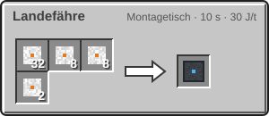

<!-- Erzeugt von tools/gen_wiki.py aus docs/handbook/ und spec/data. Nicht von Hand ändern. -->

[📖 Wiki](README.md) › Phase 4 · Orbit › **Die Landefähre**

# Die Landefähre

Eine Rakete ist für weite Strecken gebaut. Für den kurzen Weg zwischen deiner Station und dem Boden darunter gibt es die Landefähre. Sie hat 2 Sitze und einen Tank mit 32.000 mB Wasserstoff und ebenso viel Sauerstoff.

## Absetzen und betanken

1. Rechtsklick mit der Fähre auf einen Block im Orbit oder auf eine [Andockbucht](Stationsmodule.md) setzt sie ab, wie ein Boot. Auf einem Planeten geht das nicht.
2. Betanke sie wie eine Rakete: über das Slotpaar im Fenster oder auf einer Andockbucht mit Tanks daneben.
3. Setz dich hinein, öffne mit der Inventartaste das Fenster und drück „Start“.

## Wohin sie fliegt

Die Fähre pendelt nur zwischen einem Orbit und den Körpern darunter: vom Erdorbit zur Erde und zum Mond, vom Marsorbit zum Mars, vom Venusorbit zur Venus. Die Navigationskarte zeigt nur diese Ziele. Ein Flug kostet den Start und die Landung, aber keinen Transfer, siehe [Treibstoff](Die-Rakete.md).

> [!WARNING]
> Von der Erdoberfläche startet die Fähre nicht. Bring sie mit einer Rakete in den Orbit und lass sie dort.

32 × [Leichtbau-Platte](Der-Hochtemperaturofen.md), 8 × [Hitzeschild](Die-Rakete-T2.md), 8 × [Fortgeschrittener Schaltkreis](Der-Hochtemperaturofen.md), 2 × [Kühlsystem](Helium-und-Kryotechnik.md) → 1 × Landefähre

> [!TIP]
> Eine Fähre auf einer Andockbucht mit Tankdepot daneben ist nach jeder Rückkehr schnell wieder voll.

---

_Diese Seite steht auch im Spiel im **Ingenieurs-Handbuch**._

← [Die Raumstation](Die-Raumstation.md) · [Stationsmodule](Stationsmodule.md) →
