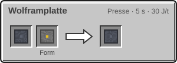
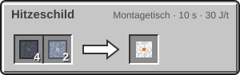
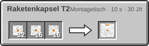
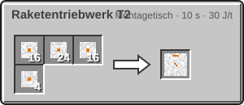
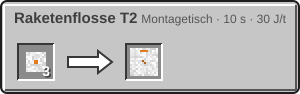

<!-- Erzeugt von tools/gen_wiki.py aus docs/handbook/ und spec/data. Nicht von Hand ändern. -->

[📖 Wiki](README.md) › Phase 3 · Ring 1 › **Die Rakete T2**

# Die Rakete T2

Mars und Venus sind zu weit für die erste [Rakete](Die-Rakete.md). Die Rakete T2 fliegt mit **Wasserstoff und Sauerstoff**, hat Platz für 2 Personen und braucht eine größere Startrampe.

## Startrampe T2

Die Rakete T2 startet nur von einer Plattform aus 7 × 7 Rampenblöcken, sonst ist alles wie bei der [Startrampe](Startrampe-und-Sonde.md). Der Turm muss so hoch sein wie die Rakete. Eine gelandete Rakete T2 startet auch ohne Rampe.

## Aufbau

1. Raketentriebwerk T2 auf der Mitte, daneben 4 Raketenflosse T2.
2. 4 bis 8 Raketentank T2, bei Bedarf Frachträume.
3. Oben die Raketenkapsel T2.

Ein Tank fasst je 16.000 mB Wasserstoff und Sauerstoff. Beides liefert der [Elektrolyseur](Elektrolyseur.md), die Pumpe füllt die Tanks wie bei T1.

## Neue Ziele

Erforsche **Planetensonden** und schick je eine [Sonde](Startrampe-und-Sonde.md) zum Mars und zur Venus. Danach erscheinen beide in der [Navigationskarte](Der-Flug.md). Siehe [Der Mars](Der-Mars.md) und [Die Venus](Die-Venus.md).

## Herstellung

| Rezept | Zutaten → Ergebnis | Wo | Dauer |
| --- | --- | --- | --- |
|  | 1 × [Wolframbarren](Der-Hochtemperaturofen.md), Form: [Pressform (Platte)](Presse.md) → 1 × Wolframplatte | Presse | 100 t (5 s) 30 J/t |
|  | 4 × Wolframplatte, 2 × [Titanplatte](Presse.md) → 1 × Hitzeschild | Montagetisch | 200 t (10 s) 30 J/t |
|  | 32 × [Leichtbau-Platte](Der-Hochtemperaturofen.md), 16 × Hitzeschild, 16 × [Fortgeschrittener Schaltkreis](Der-Hochtemperaturofen.md) → 1 × Raketenkapsel T2 | Montagetisch | 200 t (10 s) 30 J/t |
|  | 12 × [Leichtbau-Platte](Der-Hochtemperaturofen.md), 4 × Hitzeschild → 1 × Raketentank T2 | Montagetisch | 200 t (10 s) 30 J/t |
|  | 16 × [Leichtbau-Platte](Der-Hochtemperaturofen.md), 24 × Hitzeschild, 16 × [Fortgeschrittener Schaltkreis](Der-Hochtemperaturofen.md), 4 × [Kühlsystem](Helium-und-Kryotechnik.md) → 1 × Raketentriebwerk T2 | Montagetisch | 200 t (10 s) 30 J/t |
|  | 3 × [Leichtbau-Platte](Der-Hochtemperaturofen.md) → 1 × Raketenflosse T2 | Montagetisch | 200 t (10 s) 30 J/t |

> [!TIP]
> Erweitere deine 5×5-Rampe einfach um einen Ring aus Rampenblöcken. Die Rakete T1 startet weiterhin von der Mitte.

---

_Diese Seite steht auch im Spiel im **Ingenieurs-Handbuch**._

← [Helium und Kryotechnik](Helium-und-Kryotechnik.md)
