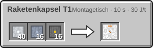
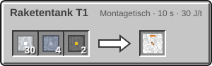
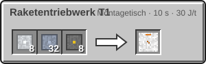
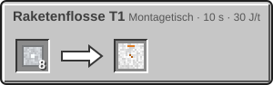
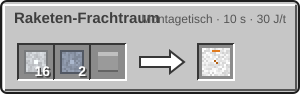

<!-- Erzeugt von tools/gen_wiki.py aus docs/handbook/ und spec/data. Nicht von Hand ändern. -->

[📖 Wiki](README.md) › Phase 2 · Raumfahrtprogramm › **Die Rakete**

# Die Rakete

Eine Rakete baust du Block für Block auf der [Startrampe](Startrampe-und-Sonde.md). Alle Teile sind einen Block groß.

## Aufbau

Von unten nach oben über der Mitte der Plattform:

1. Raketentriebwerk T1 direkt auf der Mitte.
2. 4 Raketenflosse T1 waagerecht neben dem Triebwerk, je eine im Norden, Osten, Süden und Westen.
3. 3 bis 5 Raketentank T1 übereinander.
4. Wenn du willst, ein Raketen-Frachtraum für Fracht (27 Slots, Rechtsklick öffnet ihn).
5. Ganz oben die Raketenkapsel T1. Rechtsklick darauf setzt dich hinein, Schleichen lässt dich aussteigen.

## Masse und Schub

| Teil | Masse |
| --- | --- |
| Kapsel | 4 t |
| Triebwerk | 3 t |
| Flosse | 0,5 t |
| Tank, leer | 2 t |
| Tank, voller Treibstoff | + 2 t |
| Frachtraum | 1 t + 0,05 t je belegtem Slot |

Das Triebwerk T1 hat den Schub 30. Starten darf die Rakete nur, wenn **Schub / (Masse × Schwerkraft)** mindestens 1 ist. Viele volle Tanks und ein voller Frachtraum zusammen sind zu schwer: Der Raketen-Computer zeigt das Verhältnis an.

## Treibstoff

Jeder Tank fasst 16.000 mB Kerosin **und** 16.000 mB Sauerstoff. Ein Flug kostet von beiden gleich viel:

- **Start:** 32.000 mB mal die Schwerkraft des Startorts,
- **Weg:** 6.000 mB je Distanzpunkt Unterschied, dazu 2.000 mB, wenn das Ziel ein anderer Himmelskörper ist,
- **Landung:** 25 % der Startkosten am Ziel (auf der Erde nichts).

Der Raketen-Computer im Steuerpult rechnet das für jedes Ziel aus: **grün** heißt hin und zurück, **gelb** nur hin, **grau** nicht erreichbar oder noch ohne Sonde.

## Die Checkliste

Im Steuerpult stehen diese Punkte, die alle einen Haken brauchen:

1. **Struktur gültig:** Rampe und Rakete sind richtig aufgebaut (z. B. alle Flossen am Triebwerk).
2. **Schub ≥ Gewicht.**
3. **Treibstoff für ein Ziel.**
4. **Ziel freigeschaltet:** die Erde und jedes Ziel, das eine Sonde deiner Agentur erreicht hat.
5. **Besatzung:** Ein Spieler im vollständigen [Druckanzug](Der-Druckanzug.md) sitzt in der Kapsel.

Wie Start, Flug und Landung ablaufen, steht unter [Der Flug](Der-Flug.md).

> [!WARNING]
> Plane den Rückflug ein: Gelbe Ziele erreichst du, kommst aber ohne Nachtanken nicht zurück. Nimm Treibstoff im Frachtraum mit oder baue am Ziel eine Pumpe.

## Herstellung

| Rezept | Zutaten → Ergebnis | Wo | Dauer |
| --- | --- | --- | --- |
|  | 40 × [Aluminiumplatte](Presse.md), 16 × [Titanplatte](Presse.md), 16 × [Schaltkreis](Montagetisch.md) → 1 × Raketenkapsel T1 | Montagetisch | 200 t (10 s) 30 J/t |
|  | 30 × [Aluminiumplatte](Presse.md), 4 × [Titanplatte](Presse.md), 2 × [Schaltkreis](Montagetisch.md) → 1 × Raketentank T1 | Montagetisch | 200 t (10 s) 30 J/t |
|  | 8 × [Aluminiumplatte](Presse.md), 32 × [Titanplatte](Presse.md), 8 × [Schaltkreis](Montagetisch.md) → 1 × Raketentriebwerk T1 | Montagetisch | 200 t (10 s) 30 J/t |
|  | 8 × [Aluminiumplatte](Presse.md) → 1 × Raketenflosse T1 | Montagetisch | 200 t (10 s) 30 J/t |
|  | 16 × [Aluminiumplatte](Presse.md), 2 × [Titanplatte](Presse.md), 1 × Truhe → 1 × Raketen-Frachtraum | Montagetisch | 200 t (10 s) 30 J/t |

> [!TIP]
> Für den Mond reicht schon die kleinste Rakete mit vollen Tanks für Hin- und Rückflug. Mehr Tanks bringen Reserve, aber auch Gewicht.

---

_Diese Seite steht auch im Spiel im **Ingenieurs-Handbuch**._

← [Startrampe und Sonde](Startrampe-und-Sonde.md) · [Der Flug](Der-Flug.md) →
