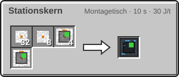
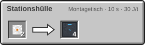
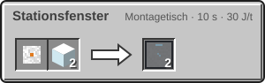

<!-- Erzeugt von tools/gen_wiki.py aus docs/handbook/ und spec/data. Nicht von Hand ändern. -->

[📖 Wiki](README.md) › Phase 4 · Orbit › **Die Raumstation**

# Die Raumstation

Jede Station beginnt mit einem Stationskern. Er lässt sich nur im Orbit setzen, auch mitten in der Luft: Ohne Zielblock landet er 3 Blöcke vor dir, aus der Kapsel einer Rakete direkt unter ihr. Alles im Umkreis von 48 Blöcken gehört zur Station.

## Was der Kern kann

- Beim Setzen entsteht eine Plattform von 5 × 5 Blöcken aus Stationshülle. Diese Plattformblöcke droppen beim Abbau nichts.
- Eine eingebaute Kuppel mit Radius 8 schafft Atemluft. Sie braucht Sauerstoff im Tank (2.000 mB) und Strom.
- Den Strom liefern 4 eingebaute Solarzellen mit je 20 J/t mal Solarfaktor des Orbits. Über Kabel nimmt der Kern zusätzlich Strom an.

## Bauen

Stationshülle ist das Bauteil für Wände und Böden, Stationsfenster ist durchsichtig wie Glas.

| Rezept | Zutaten → Ergebnis | Wo | Dauer |
| --- | --- | --- | --- |
|  | 32 × [Leichtbau-Platte](Der-Hochtemperaturofen.md), 8 × [Fortgeschrittener Schaltkreis](Der-Hochtemperaturofen.md), 4 × [Solarpanel](Strom-im-All.md), 1 × [Kuppelgenerator I](Die-Kuppel.md) → 1 × Stationskern | Montagetisch | 200 t (10 s) 30 J/t |
|  | 2 × [Leichtbau-Platte](Der-Hochtemperaturofen.md) → 4 × Stationshülle | Montagetisch | 200 t (10 s) 30 J/t |
|  | 1 × [Leichtbau-Platte](Der-Hochtemperaturofen.md), 2 × Glas → 2 × Stationsfenster | Montagetisch | 200 t (10 s) 30 J/t |

> [!WARNING]
> Ohne Sauerstoff im Tank geht die Kuppel des Kerns aus, wie jede andere Kuppel. Halte den Tank über Rohre oder Druckflaschen gefüllt.

> [!TIP]
> Den Sauerstofftank füllst du wie beim Kuppelgenerator über den Füllslot oder einen angrenzenden Sauerstoffgenerator.

---

_Diese Seite steht auch im Spiel im **Ingenieurs-Handbuch**._

← [Der Orbit](Der-Orbit.md) · [Die Landefähre](Die-Landefaehre.md) →
