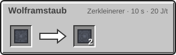

<!-- Erzeugt von tools/gen_wiki.py aus docs/handbook/ und spec/data. Nicht von Hand ändern. -->

[📖 Wiki](README.md) › Phase 3 · Ring 1 › **Die Venus**

# Die Venus

Die Venus ist der heißeste Ort im inneren Sonnensystem. Unter einer dichten, giftigen Wolkendecke liegen Lavaseen und Vulkane, aber auch Wolfram und Schwefel.

## Die Welt

- **Schwerkraft:** das 0,9-Fache der Erde.
- **Temperatur:** Tag und Nacht 465 °C.
- **Luft:** giftig und unter hohem Druck.
- **Lavameer:** Bis zur Höhe 40 ist alles mit Lava gefüllt.

## Gelände und Biome

- **Lavaebenen:** Basaltebenen mit Lavaseen und Schwefel.
- **Venus-Vulkane:** Vulkankegel aus Venusgestein und Magmablöcken, mit Wolfram im Gestein. An ihren Flanken liegen Vulkanschlote, sie sind Erkundungsziele.
- **Venus-Hochebene:** flache Hochebenen.

## Erze

| Block | Ergibt | Höhe | Biome | Menge |
| --- | --- | --- | --- | --- |
| Venus-Schwefelerz | 2 Schwefel | y 40 bis 100 | Lavaebenen | 4 Adern je Chunk, je bis 8 Blöcke |
| Venus-Wolframerz | 1 Rohwolfram | y 40 bis 140 | Venus-Vulkane | 5 Adern je Chunk, je bis 6 Blöcke |

Venus-Wolframerz braucht eine Eisenspitzhacke. Schwefelerz gibt mehrere Stücke Schwefel auf einmal.

1 × Rohwolfram → 2 × Wolframstaub

> [!WARNING]
> Auf der Oberfläche der Venus hält kein einfacher Anzug lange durch. Lies vor der Landung, welchen Schutz du brauchst.

---

_Diese Seite steht auch im Spiel im **Ingenieurs-Handbuch**._

← [Der Mars](Der-Mars.md) · [Der Hochtemperaturofen](Der-Hochtemperaturofen.md) →
