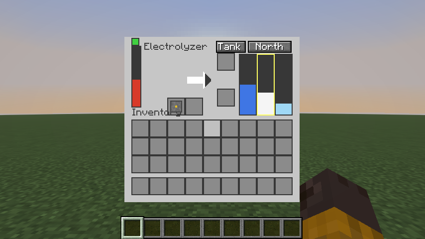
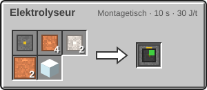
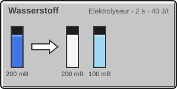

<!-- Erzeugt von tools/gen_wiki.py aus docs/handbook/ und spec/data. Nicht von Hand ändern. -->

[📖 Wiki](README.md) › Phase 1 · Erdindustrie › **Elektrolyseur**

# Elektrolyseur

Der Elektrolyseur spaltet Wasser mit Strom in **Wasserstoff** und **Sauerstoff**. Beides wirst du später dringend brauchen: Wasserstoff als Treibstoff, Sauerstoff zum Atmen auf fremden Welten.

| Steckbrief: Elektrolyseur |  |
| --- | --- |
| Verbrauch | 40 J/t |
| Dauer je Vorgang | 40 t (2 s) |
| Tanks | 16.000 mB, 16.000 mB, 16.000 mB |
| Upgrade-Slots | 2 |

Das Fenster des Elektrolyseurs: ein Eingangstank für Wasser, zwei Ausgangstanks für die Gase.

## Bauen

1 × [Maschinenrahmen](Erste-Schritte.md), 4 × [Kupferdraht](Presse.md), 2 × [Eisenplatte](Presse.md), 2 × [Kupferrohr](Fluide-und-Rohre.md), 1 × Glas → 1 × Elektrolyseur

## Was er macht

| Rezept | Zutaten → Ergebnis | Wo | Dauer |
| --- | --- | --- | --- |
|  | 200 mB Wasser → 200 mB Wasserstoff, 100 mB Sauerstoff | Elektrolyseur | 40 t (2 s) 40 J/t |

## So schließt du ihn an

1. Stell eine [Pumpe](Fluide-und-Rohre.md) über Wasser, oder leg Wassereimer in den Leerslot.
2. Führe das Wasser mit einem [Kupferrohr](Fluide-und-Rohre.md) an eine beliebige Seite des Elektrolyseurs.
3. Die Gase kommen über die **Ausgangsseite** heraus. Mit dem Knopf „Tank“ wählst du, welches Gas der Füllslot nimmt.

> [!NOTE]
> Gase passen nicht in den normalen Tank und nicht in Eimer. Vorerst sammeln sie sich im Elektrolyseur selbst. Druckflaschen und Kanister kommen in einer späteren Phase.

---

_Diese Seite steht auch im Spiel im **Ingenieurs-Handbuch**._

← [Montagetisch](Montagetisch.md) · [Raffinerie](Raffinerie.md) →
