<!-- Erzeugt von tools/gen_wiki.py aus docs/handbook/ und spec/data. Nicht von Hand ändern. -->

[📖 Wiki](README.md) › Phase 1 · Erdindustrie › **Elektroofen**

# Elektroofen

Der Elektroofen schmilzt alles, was auch der normale Ofen schmilzt, braucht dafür aber Strom statt Brennstoff. Dazu kann er Dinge, die kein Ofen kann, zum Beispiel Silizium aus Quarzsand.

| Steckbrief: Elektroofen |  |
| --- | --- |
| Verbrauch | 20 J/t |
| Dauer je Vorgang | 100 t (5 s) |
| Slots | 2 Eingabe, 1 Ausgabe |
| Upgrade-Slots | 2 |

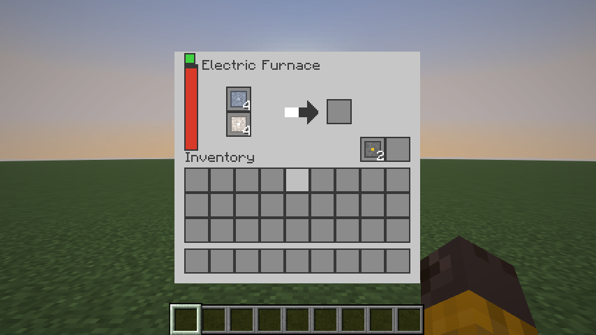

Das Fenster des Elektroofens mit zwei Eingabeslots.

## Bauen

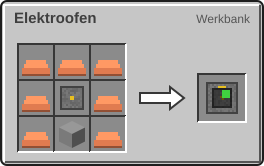

7 × Kupferbarren, 1 × Ofen, 1 × [Maschinenrahmen](Erste-Schritte.md) → 1 × Elektroofen

## Nur im Elektroofen

| Rezept | Zutaten → Ergebnis | Wo | Dauer |
| --- | --- | --- | --- |
| 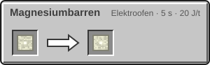 | 1 × [Rohmagnesium](Der-Mars.md) → 1 × [Magnesiumbarren](Der-Mars.md) | Elektroofen | 100 t (5 s) 20 J/t |
|  | 1 × [Magnesiumstaub](Der-Mars.md) → 1 × [Magnesiumbarren](Der-Mars.md) | Elektroofen | 100 t (5 s) 20 J/t |
|  | 1 × [Rohnickel](Der-Mars.md) → 1 × [Nickelbarren](Der-Mars.md) | Elektroofen | 100 t (5 s) 20 J/t |
| 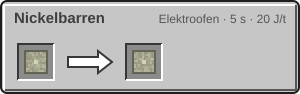 | 1 × [Nickelstaub](Der-Mars.md) → 1 × [Nickelbarren](Der-Mars.md) | Elektroofen | 100 t (5 s) 20 J/t |
| 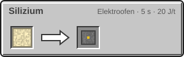 | 1 × [Quarzsand](Rohstoffe-und-Erze.md) → 1 × Silizium | Elektroofen | 100 t (5 s) 20 J/t |

## Alles aus dem normalen Ofen

Der Elektroofen nimmt jedes Vanilla-Schmelzrezept an. Dazu gehören auch die Barren aus Infinite Horizon:

| Rezept | Zutaten → Ergebnis | Wo | Dauer |
| --- | --- | --- | --- |
| 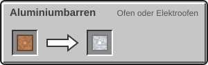 | 1 × [Bauxit](Rohstoffe-und-Erze.md) → 1 × Aluminiumbarren | Ofen oder Elektroofen | – |
| 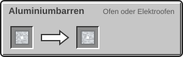 | 1 × [Aluminiumstaub](Zerkleinerer.md) → 1 × Aluminiumbarren | Ofen oder Elektroofen | – |
| 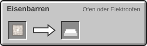 | 1 × [Eisenstaub](Zerkleinerer.md) → 1 × Eisenbarren | Ofen oder Elektroofen | – |
| 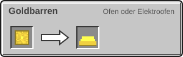 | 1 × [Goldstaub](Zerkleinerer.md) → 1 × Goldbarren | Ofen oder Elektroofen | – |
| 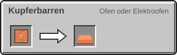 | 1 × [Kupferstaub](Zerkleinerer.md) → 1 × Kupferbarren | Ofen oder Elektroofen | – |
|  | 1 × [Rohtitan](Rohstoffe-und-Erze.md) → 1 × Titanbarren | Ofen oder Elektroofen | – |
| 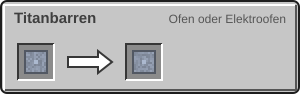 | 1 × [Titanstaub](Zerkleinerer.md) → 1 × Titanbarren | Ofen oder Elektroofen | – |

> [!NOTE]
> Der Elektroofen braucht für jedes Rezept gleich lang und gibt keine Erfahrungspunkte. Hochofen- und Räucherofen-Rezepte kann er nicht.

---

_Diese Seite steht auch im Spiel im **Ingenieurs-Handbuch**._

← [Zerkleinerer](Zerkleinerer.md) · [Presse](Presse.md) →
