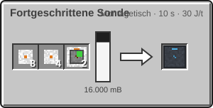

<!-- Erzeugt von tools/gen_wiki.py aus docs/handbook/ und spec/data. Nicht von Hand ändern. -->

[📖 Wiki](README.md) › Phase 5 · Ring 2 › **Erste Schritte im äußeren System**

# Erste Schritte im äußeren System

Mit Stufe 4 der Forschung öffnet sich das Sonnensystem jenseits von Mond, Mars und Venus. Jedes Ziel dort verlangt eigene Ausrüstung: Hitze, Kälte und Strahlung sind härter als in Ring 1.

## Der Ablauf

1. **Die erweiterte Sonde bauen.** Der Knoten „Erweiterte Sonde“ schaltet die Fortgeschrittene Sonde und alle Ziele in Ring 2 frei. Sie startet wie die einfache Sonde von der [Startrampe](Startrampe-und-Sonde.md) und erreicht auch die alten Ziele.
2. **Zum Merkur.** Auf dem [Merkur](Der-Merkur.md) gibt es Lithium. Nimm einen Hitzeanzug und einen Strahlenschild mit.
3. **Lithium verarbeiten.** Aus Lithiumsalz werden Barren und daraus [Lithium-Akkus](Lithium.md), die Grundlage aller Geräte der vierten Phase.
4. **In den Asteroidengürtel.** Auf den [Asteroiden](Der-Asteroidenguertel.md) gibt es Platin und Iridium, daraus entstehen Iridium-Chips. Auf [Ceres](Ceres.md) wartet ein Eisvulkan als Erkundungsziel.
5. **Zum Jupiter.** Im [Jupiter-Orbit](Jupiter-Orbit-und-Gas-Sammler.md) sammelt der Gas-Sammler Wasserstoff. Mit der Landefähre geht es weiter zum Vulkanmond [Io](Io.md).

8 × [Leichtbau-Platte](Der-Hochtemperaturofen.md), 4 × [Fortgeschrittener Schaltkreis](Der-Hochtemperaturofen.md), 2 × [Solarpanel](Strom-im-All.md), 16.000 mB [Wasserstoff](Elektrolyseur.md) → 1 × Fortgeschrittene Sonde

> [!TIP]
> Die erweiterte Sonde ist teurer als die einfache. Schick sie zuerst zu dem Ziel, dessen Rohstoffe du als Nächstes brauchst.

---

_Diese Seite steht auch im Spiel im **Ingenieurs-Handbuch**._

[Der Merkur](Der-Merkur.md) →
