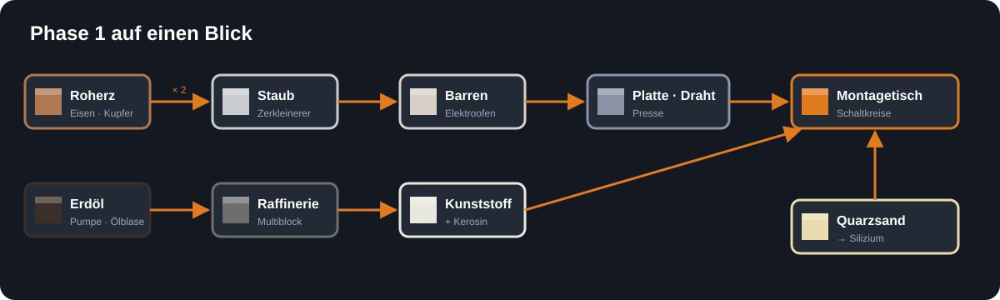

<!-- Erzeugt von tools/gen_wiki.py aus docs/handbook/ und spec/data. Nicht von Hand ändern. -->

[Startseite](Home.md) › Phase 1 · Erdindustrie › **Erste Schritte**

# Erste Schritte

In der ersten Phase baust du auf der Erde eine kleine Industrie auf. Am Ende hast du Strom, verarbeitest Erze doppelt so ergiebig wie im Ofen, stellst Schaltkreise her und raffinierst Erdöl zu Kerosin und Kunststoff. Das ist das Fundament für alles, was danach kommt.



## Der Ablauf

1. **Rohstoffe sammeln.** Du brauchst vor allem Eisen, Kupfer und Redstone. Halte außerdem Ausschau nach [Bauxiterz](Rohstoffe-und-Erze.md) in Savanne, Wüste und Tafelbergen und nach [Titanerz](Rohstoffe-und-Erze.md) tief unter der Erde. Mehr dazu unter [Rohstoffe und Erze](Rohstoffe-und-Erze.md).
2. **Maschinenrahmen bauen.** Fast jede Maschine braucht einen Maschinenrahmen. Bau gleich zwei oder drei.
3. **Strom erzeugen.** Ein [Verbrennungsgenerator](Strom.md) verbrennt Kohle oder Holz und liefert Strom. Verbinde ihn mit [Kupferkabel](Strom.md) mit deinen Maschinen. Siehe [Strom](Strom.md).
4. **Erze verdoppeln.** Der [Zerkleinerer](Zerkleinerer.md) macht aus einem Roherz zwei Staub. Schmilz den Staub im Ofen oder im [Elektroofen](Elektroofen.md). Siehe [Zerkleinerer](Zerkleinerer.md).
5. **Platten, Stangen und Draht pressen.** Die [Presse](Presse.md) formt Barren mit einer Pressform um. Kupferdraht und Eisenplatten brauchst du ständig. Siehe [Presse](Presse.md).
6. **Silizium schmelzen.** [Quarzsand](Rohstoffe-und-Erze.md) vom Strand oder Flussufer wird im Elektroofen zu [Silizium](Elektroofen.md).
7. **Den Montagetisch bauen.** Ab jetzt entstehen alle wichtigen Bauteile im [Montagetisch](Montagetisch.md). Siehe [Montagetisch](Montagetisch.md).
8. **Erdöl fördern.** Unter Wüsten und Ozeanen liegen Ölblasen. Eine [Pumpe](Fluide-und-Rohre.md) saugt das Erdöl in einen [Tank](Fluide-und-Rohre.md). Siehe [Fluide und Rohre](Fluide-und-Rohre.md).
9. **Die Raffinerie bauen.** Der erste Multiblock macht aus Erdöl Kerosin und Kunststoff. Siehe [Raffinerie](Raffinerie.md).
10. **Schaltkreise herstellen.** Silizium, Kupferdraht und Kunststoff ergeben im Montagetisch den [Schaltkreis](Montagetisch.md), das wichtigste Bauteil der Mod.
11. **Wasser spalten.** Der [Elektrolyseur](Elektrolyseur.md) macht aus Wasser Wasserstoff und Sauerstoff. Siehe [Elektrolyseur](Elektrolyseur.md).
12. **Schneller werden.** Mit Schaltkreisen baust du [Upgrades](Upgrades.md), die deine Maschinen beschleunigen oder sparsamer machen.

## Der Maschinenrahmen

**Maschinenrahmen** · Werkbank

```text
┌───┬───┬───┐
│ I │ C │ I │
├───┼───┼───┤
│ C │ R │ C │
├───┼───┼───┤
│ I │ C │ I │
└───┴───┴───┘
```

`C` = Kupferbarren · `I` = Eisenbarren · `R` = Redstone-Staub

> [!TIP]
> Zerkleinere deine Erze, statt sie direkt zu schmelzen. Aus einem Roherz werden so zwei Barren. Das lohnt sich vom ersten Tag an.

---

_Diese Seite steht auch im Spiel im **Ingenieurs-Handbuch**._

[Rohstoffe und Erze](Rohstoffe-und-Erze.md) →
