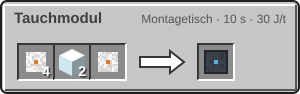
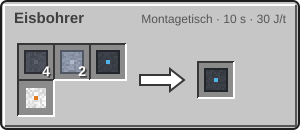
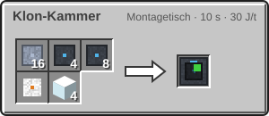

<!-- Erzeugt von tools/gen_wiki.py aus docs/handbook/ und spec/data. Nicht von Hand ändern. -->

[📖 Wiki](README.md) › Phase 5 · Ring 2 › **Europa**

# Europa

Europa ist von einer dicken Eisdecke umhüllt. Darunter liegt ein Ozean, auf dessen Grund warme Quellen sprudeln. Die Schwerkraft beträgt 0,13 g, an der Oberfläche ist es -160 °C kalt, und die Strahlung des Jupiter hat Stufe 2.

## Aufbau

- **Eisdecke** aus Europa-Eis zwischen y 112 und 124. In den **Eisspalten** reißt sie auf; dort kommst du direkt ans Wasser.
- **Ozean** darunter. Unter der Eisdecke ist das Wasser 2 °C warm, der Druck normal und die Strahlung abgeschirmt.
- **Meeresboden** aus Europa-Meeresboden.

## Ausrüstung

- An der Oberfläche: ein Raumanzug mit [Strahlenschild](Der-Merkur.md).
- Im Ozean ab y 79 abwärts herrscht Tiefseedruck. Dafür brauchst du das Tauchmodul an der Hose. Es macht dich außerdem beim Schwimmen schneller (×1,5).

4 × [Leichtbau-Platte](Der-Hochtemperaturofen.md), 2 × Glas, 1 × [Sauerstoffflasche](Sauerstoff-speichern.md) → 1 × Tauchmodul

> [!WARNING]
> Ohne Tauchmodul zerdrückt dich der Tiefseedruck. Bleib über der Grenze, bis du eines hast.

## Durch das Eis

Europa-Eis ist so hart wie Obsidian. Mit der Spitzhacke dauert ein Schacht durch die Eisdecke sehr lange. Der Eisbohrer schafft es schneller: Halte die rechte Maustaste gedrückt, und er bohrt unter dir einen Schacht von 3 × 3 Blöcken nach unten, eine Schicht alle 10 t (0,5 s). Jeder Block kostet 20 J aus dem Akku (voll: 100.000 J). Lade ihn im Ladeslot eines Akkus.

4 × [Wolframplatte](Die-Rakete-T2.md), 2 × [Titanstange](Presse.md), 1 × [Lithium-Akku](Lithium.md), 1 × [Fortgeschrittener Schaltkreis](Der-Hochtemperaturofen.md) → 1 × Eisbohrer

> [!TIP]
> Bohr nur dort, wo du wieder herauskommst. Eine Treppe aus Blöcken oder ein Jetpack bringt dich zurück auf die Eisdecke.

## Hydrothermale Quellen

Auf dem Meeresboden liegen **Quellenfelder**: Gruppen von Hydrothermale Quelle, aus denen Blasen aufsteigen. Ein Quellenfeld ist ein Erkundungsziel. Rechtsklick mit einer leeren Glasflasche auf eine Quelle gibt eine Mikrobenkultur. Danach ruht diese Quelle 1.200 t (60 s).

| Rezept | Zutaten → Ergebnis | Wo | Dauer |
| --- | --- | --- | --- |
|  | 16 × [Titanplatte](Presse.md), 4 × [Iridium-Chip](Der-Asteroidenguertel.md), 8 × Mikrobenkultur, 1 × [Druckhülle](Sauerstoffgenerator.md), 4 × Glas → 1 × [Klon-Kammer](Die-Klon-Kammer.md) | Montagetisch | 200 t (10 s) 30 J/t |

## Leben im Ozean

- Die **Eisqualle** leuchtet und treibt langsam zur nächsten Quelle. Folge ihr, wenn du ein Quellenfeld suchst.
- Jedes Quellenfeld bewacht ein **Riffwächter**. Er ist friedlich, bis jemand in seiner Nähe (Umkreis 16 Blöcke) Blöcke abbaut oder Proben nimmt. Dann greift er an (12 Schaden).

> [!TIP]
> Gib dem Riffwächter eine Weltraumration (Rechtsklick). Dann bleibt er dir gegenüber 12.000 t (600 s) friedlich, und du kannst in Ruhe Proben nehmen.

---

_Diese Seite steht auch im Spiel im **Ingenieurs-Handbuch**._

← [Io](Io.md) · [Die Klon-Kammer](Die-Klon-Kammer.md) →
