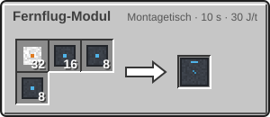
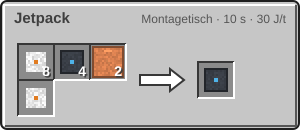

<!-- Erzeugt von tools/gen_wiki.py aus docs/handbook/ und spec/data. Nicht von Hand ändern. -->

[📖 Wiki](README.md) › Phase 5 · Ring 2 › **Fernflug und Jetpack**

# Fernflug und Jetpack

Die äußeren Ziele hinter dem Asteroidengürtel erreicht eine Rakete T2 nur mit mehr Treibstoff. Dafür gibt es das Fernflug-Modul, und die Station im Orbit wird zur Startrampe.

## Das Fernflug-Modul

Das Fernflug-Modul ist ein Raketenteil der Stufe 2. Es sitzt zwischen den Tanks und der Kapsel und fasst 128.000 mB je Treibstoffkomponente zusätzlich. Die fernen Ziele ab Saturn werden erst mit ihm wählbar.

32 × [Leichtbau-Platte](Der-Hochtemperaturofen.md), 16 × [Supraleiterdraht](Fertigung-im-Orbit.md), 8 × [Iridium-Chip](Der-Asteroidenguertel.md), 8 × [Lithium-Akku](Lithium.md) → 1 × Fernflug-Modul

## Start von der Andockbucht

Eine Rakete T2 kannst du direkt auf einer [Andockbucht](Stationsmodule.md) bauen: Triebwerk auf die Bucht, Flossen darum, Tanks, Fernflug-Modul und Kapsel darüber, ein Steuerpult in der Nähe. Turm und Treibstoffpumpe brauchst du dort nicht. Die Bucht füllt die Tanks aus Tanks, die an sie grenzen. Raketen T1 starten nicht von der Bucht.

> [!TIP]
> Ein Start von der Station kostet keinen Treibstoff für den Aufstieg. Bau die großen Raketen deshalb im Orbit.

## Das Jetpack

Das Jetpack ist ein Modul für die Brustplatte. Es speichert 200.000 J; lade es im Ladeslot eines Akkus, auch eingebaut in der Brustplatte.

- **Springen** gedrückt halten: Die Schwerkraft ist aufgehoben, und du steigst bis 0,4 Blöcke je Tick.
- **Schleichen** in der Luft: Schub nach unten.
- **Vorwärts**: 0,1 Blöcke je Tick in Blickrichtung.

Solange es schiebt, verbraucht es 40 J je Tick.

8 × [Leichtbau-Platte](Der-Hochtemperaturofen.md), 4 × [Lithium-Akku](Lithium.md), 2 × [Kupferrohr](Fluide-und-Rohre.md), 1 × [Fortgeschrittener Schaltkreis](Der-Hochtemperaturofen.md) → 1 × Jetpack

> [!WARNING]
> Ist die Energie leer, fällst du wieder, im Orbit langsam, auf einem Planeten mit voller Schwerkraft.

---

_Diese Seite steht auch im Spiel im **Ingenieurs-Handbuch**._

← [Ceres](Ceres.md) · [Jupiter-Orbit und Gas-Sammler](Jupiter-Orbit-und-Gas-Sammler.md) →
