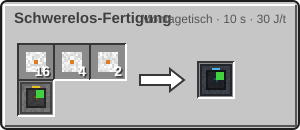

<!-- Erzeugt von tools/gen_wiki.py aus docs/handbook/ und spec/data. Nicht von Hand ändern. -->

[📖 Wiki](README.md) › Phase 4 · Orbit › **Fertigung im Orbit**

# Fertigung im Orbit

Manche Werkstoffe entstehen nur in der Schwerelosigkeit. Der Schwerelos-Fertigung arbeitet deshalb nur im Orbit; auf einem Planeten steht er auf Fehler. Er braucht Strom und für viele Rezepte flüssiges Helium aus dem [Kryo-Verflüssiger](Helium-und-Kryotechnik.md).

| Steckbrief: Schwerelos-Fertigung |  |
| --- | --- |
| Verbrauch | 100 J/t |
| Dauer je Vorgang | 200 t (10 s) |
| Slots | 3 Eingabe, 1 Ausgabe |
| Tanks | 16.000 mB |
| Upgrade-Slots | 2 |
| Ort | {"dimension_type": "orbit", "dimensions": [], "excluded_dimensions": []} |

## Rezepte

Supraleiterdraht ist der Grundstoff für Supraleiterkabel und den Fusionsreaktor.

## Stufe 4

Sobald ein Schwerelos-Fertiger deiner Agentur seinen ersten Vorgang abschließt, öffnet sich Forschungsstufe 4, siehe [Forschung](Forschung.md).

16 × [Leichtbau-Platte](Der-Hochtemperaturofen.md), 4 × [Fortgeschrittener Schaltkreis](Der-Hochtemperaturofen.md), 2 × [Kühlsystem](Helium-und-Kryotechnik.md), 1 × [Montagetisch](Montagetisch.md) → 1 × Schwerelos-Fertigung

> [!WARNING]
> Ohne Kuppel ist der Orbit Vakuum. Stell den Fertiger unter die Kuppel des Stationskerns, damit du ohne Anzug daran arbeiten kannst.

> [!TIP]
> Ein Tankdepot mit flüssigem Helium neben dem Fertiger spart viele Flüge zum Mond.

---

_Diese Seite steht auch im Spiel im **Ingenieurs-Handbuch**._

← [Stationsmodule](Stationsmodule.md) · [Weltraumwetter-Station](Weltraumwetter-Station.md) →
