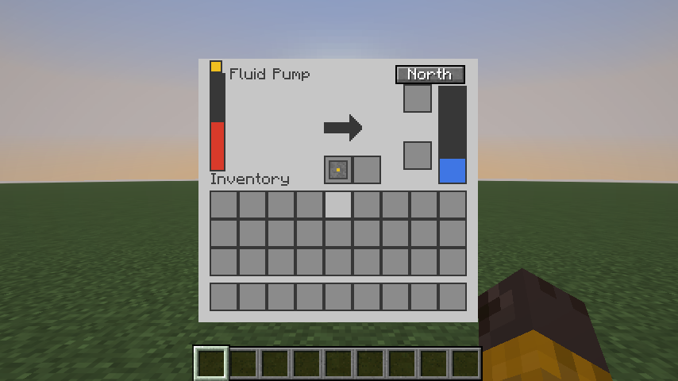
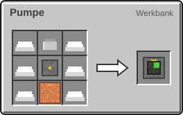
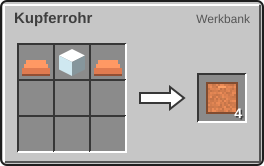
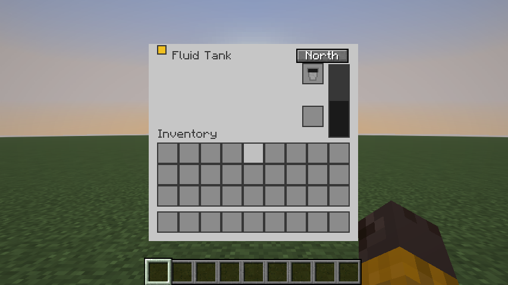
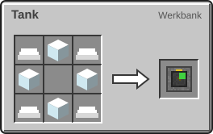

<!-- Erzeugt von tools/gen_wiki.py aus docs/handbook/ und spec/data. Nicht von Hand ändern. -->

[📖 Wiki](README.md) › Phase 1 · Erdindustrie › **Fluide und Rohre**

# Fluide und Rohre

Erdöl, Kerosin, Wasserstoff und Sauerstoff sind **Fluide**. Sie werden in Millibuckets gemessen: 1.000 mB sind ein Eimer.

## Pumpe

Die Pumpe saugt Quellblöcke unter sich ab: Wasser, Lava oder Erdöl, bis zu 8 Blöcke tief und im gleichen Umkreis zur Seite. Jeder Vorgang bringt 1.000 mB. Bei Erdöl verschwindet der Quellblock nur mit 10 % Wahrscheinlichkeit. Eine Ölblase hält also sehr lange.

| Steckbrief: Pumpe |  |
| --- | --- |
| Verbrauch | 20 J/t |
| Dauer je Vorgang | 40 t (2 s) |
| Tanks | 16.000 mB |
| Upgrade-Slots | 2 |

Das Fenster der Pumpe: Tank und Eimerslots, Knopf „Seite“ für die Ausgangsseite.

1 × Eimer, 6 × Eisenbarren, 1 × [Maschinenrahmen](Erste-Schritte.md), 1 × Kupferrohr → 1 × Pumpe

## Kupferrohr

Das Kupferrohr transportiert Flüssigkeiten und Gase, 200 mB pro Tick. Zwei wichtige Regeln:

- Ein Rohrnetz führt **immer nur ein Fluid**. Erst wenn es leer ist, kann ein anderes hinein. Für Wasser und Erdöl brauchst du also getrennte Rohre.
- Rohre ziehen nie selbst. Maschinen und Tanks **schieben** ihre Ausgabe über ihre Ausgangsseite hinein.

2 × Kupferbarren, 1 × Glas → 4 × Kupferrohr

## Tank

Der Tank fasst 16.000 mB einer Flüssigkeit. Er gibt nur über seine Ausgangsseite ab und behält seinen Inhalt, wenn du ihn abbaust. Gase passen nicht hinein; sie bleiben vorerst im Tank der Maschine.

| Steckbrief: Tank |  |
| --- | --- |
| Speicher | 16.000 mB |

Das Fenster des Tanks mit Füll- und Leerslot.

4 × Glas, 4 × Eisenbarren → 1 × Tank

## Eimer, Füll- und Leerslot

Jede Maschine mit Tank hat zwei besondere Slots:

- **Füllslot:** Leg einen leeren Eimer hinein, und die Maschine füllt ihn aus ihrem Tank.
- **Leerslot:** Leg einen vollen Eimer hinein, und die Maschine leert ihn in ihren Tank.

Ein Erdöleimer entsteht auch, wenn du mit einem leeren Eimer auf einen Erdöl-Quellblock klickst. Einen Kerosineimer füllst du nur im Füllslot der Raffinerie oder eines Tanks.

> [!TIP]
> Stell die Pumpe direkt über eine Ölblase und den Tank daneben. Mit einem Kupferrohr dazwischen läuft das Erdöl von allein.

> [!WARNING]
> Ein Rohr, das schon Wasser führt, nimmt kein Erdöl an. Wenn nichts fließt, prüfe, ob noch ein altes Fluid im Netz steckt.

---

_Diese Seite steht auch im Spiel im **Ingenieurs-Handbuch**._

← [Presse](Presse.md) · [Montagetisch](Montagetisch.md) →
