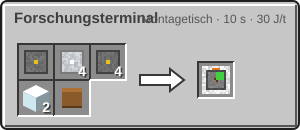

<!-- Erzeugt von tools/gen_wiki.py aus docs/handbook/ und spec/data. Nicht von Hand ändern. -->

[📖 Wiki](README.md) › Phase 2 · Raumfahrtprogramm › **Forschung**

# Forschung

Mit der Forschung beginnt dein Raumfahrtprogramm. Am Forschungsterminal gibt deine [Agentur](Deine-Agentur.md) **Forschungspunkte (FP)** aus und schaltet damit neue Bauteile und Ziele frei. Die Forschung gehört der ganzen Agentur: Was ein Mitglied erforscht, können alle bauen.

## Das Forschungsterminal

1. Bau das Terminal am Montagetisch (Rezept unten) und stell es in deine Basis. Es braucht keinen Strom.
2. Sobald es steht, öffnet sich **Stufe 1** der Forschung für deine Agentur, und du bekommst den Erfolg „Bodenstation“.
3. Rechtsklick öffnet den **Forschungsbaum**: vier Spalten für die Äste Industrie und Energie, Raumfahrt, Lebenserhaltung und Logistik, sechs Zeilen für die Stufen. Die Fläche lässt sich mit der Maus ziehen und scrollen (mit Umschalt waagerecht).
4. Oben rechts stehen die FP deiner Agentur.

Jeder Knoten zeigt sein Symbol mit einem farbigen Rahmen:

| Rahmen | Bedeutung |
| --- | --- |
| grau | gesperrt: Stufe noch zu oder Voraussetzung fehlt |
| gelb | verfügbar: ein Klick erforscht ihn |
| grün | erforscht |

Der Tooltip nennt Kosten, Freischaltungen und fehlende Voraussetzungen. Erforschen zieht die FP sofort ab. Forschen dürfen Leiter und Ingenieure der Agentur.

## Stufen

Eine Stufe öffnet sich, wenn die vorige offen ist und ihr **Tor** erfüllt ist. Offene Stufen schließen sich nie wieder, auch wenn du das Terminal abbaust. Die Zeilenköpfe im Baum zeigen jedes Tor und einen Haken, sobald die Stufe offen ist.

| Stufe | Tor | Standardkosten je Knoten |
| --- | --- | --- |
| 1 Raumfahrtprogramm | ein eigenes Forschungsterminal setzen | 10 FP |
| 2 Nahe Welten | ein Mitglied betritt den Mond | 25 FP |

Die Stufen öffnen auch die Kapitel dieses Handbuchs: Die dritte Phase („Ring 1“) liest du ab Stufe 2.

## Gesperrte Rezepte

Ein Knoten schaltet **alle Rezepte** frei, deren Ergebnis er nennt. Solange deine Agentur ihn nicht erforscht hat, bauen deine Maschinen und dein Montagetisch diese Dinge nicht: Die Statuslampe bleibt gelb, und ihr Tooltip meldet „Gesperrt“. Was in keinem Knoten steht, kannst du immer herstellen, zum Beispiel Schaltkreise, Upgrades, Ports, das Terminal selbst und die Sonde.

Das betrifft auch zehn Dinge, die du vielleicht schon gebaut hast:

| Knoten | Stufe | Kosten | Schaltet frei |
| --- | --- | --- | --- |
| Druckanzug | 1 | 10 FP | [Druckanzug-Helm](Der-Druckanzug.md), [Druckanzug-Brustplatte](Der-Druckanzug.md), [Druckanzug-Hose](Der-Druckanzug.md), [Druckanzug-Stiefel](Der-Druckanzug.md), [Sauerstoffflasche](Sauerstoff-speichern.md), [Große Sauerstoffflasche](Sauerstoff-speichern.md) |
| Gasspeicher | 1 | 10 FP | [Druckflasche](Sauerstoff-speichern.md) |
| Kuppel I | 2 | 25 FP | [Kuppelgenerator I](Die-Kuppel.md), [Sauerstoffgenerator](Sauerstoffgenerator.md), [Elektrische Lampe](Leben-ohne-Luft.md) |

> [!NOTE]
> Schon gebaute Blöcke und fertige Anzüge laufen weiter. Gesperrt ist nur das Herstellen.

> [!WARNING]
> Für die erste Reise zum Mond brauchst du den Druckanzug. Erforsche den Knoten **Druckanzug** früh, sonst baut dein Montagetisch keine neuen Anzugteile.

## Forschungspunkte

FP gehören der Agentur und werden mit zwei Nachkommastellen angezeigt. Du sammelst sie durch Erkundung und Analyse.

Auf Servern kann die Forschungspflicht abgeschaltet sein (Einstellung `research_required`). Dann sind alle Rezepte und Handbuch-Kapitel frei, und der Baum zeigt einen Hinweis.

## Herstellung

1 × [Maschinenrahmen](Erste-Schritte.md), 4 × [Aluminiumplatte](Presse.md), 4 × [Schaltkreis](Montagetisch.md), 2 × Glas, 1 × Buch → 1 × Forschungsterminal

> [!TIP]
> Stell das Terminal gleich am Anfang auf. Es kostet nur Material, öffnet Stufe 1 und zeigt dir im Baum, was als Nächstes kommt.

---

_Diese Seite steht auch im Spiel im **Ingenieurs-Handbuch**._

← [Erste Schritte ins All](Erste-Schritte-ins-All.md) · [Der Mond](Der-Mond.md) →
