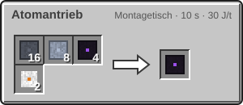
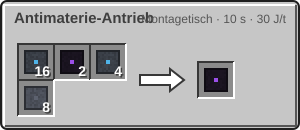
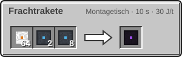
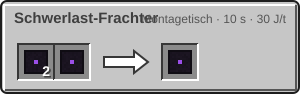

<!-- Erzeugt von tools/gen_wiki.py aus docs/handbook/ und spec/data. Nicht von Hand ändern. -->

[📖 Wiki](README.md) › Phase 6 · Netzwerk und Finale › **Frachtraketen und Antriebe**

# Frachtraketen und Antriebe

Frachtraketen bringen Items und Fluide von einem [Frachtterminal](Aussenposten-und-Frachtterminal.md) zum anderen. Wann sie fliegen, legst du am [Logistik-Computer](Logistik-Computer.md) fest. Sie fliegen nicht sichtbar durch die Welt: Das Spiel merkt sich nur Start, Ziel und Ankunftszeit. Beim Start und bei der Landung siehst du am Terminal eine kleine Rauchwolke.

## Der Hangar

Jedes Frachtterminal hat 4 Hangar-Slots unter den Tanks. Eine Rakete in einem Hangar-Slot gehört zu diesem Terminal; ihre Flüge starten immer dort. Solange sie unterwegs ist, bleibt das Item im Slot liegen, ist rot hinterlegt und lässt sich nicht herausnehmen.

## Die Frachtrakete

Die Frachtrakete hat 4 Laderäume zu je 27 Slots und 4 Fluid-Laderäume. Sie fliegt mit Methan aus ihrem eigenen Tank (64.000 mB).

- Vor jedem Start tankt sie aus dem Treibstofftank ihres Terminals nach.
- Eine Strecke kostet 2.000 mB plus 1.500 mB je Entfernungspunkt zwischen Start und Ziel.
- Am Ziel lädt sie aus und tankt für den Rückflug aus dem Treibstofftank des Ziels. Hat sie Methan geladen, behält sie davon so viel, wie der Rückflug braucht.
- Der Rückflug ist leer. Was am Ziel keinen Platz fand, bringt sie wieder mit.

> [!WARNING]
> Reicht der Treibstoff am Ziel nicht für den Rückflug, bleibt die Rakete dort und versucht es alle 1.200 t (60 s) erneut. Lagere am Ziel etwas Methan.

## Der Schwerlast-Frachter

Der Schwerlast-Frachter trägt doppelt so viel. Er braucht kein Methan: Ein [Brennstab](Der-Kernreaktor.md) reicht für 10 Flüge hin und zurück. Ist er leer, nimmt er vor dem Start selbst einen Brennstab aus dem Lager seines Terminals. Ein Atomantrieb ist schon eingebaut.

## Antriebe

| Antrieb | Flugzeit |
| --- | --- |
| ohne | {{value:logistics:flight_time.base_ticks | t}} plus {{value:logistics:flight_time.per_delta_dp_ticks | t}} je Entfernungspunkt |
| Atomantrieb | geteilt durch 2 |
| Antimaterie-Antrieb | geteilt durch 10 |

Zum Nachrüsten legst du Rakete und Antrieb zusammen in den [Montagetisch](Montagetisch.md). Treibstoff und Antrieb bleiben in der Rakete gespeichert. Es zählt nur der beste Antrieb, ein schwächerer ersetzt keinen besseren.

> [!TIP]
> Für den Antimaterie-Antrieb brauchst du geladene Antimaterie-Zellen aus der Magnetfalle. Leere Zellen nimmt der Montagetisch nicht an.

## Herstellung

| Rezept | Zutaten → Ergebnis | Wo | Dauer |
| --- | --- | --- | --- |
|  | 16 × [Wolframplatte](Die-Rakete-T2.md), 8 × [Titanplatte](Presse.md), 4 × [Brennstab](Der-Kernreaktor.md), 2 × [Kühlsystem](Helium-und-Kryotechnik.md) → 1 × Atomantrieb | Montagetisch | 200 t (10 s) 30 J/t |
|  | 16 × [Antimaterie-Zelle](Magnetfalle-und-Antimaterie.md), 2 × [Brennstab](Der-Kernreaktor.md), 4 × [Supraleiterdraht](Fertigung-im-Orbit.md), 8 × [Wolframplatte](Die-Rakete-T2.md) → 1 × Antimaterie-Antrieb | Montagetisch | 200 t (10 s) 30 J/t |
|  | 64 × [Leichtbau-Platte](Der-Hochtemperaturofen.md), 2 × [Iridium-Chip](Der-Asteroidenguertel.md), 8 × [Lithium-Akku](Lithium.md) → 1 × Frachtrakete | Montagetisch | 200 t (10 s) 30 J/t |
|  | 2 × Frachtrakete, 1 × Atomantrieb → 1 × Schwerlast-Frachter | Montagetisch | 200 t (10 s) 30 J/t |

---

_Diese Seite steht auch im Spiel im **Ingenieurs-Handbuch**._

← [Außenposten und Frachtterminal](Aussenposten-und-Frachtterminal.md) · [Logistik-Computer](Logistik-Computer.md) →
