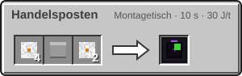

<!-- Erzeugt von tools/gen_wiki.py aus docs/handbook/ und spec/data. Nicht von Hand ändern. -->

[📖 Wiki](README.md) › Phase 6 · Netzwerk und Finale › **Handelsposten**

# Handelsposten

Am Handelsposten bietest du anderen Spielern Tauschgeschäfte an: „Gib mir X, du bekommst Y“. Er hat bis zu 8 Angebote und ein eigenes Lager mit 54 Slots. Tauschen darf **jeder**, auch Spieler fremder Agenturen. Lager und Angebote verwalten nur die Mitglieder deiner Agentur.

## Angebote einrichten

1. Stell den Handelsposten auf und öffne ihn mit Rechtsklick. Links stehen die Angebote, rechts das Lager.
2. Leg die Ware, die du hergeben willst, ins Lager.
3. Klick in einer Angebotszeile mit einem Item auf den **linken** Musterslot: Das ist X, was der Händler dir gibt. Ein Linksklick übernimmt den ganzen Stapel, ein Rechtsklick zählt ein Stück hoch.
4. Klick genauso auf den **rechten** Musterslot: Das ist Y, was der Händler dafür bekommt.
5. Linksklick ohne Item leert einen Musterslot, Rechtsklick ohne Item zählt ein Stück herunter.

Die Muster sind nur Vorlagen. Getauscht wird immer echte Ware aus dem Lager: Neben jedem Angebot steht, wie oft es noch geht.

> [!TIP]
> Was Händler dir geben, landet im Lager. Hol es regelmäßig ab, sonst ist das Lager irgendwann voll und niemand kann mehr tauschen.

## Tauschen

Leg X ins Inventar und klick beim Angebot auf „Tauschen“. Der Handelsposten nimmt X aus deinem Inventar, legt es ins Lager und gibt dir Y. Spieler fremder Agenturen sehen das Lager nicht, nur die Angebote.

## Beliefern

Frachtraketen deiner Agentur und deiner [Partner](Deine-Agentur.md) können den Handelsposten am [Logistik-Computer](Logistik-Computer.md) als Ziel wählen. Sie laden nur Items ab. Fluide bleiben in der Rakete und fliegen zurück.

> [!WARNING]
> Ein Handelsposten ist nie Startpunkt einer Route. Er hat keinen Hangar und keinen Treibstofftank: Plane den Rückflug mit genug Treibstoff ab dem Start-Terminal.

## Herstellung

4 × [Leichtbau-Platte](Der-Hochtemperaturofen.md), 1 × Truhe, 2 × [Fortgeschrittener Schaltkreis](Der-Hochtemperaturofen.md) → 1 × Handelsposten

---

_Diese Seite steht auch im Spiel im **Ingenieurs-Handbuch**._

← [Logistik-Computer](Logistik-Computer.md) · [Orbitalwerft](Orbitalwerft.md) →
