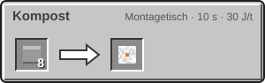
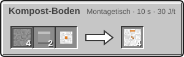
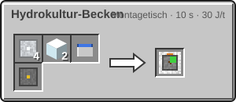

<!-- Erzeugt von tools/gen_wiki.py aus docs/handbook/ und spec/data. Nicht von Hand ändern. -->

[📖 Wiki](README.md) › Phase 3 · Ring 1 › **Hydrokultur und Kompost**

# Hydrokultur und Kompost

Auf Mond und Mars wächst im Boden nichts. Regolith und Marssand lassen sich nicht umgraben. Für Nahrung hast du zwei Wege: Kompostboden für klassische Felder oder das Hydrokultur-Becken. Beide schaltet der Forschungsknoten „Hydrokultur“ frei.

Alle Pflanzen brauchen außerhalb der Erde eine aktive [Kuppel](Die-Kuppel.md) und genug Licht.

## Kompostboden

Kompost-Boden entsteht im Montagetisch aus Regolith oder Marssand, Knochenmehl und Gips oder Kompost. Mit der Hacke wird daraus Kompost-Ackerland. Das verhält sich wie Ackerland auf der Erde: Es braucht Wasser in der Nähe und trocknet sonst wieder zu Kompostboden aus.

| Rezept | Zutaten → Ergebnis | Wo | Dauer |
| --- | --- | --- | --- |
|  | 8 × Pflanzenreste → 1 × Kompost | Montagetisch | 200 t (10 s) 30 J/t |
|  | 4 × [Mond-Regolith](Der-Mond.md) oder [Marssand](Der-Mars.md), 2 × Knochenmehl, 1 × [Gips](Der-Mars.md) → 4 × Kompost-Boden | Montagetisch | 200 t (10 s) 30 J/t |
|  | 4 × [Mond-Regolith](Der-Mond.md) oder [Marssand](Der-Mars.md), 2 × Knochenmehl, 2 × Kompost → 4 × Kompost-Boden | Montagetisch | 200 t (10 s) 30 J/t |

## Das Hydrokultur-Becken

Das Hydrokultur-Becken braucht Strom, Wasser und Licht (mindestens 9). Leg Samen oder einen Setzling in den Pflanzslot. Die Pflanze wächst alle 2.000 t (100 s) eine Stufe weiter, etwa doppelt so schnell wie auf gutem Ackerland. Ist sie reif, landet die Ernte im Ausgabeslot und der Samen bleibt im Pflanzslot. Ein Setzling braucht 2 Stufen und gibt 4 Stämme seiner Holzart.

| Steckbrief: Hydrokultur-Becken |  |
| --- | --- |
| Verbrauch | 10 J/t |
| Slots | 1 Eingabe, 1 Ausgabe |
| Tanks | 16.000 mB |
| Upgrade-Slots | 2 |

4 × [Aluminiumplatte](Presse.md), 2 × Glas, 1 × Wassereimer, 1 × [Schaltkreis](Montagetisch.md) → 1 × Hydrokultur-Becken

> [!WARNING]
> Fällt die Kuppel aus oder wird es zu dunkel, bleibt die Pflanze stehen. Die Statuslampe zeigt dann „Kein Wachstum“.

> [!TIP]
> Eine elektrische Lampe über dem Becken liefert genug Licht, auch in der Mondnacht.

---

_Diese Seite steht auch im Spiel im **Ingenieurs-Handbuch**._

← [Weltraumwetter und Ereignisse](Weltraumwetter-und-Ereignisse.md)
