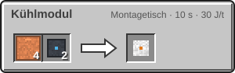

<!-- Erzeugt von tools/gen_wiki.py aus docs/handbook/ und spec/data. Nicht von Hand ändern. -->

[📖 Wiki](README.md) › Phase 5 · Ring 2 › **Io**

# Io

Io ist der innerste große Mond des Jupiter und voller Vulkane. Die Oberfläche aus Io-Kruste ist kalt (-140 °C), aber überall gibt es Lava. Die Schwerkraft beträgt 0,18 g, und die Strahlung des Jupiter hat Stufe 3.

## Ausrüstung

- Überall: ein Raumanzug mit [Strahlenschild](Der-Merkur.md).
- In der Nähe von Lava steigt die Temperatur auf 300 °C. Dort brauchst du einen [Hitzeanzug](Der-Hitzeanzug.md) mit Strahlenschild.

## Gebiete

- **Schwefelebenen**, **Lavaseen** und **Vulkanfelder**. In den Vulkanfeldern stehen Vulkanschlote; wer einen betritt, bringt seiner Agentur Forschungspunkte als Erkundungsziel.
- Io-Schwefelerz steckt überall in der Kruste und gibt Schwefel.

## Der Schwefelsalamander

In den Lavaseen und an den Vulkanschloten lebt der Schwefelsalamander. Er ist feuerfest und beschießt dich aus der Ferne mit Schwefelklumpen (5 Schaden je Treffer). Besiegt lässt er manchmal eine Hitzeschuppe fallen.

| Rezept | Zutaten → Ergebnis | Wo | Dauer |
| --- | --- | --- | --- |
|  | 4 × [Kupferrohr](Fluide-und-Rohre.md), 2 × Hitzeschuppe → 1 × [Kühlmodul](Der-Hitzeanzug.md) | Montagetisch | 200 t (10 s) 30 J/t |

## Vulkanausbruch

Steht ein Vulkanschlot in der Nähe eines Spielers, kann er ausbrechen. Du wirst vorher gewarnt. Während des Ausbruchs regnet es im Umkreis von 32 Blöcken um den Schlot Brocken aus Schwefelerz. Abstand ist der einzige Schutz.

> [!WARNING]
> Die Brocken treffen hart. Verlass den Umkreis des Schlots, sobald die Warnung kommt.

> [!TIP]
> Nach dem Ausbruch liegt frisches Schwefelerz offen herum. Sammle es ein, bevor du weiterziehst.

---

_Diese Seite steht auch im Spiel im **Ingenieurs-Handbuch**._

← [Jupiter-Orbit und Gas-Sammler](Jupiter-Orbit-und-Gas-Sammler.md) · [Europa](Europa.md) →
