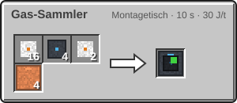

<!-- Erzeugt von tools/gen_wiki.py aus docs/handbook/ und spec/data. Nicht von Hand ändern. -->

[📖 Wiki](README.md) › Phase 5 · Ring 2 › **Jupiter-Orbit und Gas-Sammler**

# Jupiter-Orbit und Gas-Sammler

Jupiter hat keine Oberfläche, auf der du landen kannst. Eine Rakete bringt dich nur in den **Jupiter-Orbit**, eine leere Welt über dem Gasriesen. Von dort fliegst du mit der [Landefähre](Die-Landefaehre.md) zu den Monden [Io](Io.md) und Europa.

## Gefahren im Orbit

Die Strahlung im Jupiter-Orbit hat Stufe 3. Jeder Raumanzug braucht dort einen [Strahlenschild](Der-Merkur.md). Wer unter die Station fällt, landet nicht auf dem Planeten: Er wird auf den nächsten [Stationskern](Die-Raumstation.md) zurückgeholt und nimmt dabei 4 Schaden. Gibt es noch keinen Kern, entsteht eine kleine Plattform aus Stationshülle.

> [!WARNING]
> Ohne Strahlenschild ist der Jupiter-Orbit tödlich, auch in einem Hitze- oder Druckanzug.

## Der Gas-Sammler

Der Gas-Sammler arbeitet nur in den Orbits der Gasriesen. Er braucht keine Zutaten: Alle 20 Ticks füllt er 100 mB Gas in seinen Tank, im Jupiter-Orbit Wasserstoff. Leere Behälter im Füllslot werden gefüllt, Rohre ziehen das Gas ab.

| Steckbrief: Gas-Sammler |  |
| --- | --- |
| Verbrauch | 200 J/t |
| Dauer je Vorgang | 20 t (1 s) |
| Tanks | 16.000 mB |
| Upgrade-Slots | 2 |
| Ort | {"dimension_type": "orbit", "dimensions": ["infinite_horizon:jupiter_orbit", "infinite_horizon:saturn_orbit", "infinite_horizon:uranus_orbit", "infinite_horizon:neptune_orbit"], "excluded_dimensions": []} |

16 × [Leichtbau-Platte](Der-Hochtemperaturofen.md), 4 × [Supraleiterdraht](Fertigung-im-Orbit.md), 2 × [Fortgeschrittener Schaltkreis](Der-Hochtemperaturofen.md), 4 × [Kupferrohr](Fluide-und-Rohre.md) → 1 × Gas-Sammler

> [!TIP]
> Ein Gas-Sammler neben dem Tankdepot der Station versorgt Raketen und Fusionsreaktor mit Wasserstoff, ohne dass du Wasser zur Station bringen musst.

---

_Diese Seite steht auch im Spiel im **Ingenieurs-Handbuch**._

← [Fernflug und Jetpack](Fernflug-und-Jetpack.md) · [Io](Io.md) →
