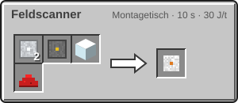

<!-- Erzeugt von tools/gen_wiki.py aus docs/handbook/ und spec/data. Nicht von Hand ändern. -->

[📖 Wiki](README.md) › Phase 3 · Ring 1 › **Kreaturen des inneren Sonnensystems**

# Kreaturen des inneren Sonnensystems

Auf den fremden Welten lebt mehr, als man denkt. Die meisten Kreaturen sind harmlos, einige nützlich, einer ist gefährlich. Mit dem Feldscanner analysierst du sie: Rechtsklick auf eine Kreatur gibt deiner Agentur beim ersten Mal je Art 15 FP.

## Mond

- **Geröllkrabbler:** liegt getarnt wie ein Stein herum, bis du näher als 3 Blöcke kommst. Er frisst Kabel und Metallblöcke außerhalb von Kuppeln, alle 200 t (10 s) einen. Greifst du ihn an, wehrt er sich. Er lässt Metallkonzentrat fallen, das im Zerkleinerer Metall gibt.
- **Schattenläufer:** scheu, flieht vor Licht und vor dir. Folgst du ihm lange genug, führt er dich zu Eis oder Erz in der Nähe.

## Mars

- **Dünengräber:** gräbt sich unsichtbar durch den Sand und wird von Vibrationen angelockt, etwa von einem laufenden Zerkleinerer oder dem Bohrer deines [Rovers](Der-Rover.md). Er greift Spieler an und lässt Panzerplatte fallen.
- **Staubgeist:** schwebt friedlich und ist gegen Pfeile immun. Kommst du ihm nahe, führt er dich meist zu einer Lavaröhre oder einem Meteoritenfeld und verschwindet dann.

## Venus

- **Schwefelschnecke:** feuerfest, hinterlässt eine dünne Schwefelspur, die nach einer Weile verschwindet, und legt ab und zu [Schwefel](Die-Venus.md). Mit Schwefel vermehrt sie sich.
- **Wolkenrochen:** fliegt friedlich umher. Mit [Schwefel](Die-Venus.md) kannst du ihn zähmen (nicht jeder Versuch gelingt), mit einem Sattel wird er zum fliegenden Reittier. Er fliegt in deine Blickrichtung.

> [!WARNING]
> Dünengräber kommen nur im Dunkeln heraus. Eine laufende Maschine auf dem Mars lockt sie aus großer Entfernung an.

## Herstellung

2 × [Aluminiumplatte](Presse.md), 1 × [Schaltkreis](Montagetisch.md), 1 × Glas, 1 × Redstone-Staub → 1 × Feldscanner

> [!TIP]
> Analysiere jede Art einmal: Das sind leichte Forschungspunkte auf jeder neuen Welt.

---

_Diese Seite steht auch im Spiel im **Ingenieurs-Handbuch**._

← [Der Rover](Der-Rover.md)
