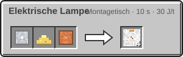

<!-- Erzeugt von tools/gen_wiki.py aus docs/handbook/ und spec/data. Nicht von Hand ändern. -->

[📖 Wiki](README.md) › Phase 3 · Ring 1 › **Leben ohne Luft**

# Leben ohne Luft

Auf allen fremden Welten gelten außerhalb einer aktiven [Kuppel](Die-Kuppel.md) eigene Regeln, egal wie die Atmosphäre aussieht. Auf der Erde, im Nether und im End bleibt alles wie gewohnt.

## Kein Feuer

- **Fackeln, Feuer, Lagerfeuer, Laternen und Kerzen** lassen sich draußen nicht setzen. Redstone-Fackeln funktionieren weiter.
- Schon vorhandene Fackeln erlöschen nach und nach und werden zu Erloschene Fackel. Lagerfeuer und Kerzen gehen aus, Laternen und Feuer verschwinden.

Licht bringt die Elektrische Lampe. Sie leuchtet überall mit voller Stärke, braucht aber Strom: 5 J/t. Ohne Strom bleibt sie dunkel.

| Steckbrief: Elektrische Lampe |  |
| --- | --- |
| Verbrauch | 5 J/t |

## Keine Pflanzen, kein Wasser

- **Pflanzen** wachsen draußen nicht, auch Knochenmehl hilft nicht.
- **Wasser** gefriert auf dem Mond sofort zu Eis, und dieses Eis schmilzt dort nicht.

## Betten

Ein Bett setzt deinen Spawnpunkt auf fremden Welten nur **innerhalb einer aktiven Kuppel**. Draußen erscheint „Hier kannst du nicht atmen“, und du kannst nicht schlafen.

Fällt die Kuppel aus, während du tot bist, ist dein Spawnpunkt nicht mehr sicher. Du erscheinst dann am Weltspawn der Erde.

> [!WARNING]
> Baue deine Basis so, dass Bett und Kuppelgenerator dicht beieinander stehen. Ein Bett am Kuppelrand liegt schnell draußen.

## Herstellung

> [!NOTE]
> Die elektrische Lampe schaltet der Knoten **Kuppel I** in Stufe 2 frei ([Forschung](Forschung.md)).

1 × [Aluminiumplatte](Presse.md), 1 × Glowstonestaub, 1 × [Kupferdraht](Presse.md) → 4 × Elektrische Lampe

> [!TIP]
> In der Kuppel funktionieren Fackeln und Lagerfeuer ganz normal. Elektrische Lampen lohnen sich vor allem draußen und in Höhlen.

---

_Diese Seite steht auch im Spiel im **Ingenieurs-Handbuch**._

← [Die Kuppel](Die-Kuppel.md) · [Das Landefeuer](Das-Landefeuer.md) →
