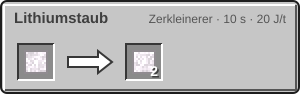
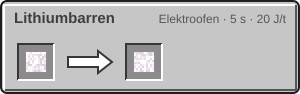
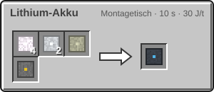
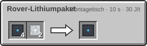
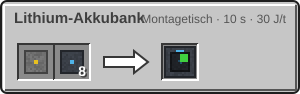

<!-- Erzeugt von tools/gen_wiki.py aus docs/handbook/ und spec/data. Nicht von Hand ändern. -->

[📖 Wiki](README.md) › Phase 5 · Ring 2 › **Lithium**

# Lithium

Lithium kommt als Salzkruste vom [Merkur](Der-Merkur.md). Der Zerkleinerer macht daraus Staub, der Elektroofen Barren. Aus den Barren baust du den Lithium-Akku, ein Bauteil fast aller Geräte der vierten Phase.

| Rezept | Zutaten → Ergebnis | Wo | Dauer |
| --- | --- | --- | --- |
|  | 1 × Lithiumsalz → 2 × Lithiumstaub | Zerkleinerer | 200 t (10 s) 20 J/t |
|  | 1 × Lithiumsalz → 1 × Lithiumbarren | Elektroofen | 100 t (5 s) 20 J/t |
|  | 1 × Lithiumstaub → 1 × Lithiumbarren | Elektroofen | 100 t (5 s) 20 J/t |
|  | 4 × Lithiumbarren, 2 × [Aluminiumplatte](Presse.md), 1 × [Nickelplatte](Der-Hitzeanzug.md), 1 × [Schaltkreis](Montagetisch.md) → 1 × Lithium-Akku | Montagetisch | 200 t (10 s) 30 J/t |

## Lithium-Akkubank

Die Lithium-Akkubank speichert 4.000.000 J und gibt bis 4.096 J/t ab, über ihre Ausgangsseite wie der Akku.

| Steckbrief: Lithium-Akkubank |  |
| --- | --- |
| Speicher | 4.000.000 J |
| Ein/Aus | 4.096 J/t |

## Rover-Akku

Der Rover-Lithiumpaket ist ein Modul für den [Rover](Der-Rover.md): Er fasst damit das 2-Fache an Energie.

4 × Lithium-Akku, 2 × [Aluminiumplatte](Presse.md) → 1 × Rover-Lithiumpaket

1 × [Maschinenrahmen](Erste-Schritte.md), 8 × Lithium-Akku → 1 × Lithium-Akkubank

> [!TIP]
> Lithiumsalz gibt im Zerkleinerer und Elektroofen gleich viel Lithium. Spar dir den Zerkleinerer, solange du ihn für Erze brauchst.

---

_Diese Seite steht auch im Spiel im **Ingenieurs-Handbuch**._

← [Der Merkur](Der-Merkur.md)
