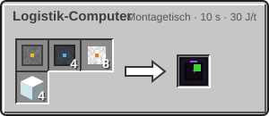

<!-- Erzeugt von tools/gen_wiki.py aus docs/handbook/ und spec/data. Nicht von Hand ändern. -->

[📖 Wiki](README.md) › Phase 6 · Netzwerk und Finale › **Logistik-Computer**

# Logistik-Computer

Am Logistik-Computer legst du Routen für deine [Frachtraketen](Frachtraketen-und-Antriebe.md) an. Die Routen gehören deiner Agentur: Jeder Logistik-Computer zeigt dieselben, egal wo er steht.

## Eine Route anlegen

1. Stell mindestens zwei [Frachtterminals](Aussenposten-und-Frachtterminal.md) auf und leg eine Frachtrakete in einen Hangar-Slot des Start-Terminals.
2. Klick am Logistik-Computer auf „Neu“.
3. Wähle mit den Knöpfen Start und Ziel. Der Start ist immer das Terminal, in dessen Hangar die Rakete liegt.
4. Wähle die Startbedingung und trag N (und bei Bedarf X) ein.
5. Trag die Fracht ein: Item- oder Fluid-IDs mit Komma getrennt. Der Knopf „Hand“ fügt das Item in deiner Hand hinzu. Leer heißt: alles.
6. Wähle unter „Raketen“ die Hangar-Slots, deren Raketen auf dieser Route fliegen. Eine Rakete gehört immer nur zu einer Route.
7. Klick auf „Speichern“.

## Ziele bei Partnern

Als Ziel stehen auch deine [Handelsposten](Handelsposten.md) zur Wahl und, mit dem Vorsatz „Partner“, die freigegebenen Terminals, Werften und Handelsposten deiner [Partner](Deine-Agentur.md). Endet die Partnerschaft oder nimmt der Partner die Freigabe zurück, starten die Raketen dieser Route nicht mehr. Eine Rakete, die schon unterwegs ist, bringt ihre Fracht wieder mit.

## Startbedingungen

| Bedingung | Die Rakete startet … |
| --- | --- |
| wenn voll | sobald die passende Fracht alle Laderäume füllt (alle Item-Slots oder alle Fluid-Laderäume) |
| alle N Ticks | spätestens N Ticks nach dem letzten Start |
| wenn Ziel weniger als N von X hat | sobald das Ziel weniger als N Stück (oder mB) von X lagert |
| bis der Bedarf gedeckt ist | solange die [[werft | Werft]] noch etwas von der Fracht braucht; sie lädt nur, was fehlt |

Ohne passende Fracht im Start-Terminal startet keine Route.

## Die Statusliste

Unter dem Editor siehst du jede Rakete der Route: unterwegs (mit Restzeit), geladen (auf dem Hinflug mit Fracht), wartend oder ohne Treibstoff. Eine Rakete ohne Treibstoff versucht es alle 1.200 t (60 s) erneut.

> [!WARNING]
> Eine rote Zeile warnt dich, wenn Hin- und Rückflug zusammen mehr Treibstoff brauchen, als in den Tank passt, und am Ziel kein Methan lagert. Dann bleibt die Rakete am Ziel liegen.

> [!TIP]
> Ist ein Außenposten gerade nicht geladen, prüft der Logistik-Computer ihn nur ab und zu. Dabei rechnet er nach, was die Produzenten in der Zwischenzeit gefördert haben.

## Herstellung

1 × [Maschinenrahmen](Erste-Schritte.md), 4 × [Iridium-Chip](Der-Asteroidenguertel.md), 8 × [Fortgeschrittener Schaltkreis](Der-Hochtemperaturofen.md), 4 × Glas → 1 × Logistik-Computer

---

_Diese Seite steht auch im Spiel im **Ingenieurs-Handbuch**._

← [Frachtraketen und Antriebe](Frachtraketen-und-Antriebe.md) · [Handelsposten](Handelsposten.md) →
