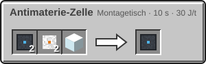
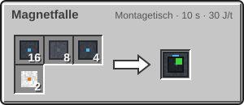

<!-- Erzeugt von tools/gen_wiki.py aus docs/handbook/ und spec/data. Nicht von Hand ändern. -->

[📖 Wiki](README.md) › Phase 5 · Ring 2 › **Magnetfalle und Antimaterie**

# Magnetfalle und Antimaterie

Im starken Magnetfeld des Jupiter lassen sich Antiteilchen einfangen. Die Magnetfalle arbeitet deshalb nur im [Jupiter-Orbit](Jupiter-Orbit-und-Gas-Sammler.md).

## So geht es

1. Bau die Magnetfalle in deiner Station im Jupiter-Orbit und schließ sie an viel Strom an.
2. Leg eine leere Antimaterie-Zelle in den Eingabeslot.
3. Nach einem langen Vorgang liegt die gefüllte Zelle im Ausgabeslot. Gefüllte Zellen schimmern.

| Steckbrief: Magnetfalle |  |
| --- | --- |
| Verbrauch | 2.000 J/t |
| Dauer je Vorgang | 24.000 t (1.200 s) |
| Slots | 1 Eingabe, 1 Ausgabe |
| Upgrade-Slots | 2 |
| Ort | {"dimension_type": "orbit", "dimensions": ["infinite_horizon:jupiter_orbit"], "excluded_dimensions": []} |

2 × [Supraleiterdraht](Fertigung-im-Orbit.md), 2 × [Leichtbau-Platte](Der-Hochtemperaturofen.md), 1 × Glas → 1 × Antimaterie-Zelle

16 × [Supraleiterdraht](Fertigung-im-Orbit.md), 8 × [Wolframplatte](Die-Rakete-T2.md), 4 × [Iridium-Chip](Der-Asteroidenguertel.md), 2 × [Kühlsystem](Helium-und-Kryotechnik.md) → 1 × Magnetfalle

> [!TIP]
> Die erste gefüllte Zelle ist ein Schritt zur letzten Forschungsstufe. Fang früh an, der Vorgang dauert lange.

> [!WARNING]
> Ohne Strom bleibt der Fortschritt stehen. Sorg für einen Akku oder einen Fusionsreaktor in der Station.

---

_Diese Seite steht auch im Spiel im **Ingenieurs-Handbuch**._

← [Enceladus](Enceladus.md)
