<!-- Erzeugt von tools/gen_wiki.py aus docs/handbook/ und spec/data. Nicht von Hand ändern. -->

[📖 Wiki](README.md) › Phase 1 · Erdindustrie › **Montagetisch**

# Montagetisch

Der Montagetisch ist das Herz deiner Werkstatt. Fast alles, was nach der ersten Phase kommt, entsteht hier: Schaltkreise, Maschinen, Raketenteile, Raumanzüge.

Der Montagetisch hat **9 Eingabeslots** ohne festes Muster, einen Fluidtank und 3 Ausgabeslots.

| Steckbrief: Montagetisch |  |
| --- | --- |
| Verbrauch | 30 J/t |
| Dauer je Vorgang | 200 t (10 s) |
| Slots | 9 Eingabe, 3 Ausgabe |
| Tanks | 16.000 mB |
| Upgrade-Slots | 2 |

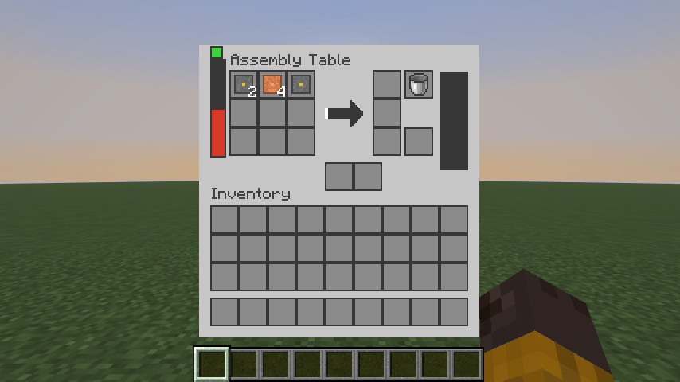

Das Fenster des Montagetischs: 3 × 3 Eingabeslots ohne festes Muster, rechts Ausgaben, Eimerslots und Tank.

## Bauen

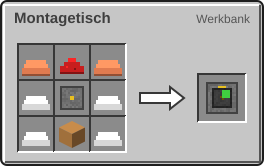

2 × Kupferbarren, 4 × Eisenbarren, 1 × [Maschinenrahmen](Erste-Schritte.md), 1 × Redstone-Staub, 1 × Werkbank → 1 × Montagetisch

## Genau abmessen

Der Montagetisch ist pingelig: Ein Rezept startet nur, wenn in den Slots **genau** die Zutaten in **genau** der richtigen Menge liegen. Liegt etwas zu viel oder etwas anderes in einem Slot, passiert nichts.

- Eine Zutat darf mehrere Slots belegen. Die Mengen werden zusammengezählt.
- Verbraucht wird genau die Menge aus dem Rezept.
- Beispiel: 4 [Eisenplatte](Presse.md) und 1 [Kupferrohr](Fluide-und-Rohre.md) ergeben einen [Fluid-Port](Raffinerie.md). Mit 2 Platten und 1 Rohr bekommst du dagegen [Raffinerie-Gehäuse](Raffinerie.md).

## Der Schaltkreis

Der Schaltkreis steckt in fast jeder Maschine ab Phase 2. Bau dir früh eine kleine Produktion dafür auf.

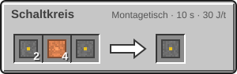

2 × [Silizium](Elektroofen.md), 4 × [Kupferdraht](Presse.md), 1 × [Kunststoff](Raffinerie.md) → 1 × Schaltkreis

## Alle Rezepte des Montagetischs

| Rezept | Zutaten → Ergebnis | Wo | Dauer |
| --- | --- | --- | --- |
| 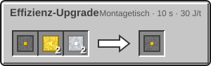 | 1 × Schaltkreis, 2 × [Golddraht](Presse.md), 2 × [Aluminiumplatte](Presse.md) → 1 × [Effizienz-Upgrade](Upgrades.md) | Montagetisch | 200 t (10 s) 30 J/t |
| 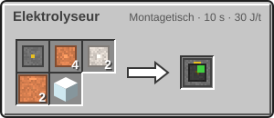 | 1 × [Maschinenrahmen](Erste-Schritte.md), 4 × [Kupferdraht](Presse.md), 2 × [Eisenplatte](Presse.md), 2 × [Kupferrohr](Fluide-und-Rohre.md), 1 × Glas → 1 × [Elektrolyseur](Elektrolyseur.md) | Montagetisch | 200 t (10 s) 30 J/t |
| 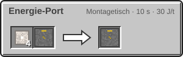 | 4 × [Eisenplatte](Presse.md), 1 × [Kupferkabel](Strom.md) → 1 × [Energie-Port](Raffinerie.md) | Montagetisch | 200 t (10 s) 30 J/t |
| 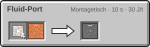 | 4 × [Eisenplatte](Presse.md), 1 × [Kupferrohr](Fluide-und-Rohre.md) → 1 × [Fluid-Port](Raffinerie.md) | Montagetisch | 200 t (10 s) 30 J/t |
| 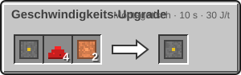 | 1 × Schaltkreis, 4 × Redstone-Staub, 2 × [Kupferdraht](Presse.md) → 1 × [Geschwindigkeits-Upgrade](Upgrades.md) | Montagetisch | 200 t (10 s) 30 J/t |
| 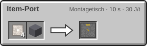 | 4 × [Eisenplatte](Presse.md), 1 × Trichter → 1 × [Item-Port](Raffinerie.md) | Montagetisch | 200 t (10 s) 30 J/t |
| 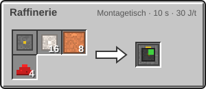 | 1 × [Maschinenrahmen](Erste-Schritte.md), 16 × [Eisenplatte](Presse.md), 8 × [Kupferrohr](Fluide-und-Rohre.md), 4 × Redstone-Staub → 1 × [Raffinerie](Raffinerie.md) | Montagetisch | 200 t (10 s) 30 J/t |
| 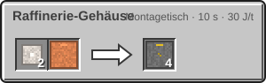 | 2 × [Eisenplatte](Presse.md), 1 × [Kupferrohr](Fluide-und-Rohre.md) → 4 × [Raffinerie-Gehäuse](Raffinerie.md) | Montagetisch | 200 t (10 s) 30 J/t |
|  | 2 × [Silizium](Elektroofen.md), 4 × [Kupferdraht](Presse.md), 1 × [Kunststoff](Raffinerie.md) → 1 × Schaltkreis | Montagetisch | 200 t (10 s) 30 J/t |
| 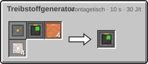 | 1 × [Maschinenrahmen](Erste-Schritte.md), 1 × [Verbrennungsgenerator](Strom.md), 4 × [Kupferrohr](Fluide-und-Rohre.md), 4 × [Eisenplatte](Presse.md) → 1 × [Treibstoffgenerator](Strom.md) | Montagetisch | 200 t (10 s) 30 J/t |

> [!TIP]
> Wenn der Pfeil nicht losläuft, obwohl alles da zu sein scheint: Nimm alles heraus und lege die Zutaten in genau der Rezeptmenge wieder hinein.

---

_Diese Seite steht auch im Spiel im **Ingenieurs-Handbuch**._

← [Fluide und Rohre](Fluide-und-Rohre.md) · [Elektrolyseur](Elektrolyseur.md) →
