<!-- Erzeugt von tools/gen_wiki.py aus docs/handbook/ und spec/data. Nicht von Hand ändern. -->

[📖 Wiki](README.md) › Phase 1 · Erdindustrie › **Montagetisch**

# Montagetisch

Der Montagetisch ist das Herz deiner Werkstatt. Fast alles, was nach der ersten Phase kommt, entsteht hier: Schaltkreise, Maschinen, Raketenteile, Raumanzüge.

Der Montagetisch hat **9 Eingabeslots** ohne festes Muster, einen Fluidtank und 3 Ausgabeslots.

| Steckbrief: Montagetisch |  |
| --- | --- |
| Verbrauch | 30 J/t |
| Dauer je Vorgang | 200 t (10 s) |
| Slots | 9 Eingabe, 3 Ausgabe |
| Tanks | 16.000 mB |
| Upgrade-Slots | 2 |

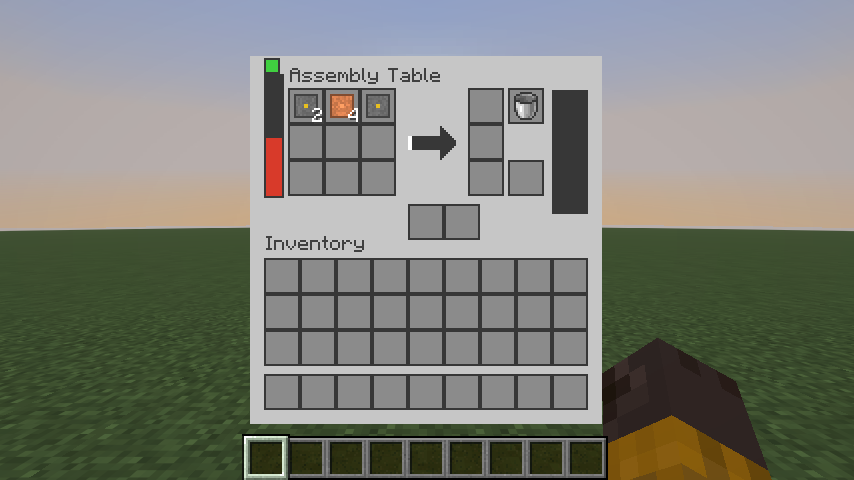

Das Fenster des Montagetischs: 3 × 3 Eingabeslots ohne festes Muster, rechts Ausgaben, Eimerslots und Tank.

## Bauen

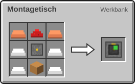

2 × Kupferbarren, 4 × Eisenbarren, 1 × [Maschinenrahmen](Erste-Schritte.md), 1 × Redstone-Staub, 1 × Werkbank → 1 × Montagetisch

## Genau abmessen

Der Montagetisch ist pingelig: Ein Rezept startet nur, wenn in den Slots **genau** die Zutaten in **genau** der richtigen Menge liegen. Liegt etwas zu viel oder etwas anderes in einem Slot, passiert nichts.

- Eine Zutat darf mehrere Slots belegen. Die Mengen werden zusammengezählt.
- Verbraucht wird genau die Menge aus dem Rezept.
- Beispiel: 4 [Eisenplatte](Presse.md) und 1 [Kupferrohr](Fluide-und-Rohre.md) ergeben einen [Fluid-Port](Raffinerie.md). Mit 2 Platten und 1 Rohr bekommst du dagegen [Raffinerie-Gehäuse](Raffinerie.md).

## Der Schaltkreis

Der Schaltkreis steckt in fast jeder Maschine ab Phase 2. Bau dir früh eine kleine Produktion dafür auf.

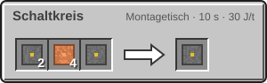

2 × [Silizium](Elektroofen.md), 4 × [Kupferdraht](Presse.md), 1 × [Kunststoff](Raffinerie.md) → 1 × Schaltkreis

## Alle Rezepte des Montagetischs

| Rezept | Zutaten → Ergebnis | Wo | Dauer |
| --- | --- | --- | --- |
|  | 2 × [Aluminiumplatte](Presse.md), 1 × [Kunststoff](Raffinerie.md) → 4 × [Aerostat-Plattform](Die-Venus.md) | Montagetisch | 200 t (10 s) 30 J/t |
| 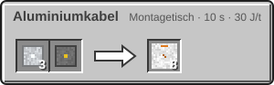 | 3 × [Aluminiumdraht](Presse.md), 1 × [Kunststoff](Raffinerie.md) → 8 × [Aluminiumkabel](Strom-im-All.md) | Montagetisch | 200 t (10 s) 30 J/t |
| 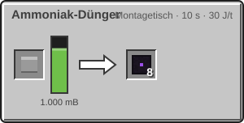 | 1 × Knochenmehl, 1.000 mB [Ammoniak](Bohrturm-und-Pumpstation.md) → 8 × [Ammoniak-Dünger](Hydrokultur-und-Kompost.md) | Montagetisch | 200 t (10 s) 30 J/t |
| 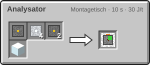 | 1 × [Maschinenrahmen](Erste-Schritte.md), 4 × [Aluminiumplatte](Presse.md), 2 × Schaltkreis, 1 × Glas → 1 × [Analysator](Forschung.md) | Montagetisch | 200 t (10 s) 30 J/t |
| 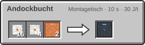 | 16 × [Leichtbau-Platte](Der-Hochtemperaturofen.md), 4 × [Fortgeschrittener Schaltkreis](Der-Hochtemperaturofen.md), 2 × [Kupferrohr](Fluide-und-Rohre.md) → 1 × [Andockbucht](Stationsmodule.md) | Montagetisch | 200 t (10 s) 30 J/t |
| 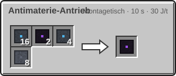 | 16 × [Antimaterie-Zelle](Magnetfalle-und-Antimaterie.md), 2 × [Brennstab](Der-Kernreaktor.md), 4 × [Supraleiterdraht](Fertigung-im-Orbit.md), 8 × [Wolframplatte](Die-Rakete-T2.md) → 1 × [Antimaterie-Antrieb](Frachtraketen-und-Antriebe.md) | Montagetisch | 200 t (10 s) 30 J/t |
| 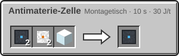 | 2 × [Supraleiterdraht](Fertigung-im-Orbit.md), 2 × [Leichtbau-Platte](Der-Hochtemperaturofen.md), 1 × Glas → 1 × [Antimaterie-Zelle](Magnetfalle-und-Antimaterie.md) | Montagetisch | 200 t (10 s) 30 J/t |
| 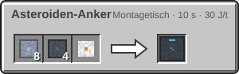 | 8 × [Titanstange](Presse.md), 4 × [Wolframplatte](Die-Rakete-T2.md), 1 × [Fortgeschrittener Schaltkreis](Der-Hochtemperaturofen.md) → 1 × [Asteroiden-Anker](Der-Asteroidenguertel.md) | Montagetisch | 200 t (10 s) 30 J/t |
| 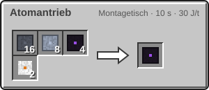 | 16 × [Wolframplatte](Die-Rakete-T2.md), 8 × [Titanplatte](Presse.md), 4 × [Brennstab](Der-Kernreaktor.md), 2 × [Kühlsystem](Helium-und-Kryotechnik.md) → 1 × [Atomantrieb](Frachtraketen-und-Antriebe.md) | Montagetisch | 200 t (10 s) 30 J/t |
| 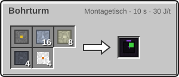 | 1 × [Maschinenrahmen](Erste-Schritte.md), 16 × [Titanplatte](Presse.md), 8 × [Nickelplatte](Der-Hitzeanzug.md), 4 × [Wolframplatte](Die-Rakete-T2.md), 4 × [Fortgeschrittener Schaltkreis](Der-Hochtemperaturofen.md) → 1 × [Bohrturm](Bohrturm-und-Pumpstation.md) | Montagetisch | 200 t (10 s) 30 J/t |
|  | 4 × [Uranbarren](Pluto.md), 1 × [Titanplatte](Presse.md) → 1 × [Brennstab](Der-Kernreaktor.md) | Montagetisch | 200 t (10 s) 30 J/t |
| 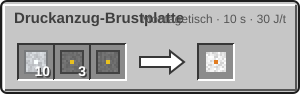 | 10 × [Aluminiumplatte](Presse.md), 3 × [Kunststoff](Raffinerie.md), 1 × Schaltkreis → 1 × [Druckanzug-Brustplatte](Der-Druckanzug.md) | Montagetisch | 200 t (10 s) 30 J/t |
| 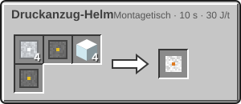 | 4 × [Aluminiumplatte](Presse.md), 1 × [Kunststoff](Raffinerie.md), 4 × Glas, 1 × Schaltkreis → 1 × [Druckanzug-Helm](Der-Druckanzug.md) | Montagetisch | 200 t (10 s) 30 J/t |
| 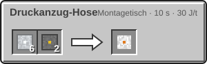 | 6 × [Aluminiumplatte](Presse.md), 2 × [Kunststoff](Raffinerie.md) → 1 × [Druckanzug-Hose](Der-Druckanzug.md) | Montagetisch | 200 t (10 s) 30 J/t |
| 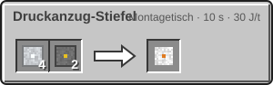 | 4 × [Aluminiumplatte](Presse.md), 2 × [Kunststoff](Raffinerie.md) → 1 × [Druckanzug-Stiefel](Der-Druckanzug.md) | Montagetisch | 200 t (10 s) 30 J/t |
| 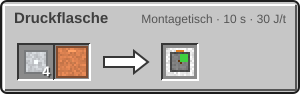 | 4 × [Aluminiumplatte](Presse.md), 1 × [Kupferrohr](Fluide-und-Rohre.md) → 1 × [Druckflasche](Sauerstoff-speichern.md) | Montagetisch | 200 t (10 s) 30 J/t |
| 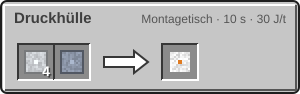 | 4 × [Aluminiumplatte](Presse.md), 1 × [Titanplatte](Presse.md) → 1 × [Druckhülle](Sauerstoffgenerator.md) | Montagetisch | 200 t (10 s) 30 J/t |
| 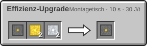 | 1 × Schaltkreis, 2 × [Golddraht](Presse.md), 2 × [Aluminiumplatte](Presse.md) → 1 × [Effizienz-Upgrade](Upgrades.md) | Montagetisch | 200 t (10 s) 30 J/t |
| 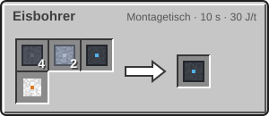 | 4 × [Wolframplatte](Die-Rakete-T2.md), 2 × [Titanstange](Presse.md), 1 × [Lithium-Akku](Lithium.md), 1 × [Fortgeschrittener Schaltkreis](Der-Hochtemperaturofen.md) → 1 × [Eisbohrer](Europa.md) | Montagetisch | 200 t (10 s) 30 J/t |
| 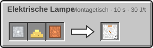 | 1 × [Aluminiumplatte](Presse.md), 1 × Glowstonestaub, 1 × [Kupferdraht](Presse.md) → 4 × [Elektrische Lampe](Leben-ohne-Luft.md) | Montagetisch | 200 t (10 s) 30 J/t |
| 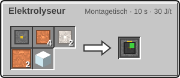 | 1 × [Maschinenrahmen](Erste-Schritte.md), 4 × [Kupferdraht](Presse.md), 2 × [Eisenplatte](Presse.md), 2 × [Kupferrohr](Fluide-und-Rohre.md), 1 × Glas → 1 × [Elektrolyseur](Elektrolyseur.md) | Montagetisch | 200 t (10 s) 30 J/t |
| 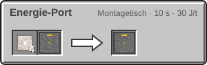 | 4 × [Eisenplatte](Presse.md), 1 × [Kupferkabel](Strom.md) → 1 × [Energie-Port](Raffinerie.md) | Montagetisch | 200 t (10 s) 30 J/t |
| 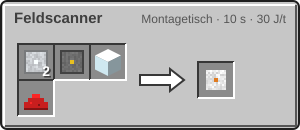 | 2 × [Aluminiumplatte](Presse.md), 1 × Schaltkreis, 1 × Glas, 1 × Redstone-Staub → 1 × [Feldscanner](Kreaturen-des-inneren-Sonnensystems.md) | Montagetisch | 200 t (10 s) 30 J/t |
| 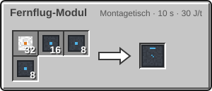 | 32 × [Leichtbau-Platte](Der-Hochtemperaturofen.md), 16 × [Supraleiterdraht](Fertigung-im-Orbit.md), 8 × [Iridium-Chip](Der-Asteroidenguertel.md), 8 × [Lithium-Akku](Lithium.md) → 1 × [Fernflug-Modul](Fernflug-und-Jetpack.md) | Montagetisch | 200 t (10 s) 30 J/t |
| 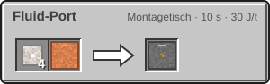 | 4 × [Eisenplatte](Presse.md), 1 × [Kupferrohr](Fluide-und-Rohre.md) → 1 × [Fluid-Port](Raffinerie.md) | Montagetisch | 200 t (10 s) 30 J/t |
| 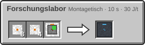 | 8 × [Leichtbau-Platte](Der-Hochtemperaturofen.md), 4 × [Fortgeschrittener Schaltkreis](Der-Hochtemperaturofen.md), 1 × [Analysator](Forschung.md) → 1 × [Forschungslabor](Stationsmodule.md) | Montagetisch | 200 t (10 s) 30 J/t |
| 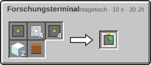 | 1 × [Maschinenrahmen](Erste-Schritte.md), 4 × [Aluminiumplatte](Presse.md), 4 × Schaltkreis, 2 × Glas, 1 × Buch → 1 × [Forschungsterminal](Forschung.md) | Montagetisch | 200 t (10 s) 30 J/t |
| 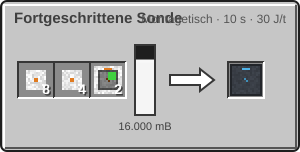 | 8 × [Leichtbau-Platte](Der-Hochtemperaturofen.md), 4 × [Fortgeschrittener Schaltkreis](Der-Hochtemperaturofen.md), 2 × [Solarpanel](Strom-im-All.md), 16.000 mB [Wasserstoff](Elektrolyseur.md) → 1 × [Fortgeschrittene Sonde](Erste-Schritte-im-aeusseren-System.md) | Montagetisch | 200 t (10 s) 30 J/t |
|  | 2 × Schaltkreis, 4 × [Golddraht](Presse.md), 2 × [Silizium](Elektroofen.md) → 1 × [Fortgeschrittener Schaltkreis](Der-Hochtemperaturofen.md) | Montagetisch | 200 t (10 s) 30 J/t |
| 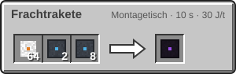 | 64 × [Leichtbau-Platte](Der-Hochtemperaturofen.md), 2 × [Iridium-Chip](Der-Asteroidenguertel.md), 8 × [Lithium-Akku](Lithium.md) → 1 × [Frachtrakete](Frachtraketen-und-Antriebe.md) | Montagetisch | 200 t (10 s) 30 J/t |
| 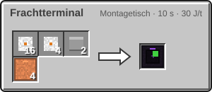 | 16 × [Leichtbau-Platte](Der-Hochtemperaturofen.md), 4 × [Fortgeschrittener Schaltkreis](Der-Hochtemperaturofen.md), 2 × Truhe, 4 × [Kupferrohr](Fluide-und-Rohre.md) → 1 × [Frachtterminal](Aussenposten-und-Frachtterminal.md) | Montagetisch | 200 t (10 s) 30 J/t |
| 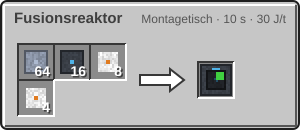 | 64 × [Titanplatte](Presse.md), 16 × [Supraleiterdraht](Fertigung-im-Orbit.md), 8 × [Kühlsystem](Helium-und-Kryotechnik.md), 4 × [Fortgeschrittener Schaltkreis](Der-Hochtemperaturofen.md) → 1 × [Fusionsreaktor](Der-Fusionsreaktor.md) | Montagetisch | 200 t (10 s) 30 J/t |
| 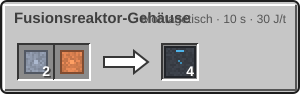 | 2 × [Titanplatte](Presse.md), 1 × [Kupferdraht](Presse.md) → 4 × [Fusionsreaktor-Gehäuse](Der-Fusionsreaktor.md) | Montagetisch | 200 t (10 s) 30 J/t |
| 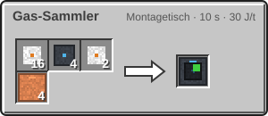 | 16 × [Leichtbau-Platte](Der-Hochtemperaturofen.md), 4 × [Supraleiterdraht](Fertigung-im-Orbit.md), 2 × [Fortgeschrittener Schaltkreis](Der-Hochtemperaturofen.md), 4 × [Kupferrohr](Fluide-und-Rohre.md) → 1 × [Gas-Sammler](Jupiter-Orbit-und-Gas-Sammler.md) | Montagetisch | 200 t (10 s) 30 J/t |
|  | 8 × [Aluminiumplatte](Presse.md), 2 × [Druckhülle](Sauerstoffgenerator.md) → 1 × [Gastank](Helium-und-Kryotechnik.md) | Montagetisch | 200 t (10 s) 30 J/t |
| 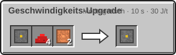 | 1 × Schaltkreis, 4 × Redstone-Staub, 2 × [Kupferdraht](Presse.md) → 1 × [Geschwindigkeits-Upgrade](Upgrades.md) | Montagetisch | 200 t (10 s) 30 J/t |
| 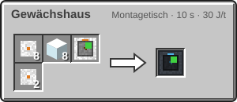 | 8 × [Leichtbau-Platte](Der-Hochtemperaturofen.md), 8 × Glas, 1 × [Hydrokultur-Becken](Hydrokultur-und-Kompost.md), 2 × [Fortgeschrittener Schaltkreis](Der-Hochtemperaturofen.md) → 1 × [Gewächshaus](Stationsmodule.md) | Montagetisch | 200 t (10 s) 30 J/t |
|  | 2 × [Sauerstoffflasche](Sauerstoff-speichern.md), 1 × [Titanplatte](Presse.md) → 1 × [Große Sauerstoffflasche](Sauerstoff-speichern.md) | Montagetisch | 200 t (10 s) 30 J/t |
|  | 4 × [Leichtbau-Platte](Der-Hochtemperaturofen.md), 1 × Truhe, 2 × [Fortgeschrittener Schaltkreis](Der-Hochtemperaturofen.md) → 1 × [Handelsposten](Handelsposten.md) | Montagetisch | 200 t (10 s) 30 J/t |
| 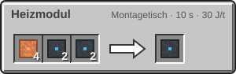 | 4 × [Kupferdraht](Presse.md), 2 × [Lithium-Akku](Lithium.md), 2 × [Isoliergewebe](Triton.md) → 1 × [Heizmodul](Der-Tiefraumanzug.md) | Montagetisch | 200 t (10 s) 30 J/t |
| 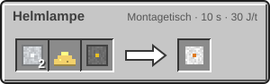 | 2 × [Aluminiumplatte](Presse.md), 1 × Glowstonestaub, 1 × Schaltkreis → 1 × [Helmlampe](Der-Druckanzug.md) | Montagetisch | 200 t (10 s) 30 J/t |
| 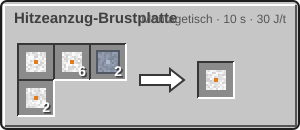 | 1 × [Druckanzug-Brustplatte](Der-Druckanzug.md), 6 × [Keramikplatte](Der-Hochtemperaturofen.md), 2 × [Titanplatte](Presse.md), 2 × [Kühlsystem](Helium-und-Kryotechnik.md) → 1 × [Hitzeanzug-Brustplatte](Der-Hitzeanzug.md) | Montagetisch | 200 t (10 s) 30 J/t |
|  | 1 × [Druckanzug-Helm](Der-Druckanzug.md), 3 × [Keramikplatte](Der-Hochtemperaturofen.md), 2 × [Titanplatte](Presse.md) → 1 × [Hitzeanzug-Helm](Der-Hitzeanzug.md) | Montagetisch | 200 t (10 s) 30 J/t |
|  | 1 × [Druckanzug-Hose](Der-Druckanzug.md), 4 × [Keramikplatte](Der-Hochtemperaturofen.md), 2 × [Titanplatte](Presse.md) → 1 × [Hitzeanzug-Hose](Der-Hitzeanzug.md) | Montagetisch | 200 t (10 s) 30 J/t |
|  | 1 × [Druckanzug-Stiefel](Der-Druckanzug.md), 3 × [Keramikplatte](Der-Hochtemperaturofen.md), 2 × [Titanplatte](Presse.md) → 1 × [Hitzeanzug-Stiefel](Der-Hitzeanzug.md) | Montagetisch | 200 t (10 s) 30 J/t |
| 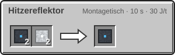 | 2 × [Spiegelpanzer](Der-Merkur.md), 2 × [Aluminiumplatte](Presse.md) → 1 × [Hitzereflektor](Der-Merkur.md) | Montagetisch | 200 t (10 s) 30 J/t |
| 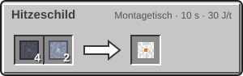 | 4 × [Wolframplatte](Die-Rakete-T2.md), 2 × [Titanplatte](Presse.md) → 1 × [Hitzeschild](Die-Rakete-T2.md) | Montagetisch | 200 t (10 s) 30 J/t |
| 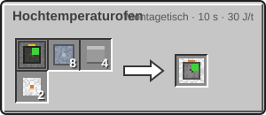 | 1 × [Elektroofen](Elektroofen.md), 8 × [Titanplatte](Presse.md), 4 × Ziegel, 2 × [Fortgeschrittener Schaltkreis](Der-Hochtemperaturofen.md) → 1 × [Hochtemperaturofen](Der-Hochtemperaturofen.md) | Montagetisch | 200 t (10 s) 30 J/t |
| 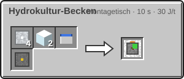 | 4 × [Aluminiumplatte](Presse.md), 2 × Glas, 1 × Wassereimer, 1 × Schaltkreis → 1 × [Hydrokultur-Becken](Hydrokultur-und-Kompost.md) | Montagetisch | 200 t (10 s) 30 J/t |
| 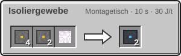 | 4 × [Kunststoff](Raffinerie.md), 2 × [Silizium](Elektroofen.md), 1 × [Lithiumbarren](Lithium.md) → 2 × [Isoliergewebe](Triton.md) | Montagetisch | 200 t (10 s) 30 J/t |
| 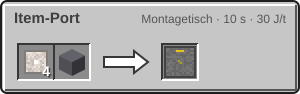 | 4 × [Eisenplatte](Presse.md), 1 × Trichter → 1 × [Item-Port](Raffinerie.md) | Montagetisch | 200 t (10 s) 30 J/t |
| 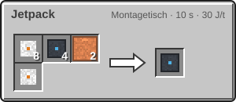 | 8 × [Leichtbau-Platte](Der-Hochtemperaturofen.md), 4 × [Lithium-Akku](Lithium.md), 2 × [Kupferrohr](Fluide-und-Rohre.md), 1 × [Fortgeschrittener Schaltkreis](Der-Hochtemperaturofen.md) → 1 × [Jetpack](Fernflug-und-Jetpack.md) | Montagetisch | 200 t (10 s) 30 J/t |
| 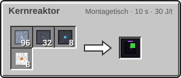 | 96 × [Titanplatte](Presse.md), 32 × [Wolframplatte](Die-Rakete-T2.md), 8 × [Iridium-Chip](Der-Asteroidenguertel.md), 8 × [Kühlsystem](Helium-und-Kryotechnik.md) → 1 × [Kernreaktor](Der-Kernreaktor.md) | Montagetisch | 200 t (10 s) 30 J/t |
| 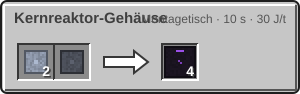 | 2 × [Titanplatte](Presse.md), 1 × [Wolframplatte](Die-Rakete-T2.md) → 4 × [Kernreaktor-Gehäuse](Der-Kernreaktor.md) | Montagetisch | 200 t (10 s) 30 J/t |
| 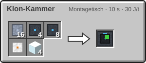 | 16 × [Titanplatte](Presse.md), 4 × [Iridium-Chip](Der-Asteroidenguertel.md), 8 × [Mikrobenkultur](Europa.md), 1 × [Druckhülle](Sauerstoffgenerator.md), 4 × Glas → 1 × [Klon-Kammer](Die-Klon-Kammer.md) | Montagetisch | 200 t (10 s) 30 J/t |
|  | 8 × Pflanzenreste → 1 × [Kompost](Hydrokultur-und-Kompost.md) | Montagetisch | 200 t (10 s) 30 J/t |
|  | 4 × [Mond-Regolith](Der-Mond.md) oder [Marssand](Der-Mars.md), 2 × Knochenmehl, 1 × [Gips](Der-Mars.md) → 4 × [Kompost-Boden](Hydrokultur-und-Kompost.md) | Montagetisch | 200 t (10 s) 30 J/t |
|  | 4 × [Mond-Regolith](Der-Mond.md) oder [Marssand](Der-Mars.md), 2 × Knochenmehl, 2 × [Kompost](Hydrokultur-und-Kompost.md) → 4 × [Kompost-Boden](Hydrokultur-und-Kompost.md) | Montagetisch | 200 t (10 s) 30 J/t |
| 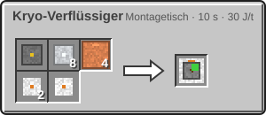 | 1 × [Maschinenrahmen](Erste-Schritte.md), 8 × [Aluminiumplatte](Presse.md), 4 × [Kupferrohr](Fluide-und-Rohre.md), 2 × [Fortgeschrittener Schaltkreis](Der-Hochtemperaturofen.md), 1 × [Druckhülle](Sauerstoffgenerator.md) → 1 × [Kryo-Verflüssiger](Helium-und-Kryotechnik.md) | Montagetisch | 200 t (10 s) 30 J/t |
|  | 4 × [Aluminiumplatte](Presse.md), 2 × [Fortgeschrittener Schaltkreis](Der-Hochtemperaturofen.md), 2 × [Kupferrohr](Fluide-und-Rohre.md) → 1 × [Kuppel-Effizienzmodul](Die-Kuppel.md) | Montagetisch | 200 t (10 s) 30 J/t |
|  | 4 × [Aluminiumplatte](Presse.md), 2 × [Fortgeschrittener Schaltkreis](Der-Hochtemperaturofen.md) → 1 × [Kuppel-Reichweitenmodul](Die-Kuppel.md) | Montagetisch | 200 t (10 s) 30 J/t |
|  | 8 × [Titanplatte](Presse.md), 2 × [Fortgeschrittener Schaltkreis](Der-Hochtemperaturofen.md) → 1 × [Kuppel-Schildmodul](Die-Kuppel.md) | Montagetisch | 200 t (10 s) 30 J/t |
|  | 16 × [Aluminiumplatte](Presse.md), 8 × [Titanplatte](Presse.md), 4 × Schaltkreis, 4 × Glas → 1 × [Kuppelgenerator I](Die-Kuppel.md) | Montagetisch | 200 t (10 s) 30 J/t |
|  | 1 × [Kuppelgenerator I](Die-Kuppel.md), 16 × [Leichtbau-Platte](Der-Hochtemperaturofen.md), 4 × [Kühlsystem](Helium-und-Kryotechnik.md), 4 × [Fortgeschrittener Schaltkreis](Der-Hochtemperaturofen.md) → 1 × [Kuppelgenerator II](Die-Kuppel.md) | Montagetisch | 200 t (10 s) 30 J/t |
|  | 1 × [Kuppelgenerator II](Die-Kuppel.md), 16 × [Supraleiterdraht](Fertigung-im-Orbit.md), 16 × [Wolframplatte](Die-Rakete-T2.md), 4 × [Iridium-Chip](Der-Asteroidenguertel.md) → 1 × [Kuppelgenerator III](Die-Kuppel.md) | Montagetisch | 200 t (10 s) 30 J/t |
|  | 4 × [Kupferrohr](Fluide-und-Rohre.md), 1 × [Kühlsystem](Helium-und-Kryotechnik.md) → 1 × [Kühlmodul](Der-Hitzeanzug.md) | Montagetisch | 200 t (10 s) 30 J/t |
|  | 4 × [Kupferrohr](Fluide-und-Rohre.md), 2 × [Hitzeschuppe](Io.md) → 1 × [Kühlmodul](Der-Hitzeanzug.md) | Montagetisch | 200 t (10 s) 30 J/t |
|  | 4 × [Kupferrohr](Fluide-und-Rohre.md), 1 × [Druckhülle](Sauerstoffgenerator.md), 1.000 mB [Flüssiges Helium](Helium-und-Kryotechnik.md) → 1 × [Kühlsystem](Helium-und-Kryotechnik.md) | Montagetisch | 200 t (10 s) 30 J/t |
|  | 2 × [Aluminiumplatte](Presse.md), 1 × Schaltkreis, 1 × Redstone-Lampe → 1 × [Landefeuer](Das-Landefeuer.md) | Montagetisch | 200 t (10 s) 30 J/t |
|  | 32 × [Leichtbau-Platte](Der-Hochtemperaturofen.md), 8 × [Hitzeschild](Die-Rakete-T2.md), 8 × [Fortgeschrittener Schaltkreis](Der-Hochtemperaturofen.md), 2 × [Kühlsystem](Helium-und-Kryotechnik.md) → 1 × [Landefähre](Die-Landefaehre.md) | Montagetisch | 200 t (10 s) 30 J/t |
|  | 4 × [Lithiumbarren](Lithium.md), 2 × [Aluminiumplatte](Presse.md), 1 × [Nickelplatte](Der-Hitzeanzug.md), 1 × Schaltkreis → 1 × [Lithium-Akku](Lithium.md) | Montagetisch | 200 t (10 s) 30 J/t |
|  | 1 × [Maschinenrahmen](Erste-Schritte.md), 8 × [Lithium-Akku](Lithium.md) → 1 × [Lithium-Akkubank](Lithium.md) | Montagetisch | 200 t (10 s) 30 J/t |
|  | 1 × [Maschinenrahmen](Erste-Schritte.md), 4 × [Iridium-Chip](Der-Asteroidenguertel.md), 8 × [Fortgeschrittener Schaltkreis](Der-Hochtemperaturofen.md), 4 × Glas → 1 × [Logistik-Computer](Logistik-Computer.md) | Montagetisch | 200 t (10 s) 30 J/t |
|  | 16 × [Supraleiterdraht](Fertigung-im-Orbit.md), 8 × [Wolframplatte](Die-Rakete-T2.md), 4 × [Iridium-Chip](Der-Asteroidenguertel.md), 2 × [Kühlsystem](Helium-und-Kryotechnik.md) → 1 × [Magnetfalle](Magnetfalle-und-Antimaterie.md) | Montagetisch | 200 t (10 s) 30 J/t |
|  | 4 × [Eisenplatte](Presse.md), 2 × [Nickelplatte](Der-Hitzeanzug.md), 1 × Schaltkreis → 1 × [Magnetstiefel](Der-Orbit.md) | Montagetisch | 200 t (10 s) 30 J/t |
|  | 1 × [Maschinenrahmen](Erste-Schritte.md), 2 × [Aluminiumplatte](Presse.md), 1 × Kolben, 1 × Schaltkreis → 1 × [Nahrungspacker](Weltraumnahrung.md) | Montagetisch | 200 t (10 s) 30 J/t |
|  | 2 × [Panzerplatte](Kreaturen-des-inneren-Sonnensystems.md), 1 × [Titanplatte](Presse.md) → 1 × [Panzerung](Der-Hitzeanzug.md) | Montagetisch | 200 t (10 s) 30 J/t |
|  | 2 × [Läuferbein](Titan.md), 2 × [Kunststoff](Raffinerie.md) → 4 × [Ponton](Bohrturm-und-Pumpstation.md) | Montagetisch | 200 t (10 s) 30 J/t |
|  | 2 × [Titanstange](Presse.md), 1 × [Eisenplatte](Presse.md) → 1 × [Probenzange](Forschung.md) | Montagetisch | 200 t (10 s) 30 J/t |
|  | 1 × [Maschinenrahmen](Erste-Schritte.md), 1 × [Pumpe](Fluide-und-Rohre.md), 8 × [Titanplatte](Presse.md), 2 × [Fortgeschrittener Schaltkreis](Der-Hochtemperaturofen.md) → 1 × [Pumpstation](Bohrturm-und-Pumpstation.md) | Montagetisch | 200 t (10 s) 30 J/t |
|  | 1 × [Maschinenrahmen](Erste-Schritte.md), 16 × [Eisenplatte](Presse.md), 8 × [Kupferrohr](Fluide-und-Rohre.md), 4 × Redstone-Staub → 1 × [Raffinerie](Raffinerie.md) | Montagetisch | 200 t (10 s) 30 J/t |
|  | 2 × [Eisenplatte](Presse.md), 1 × [Kupferrohr](Fluide-und-Rohre.md) → 4 × [Raffinerie-Gehäuse](Raffinerie.md) | Montagetisch | 200 t (10 s) 30 J/t |
|  | 16 × [Aluminiumplatte](Presse.md), 2 × [Titanplatte](Presse.md), 1 × Truhe → 1 × [Raketen-Frachtraum](Die-Rakete.md) | Montagetisch | 200 t (10 s) 30 J/t |
|  | 8 × [Aluminiumplatte](Presse.md) → 1 × [Raketenflosse T1](Die-Rakete.md) | Montagetisch | 200 t (10 s) 30 J/t |
|  | 3 × [Leichtbau-Platte](Der-Hochtemperaturofen.md) → 1 × [Raketenflosse T2](Die-Rakete-T2.md) | Montagetisch | 200 t (10 s) 30 J/t |
|  | 40 × [Aluminiumplatte](Presse.md), 16 × [Titanplatte](Presse.md), 16 × Schaltkreis → 1 × [Raketenkapsel T1](Die-Rakete.md) | Montagetisch | 200 t (10 s) 30 J/t |
|  | 32 × [Leichtbau-Platte](Der-Hochtemperaturofen.md), 16 × [Hitzeschild](Die-Rakete-T2.md), 16 × [Fortgeschrittener Schaltkreis](Der-Hochtemperaturofen.md) → 1 × [Raketenkapsel T2](Die-Rakete-T2.md) | Montagetisch | 200 t (10 s) 30 J/t |
|  | 30 × [Aluminiumplatte](Presse.md), 4 × [Titanplatte](Presse.md), 2 × Schaltkreis → 1 × [Raketentank T1](Die-Rakete.md) | Montagetisch | 200 t (10 s) 30 J/t |
|  | 12 × [Leichtbau-Platte](Der-Hochtemperaturofen.md), 4 × [Hitzeschild](Die-Rakete-T2.md) → 1 × [Raketentank T2](Die-Rakete-T2.md) | Montagetisch | 200 t (10 s) 30 J/t |
|  | 8 × [Aluminiumplatte](Presse.md), 32 × [Titanplatte](Presse.md), 8 × Schaltkreis → 1 × [Raketentriebwerk T1](Die-Rakete.md) | Montagetisch | 200 t (10 s) 30 J/t |
|  | 16 × [Leichtbau-Platte](Der-Hochtemperaturofen.md), 24 × [Hitzeschild](Die-Rakete-T2.md), 16 × [Fortgeschrittener Schaltkreis](Der-Hochtemperaturofen.md), 4 × [Kühlsystem](Helium-und-Kryotechnik.md) → 1 × [Raketentriebwerk T2](Die-Rakete-T2.md) | Montagetisch | 200 t (10 s) 30 J/t |
|  | 1 × [Maschinenrahmen](Erste-Schritte.md), 8 × [Aluminiumplatte](Presse.md), 4 × [Kupferdraht](Presse.md), 2 × Schaltkreis, 1 × [Druckflasche](Sauerstoff-speichern.md) → 1 × [Regolith-Erhitzer](Helium-und-Kryotechnik.md) | Montagetisch | 200 t (10 s) 30 J/t |
|  | 16 × [Aluminiumplatte](Presse.md), 1 × Truhe → 1 × [Rover-Anhänger](Der-Rover.md) | Montagetisch | 200 t (10 s) 30 J/t |
|  | 32 × [Aluminiumplatte](Presse.md), 16 × [Titanplatte](Presse.md), 4 × Schaltkreis, 4 × [Solarpanel](Strom-im-All.md), 1 × [Akku](Strom.md) → 1 × [Rover-Bausatz](Der-Rover.md) | Montagetisch | 200 t (10 s) 30 J/t |
|  | 4 × [Titanplatte](Presse.md), 2 × [Titanstange](Presse.md), 1 × Diamant → 1 × [Rover-Bohrer](Der-Rover.md) | Montagetisch | 200 t (10 s) 30 J/t |
|  | 8 × [Aluminiumplatte](Presse.md), 4 × Glas, 2 × [Sauerstoffflasche](Sauerstoff-speichern.md), 1 × [Druckhülle](Sauerstoffgenerator.md) → 1 × [Rover-Druckkabine](Der-Rover.md) | Montagetisch | 200 t (10 s) 30 J/t |
|  | 4 × [Lithium-Akku](Lithium.md), 2 × [Aluminiumplatte](Presse.md) → 1 × [Rover-Lithiumpaket](Lithium.md) | Montagetisch | 200 t (10 s) 30 J/t |
|  | 4 × [Aluminiumplatte](Presse.md), 2 × [Fortgeschrittener Schaltkreis](Der-Hochtemperaturofen.md), 1 × Glas → 1 × [Rover-Scanner](Der-Rover.md) | Montagetisch | 200 t (10 s) 30 J/t |
|  | 2 × [Aluminiumplatte](Presse.md), 2 × Glowstonestaub → 1 × [Rover-Scheinwerfer](Der-Rover.md) | Montagetisch | 200 t (10 s) 30 J/t |
|  | 2 × [Aluminiumplatte](Presse.md), 1 × [Kupferrohr](Fluide-und-Rohre.md) → 1 × [Sauerstoffflasche](Sauerstoff-speichern.md) | Montagetisch | 200 t (10 s) 30 J/t |
|  | 8 × [Aluminiumplatte](Presse.md), 4 × [Kupferrohr](Fluide-und-Rohre.md), 2 × Schaltkreis, 1 × [Druckhülle](Sauerstoffgenerator.md) → 1 × [Sauerstoffgenerator](Sauerstoffgenerator.md) | Montagetisch | 200 t (10 s) 30 J/t |
|  | 2 × [Silizium](Elektroofen.md), 4 × [Kupferdraht](Presse.md), 1 × [Kunststoff](Raffinerie.md) → 1 × Schaltkreis | Montagetisch | 200 t (10 s) 30 J/t |
|  | 16 × [Leichtbau-Platte](Der-Hochtemperaturofen.md), 4 × [Fortgeschrittener Schaltkreis](Der-Hochtemperaturofen.md), 2 × [Kühlsystem](Helium-und-Kryotechnik.md), 1 × Montagetisch → 1 × [Schwerelos-Fertigung](Fertigung-im-Orbit.md) | Montagetisch | 200 t (10 s) 30 J/t |
|  | 2 × [Leichtbau-Platte](Der-Hochtemperaturofen.md), 2 × [Supraleiterdraht](Fertigung-im-Orbit.md), 1 × [Fortgeschrittener Schaltkreis](Der-Hochtemperaturofen.md) → 1 × [Schwerkraftplatte](Der-Fusionsreaktor.md) | Montagetisch | 200 t (10 s) 30 J/t |
|  | 2 × [Frachtrakete](Frachtraketen-und-Antriebe.md), 1 × [Atomantrieb](Frachtraketen-und-Antriebe.md) → 1 × [Schwerlast-Frachter](Frachtraketen-und-Antriebe.md) | Montagetisch | 200 t (10 s) 30 J/t |
|  | 2 × [Solarpanel](Strom-im-All.md), 1 × [Leichtbau-Platte](Der-Hochtemperaturofen.md) → 1 × [Solarflügel](Stationsmodule.md) | Montagetisch | 200 t (10 s) 30 J/t |
|  | 4 × [Silizium](Elektroofen.md), 2 × [Aluminiumplatte](Presse.md), 4 × [Kupferdraht](Presse.md), 1 × Glas → 1 × [Solarpanel](Strom-im-All.md) | Montagetisch | 200 t (10 s) 30 J/t |
|  | 8 × [Aluminiumplatte](Presse.md), 2 × Schaltkreis, 1 × [Solarpanel](Strom-im-All.md), 16.000 mB [Kerosin](Raffinerie.md) → 1 × [Sonde](Startrampe-und-Sonde.md) | Montagetisch | 200 t (10 s) 30 J/t |
|  | 1 × [Maschinenrahmen](Erste-Schritte.md), 4 × Schaltkreis, 4 × [Aluminiumplatte](Presse.md), 2 × Glas → 1 × [Startkontrolle](Startrampe-und-Sonde.md) | Montagetisch | 200 t (10 s) 30 J/t |
|  | 2 × [Eisenplatte](Presse.md), 1 × [Titanplatte](Presse.md) → 2 × [Startrampe](Startrampe-und-Sonde.md) | Montagetisch | 200 t (10 s) 30 J/t |
|  | 4 × [Eisenstange](Presse.md), 1 × [Eisenplatte](Presse.md) → 2 × [Startturm](Startrampe-und-Sonde.md) | Montagetisch | 200 t (10 s) 30 J/t |
|  | 1 × [Leichtbau-Platte](Der-Hochtemperaturofen.md), 2 × Glas → 2 × [Stationsfenster](Die-Raumstation.md) | Montagetisch | 200 t (10 s) 30 J/t |
|  | 2 × [Leichtbau-Platte](Der-Hochtemperaturofen.md) → 4 × [Stationshülle](Die-Raumstation.md) | Montagetisch | 200 t (10 s) 30 J/t |
|  | 32 × [Leichtbau-Platte](Der-Hochtemperaturofen.md), 8 × [Fortgeschrittener Schaltkreis](Der-Hochtemperaturofen.md), 4 × [Solarpanel](Strom-im-All.md), 1 × [Kuppelgenerator I](Die-Kuppel.md) → 1 × [Stationskern](Die-Raumstation.md) | Montagetisch | 200 t (10 s) 30 J/t |
|  | 8 × [Wolframplatte](Die-Rakete-T2.md), 1 × [Kunststoff](Raffinerie.md) → 1 × [Strahlenschild](Der-Merkur.md) | Montagetisch | 200 t (10 s) 30 J/t |
|  | 1 × [Supraleiterdraht](Fertigung-im-Orbit.md), 2 × [Kunststoff](Raffinerie.md) → 4 × [Supraleiterkabel](Der-Fusionsreaktor.md) | Montagetisch | 200 t (10 s) 30 J/t |
|  | 8 × [Leichtbau-Platte](Der-Hochtemperaturofen.md), 4 × [Kupferrohr](Fluide-und-Rohre.md), 1 × [Druckhülle](Sauerstoffgenerator.md) → 1 × [Tankdepot](Stationsmodule.md) | Montagetisch | 200 t (10 s) 30 J/t |
|  | 4 × [Leichtbau-Platte](Der-Hochtemperaturofen.md), 2 × Glas, 1 × [Sauerstoffflasche](Sauerstoff-speichern.md) → 1 × [Tauchmodul](Europa.md) | Montagetisch | 200 t (10 s) 30 J/t |
|  | 1 × [Hitzeanzug-Brustplatte](Der-Hitzeanzug.md), 2 × [Supraleiterdraht](Fertigung-im-Orbit.md), 4 × [Lithium-Akku](Lithium.md), 2 × [Isoliergewebe](Triton.md) → 1 × [Tiefraumanzug-Brustplatte](Der-Tiefraumanzug.md) | Montagetisch | 200 t (10 s) 30 J/t |
|  | 1 × [Hitzeanzug-Helm](Der-Hitzeanzug.md), 2 × [Supraleiterdraht](Fertigung-im-Orbit.md), 2 × [Isoliergewebe](Triton.md) → 1 × [Tiefraumanzug-Helm](Der-Tiefraumanzug.md) | Montagetisch | 200 t (10 s) 30 J/t |
|  | 1 × [Hitzeanzug-Hose](Der-Hitzeanzug.md), 2 × [Supraleiterdraht](Fertigung-im-Orbit.md), 2 × [Isoliergewebe](Triton.md) → 1 × [Tiefraumanzug-Hose](Der-Tiefraumanzug.md) | Montagetisch | 200 t (10 s) 30 J/t |
|  | 1 × [Hitzeanzug-Stiefel](Der-Hitzeanzug.md), 2 × [Supraleiterdraht](Fertigung-im-Orbit.md), 2 × [Isoliergewebe](Triton.md) → 1 × [Tiefraumanzug-Stiefel](Der-Tiefraumanzug.md) | Montagetisch | 200 t (10 s) 30 J/t |
|  | 3 × [Titanplatte](Presse.md), 1 × Glas → 4 × [Titanrohr](Der-Hochtemperaturofen.md) | Montagetisch | 200 t (10 s) 30 J/t |
|  | 4 × [Aluminiumplatte](Presse.md), 1 × [Druckhülle](Sauerstoffgenerator.md) → 1 × [Transporttank](Sauerstoff-speichern.md) | Montagetisch | 200 t (10 s) 30 J/t |
|  | 1 × [Maschinenrahmen](Erste-Schritte.md), 1 × [Verbrennungsgenerator](Strom.md), 4 × [Kupferrohr](Fluide-und-Rohre.md), 4 × [Eisenplatte](Presse.md) → 1 × [Treibstoffgenerator](Strom.md) | Montagetisch | 200 t (10 s) 30 J/t |
|  | 1 × [Maschinenrahmen](Erste-Schritte.md), 4 × [Kupferrohr](Fluide-und-Rohre.md), 2 × [Aluminiumplatte](Presse.md), 1 × Schaltkreis → 1 × [Treibstoffpumpe](Startrampe-und-Sonde.md) | Montagetisch | 200 t (10 s) 30 J/t |
|  | 8 × [Aluminiumplatte](Presse.md), 4 × [Fortgeschrittener Schaltkreis](Der-Hochtemperaturofen.md), 1 × [Solarpanel](Strom-im-All.md) → 1 × [Weltraumwetter-Station](Weltraumwetter-Station.md) | Montagetisch | 200 t (10 s) 30 J/t |
|  | 32 × [Leichtbau-Platte](Der-Hochtemperaturofen.md), 4 × [Iridium-Chip](Der-Asteroidenguertel.md) → 1 × [Werft-Andockbucht](Orbitalwerft.md) | Montagetisch | 200 t (10 s) 30 J/t |
|  | 64 × [Leichtbau-Platte](Der-Hochtemperaturofen.md), 16 × [Iridium-Chip](Der-Asteroidenguertel.md), 8 × [Fortgeschrittener Schaltkreis](Der-Hochtemperaturofen.md) → 1 × [Werft-Terminal](Orbitalwerft.md) | Montagetisch | 200 t (10 s) 30 J/t |
|  | 8 × [Leichtbau-Platte](Der-Hochtemperaturofen.md), 1 × Bett, 1 × Truhe, 1 × [Fortgeschrittener Schaltkreis](Der-Hochtemperaturofen.md) → 1 × [Wohnmodul](Stationsmodule.md) | Montagetisch | 200 t (10 s) 30 J/t |
|  | 8 × [Aluminiumplatte](Presse.md), 4 × [Titanplatte](Presse.md), 2 × Schaltkreis, 1 × [Kunststoff](Raffinerie.md) → 1 × [Wolkenaufzug](Die-Venus.md) | Montagetisch | 200 t (10 s) 30 J/t |

> [!TIP]
> Wenn der Pfeil nicht losläuft, obwohl alles da zu sein scheint: Nimm alles heraus und lege die Zutaten in genau der Rezeptmenge wieder hinein.

---

_Diese Seite steht auch im Spiel im **Ingenieurs-Handbuch**._

← [Fluide und Rohre](Fluide-und-Rohre.md) · [Elektrolyseur](Elektrolyseur.md) →
