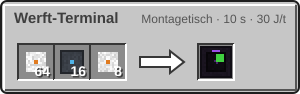
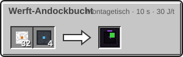

<!-- Erzeugt von tools/gen_wiki.py aus docs/handbook/ und spec/data. Nicht von Hand ändern. -->

[📖 Wiki](README.md) › Phase 6 · Netzwerk und Finale › **Orbitalwerft**

# Orbitalwerft

In der Orbitalwerft entsteht dein Sternenschiff. Sie braucht riesige Mengen an Material aus allen Ecken des Sonnensystems, deshalb belieferst du sie mit [Frachtraketen](Frachtraketen-und-Antriebe.md).

## Aufbau

1. Bau eine [Station](Die-Raumstation.md) im Erdorbit.
2. Stell das Werft-Terminal in die Station, höchstens 48 Blöcke vom Stationskern entfernt. An einem anderen Ort lässt es sich nicht setzen.
3. Stell mindestens eine Werft-Andockbucht in dieselbe Station. Sie ist das Landeziel deiner Frachtraketen.

> [!WARNING]
> Ohne Werft-Andockbucht in der Station kann die Werft nichts annehmen. Das Terminal zeigt dann einen roten Hinweis.

## Das Werftlager

Was an der Andockbucht ankommt, wandert sofort ins Werftlager. Das Lager ist unbegrenzt, nimmt aber nur an, was die Werft noch braucht. Alles andere bleibt in der Rakete und fliegt zurück. Auch Rohre und Trichter an der Andockbucht liefern ein.

- Methan füllt zuerst den Treibstofftank der Andockbucht. Daraus tanken deine Raketen für den Rückflug. Erst der Rest geht ins Werftlager.
- Für den Bordcomputer nimmt die Werft nur eine Sternenkarte deiner eigenen Agentur an.

> [!TIP]
> Leg am [Logistik-Computer](Logistik-Computer.md) Routen mit der Bedingung „bis der Bedarf gedeckt ist“ zur Andockbucht an. Die Raketen laden dann nur, was die Werft noch braucht, und hören von selbst auf.

## Die Bauabschnitte

Das Terminal zeigt alle acht Abschnitte mit Fortschrittsbalken. Fährst du mit der Maus über einen Balken, siehst du, was noch fehlt. Lieferungen nimmt die Werft für alle offenen Abschnitte an, die frühesten zuerst.

Ist ein Abschnitt voll beliefert, baut die Werft ihn in 48.000 t (2.400 s). Gebaut wird der Reihe nach, von 1 bis 8, und die Zeit läuft auch weiter, wenn du nicht in der Nähe bist. Mit jedem fertigen Abschnitt wächst das Gerüst über dem Terminal.

| Abschnitt | Wichtigste Materialien |
| --- | --- |
| 1 Rumpf | Leichtbau-, Titan- und Aluminiumplatten |
| 2 Schilde | Wolframplatten, Hitzeschilde |
| 3 Hauptantrieb | Antimaterie-Antriebe |
| 4 Energie | Kernreaktor, Lithium-Akkus, Brennstäbe |
| 5 Bordcomputer | Iridium-Chips, Platin, Sternenkarte |
| 6 Lebenserhaltung | Kuppelgenerator III, Sauerstoffgeneratoren, Gewächshaus, Klon-Kammer |
| 7 Kühlung | flüssiger Stickstoff, flüssiges Helium, Ammoniak |
| 8 Manövriertriebwerke | Methan, Wasserstoff, Schwefel |

## Herstellung

64 × [Leichtbau-Platte](Der-Hochtemperaturofen.md), 16 × [Iridium-Chip](Der-Asteroidenguertel.md), 8 × [Fortgeschrittener Schaltkreis](Der-Hochtemperaturofen.md) → 1 × Werft-Terminal

32 × [Leichtbau-Platte](Der-Hochtemperaturofen.md), 4 × [Iridium-Chip](Der-Asteroidenguertel.md) → 1 × Werft-Andockbucht

---

_Diese Seite steht auch im Spiel im **Ingenieurs-Handbuch**._

← [Logistik-Computer](Logistik-Computer.md)
