<!-- Erzeugt von tools/gen_wiki.py aus docs/handbook/ und spec/data. Nicht von Hand ändern. -->

[📖 Wiki](README.md) › Phase 1 · Erdindustrie › **Presse**

# Presse

Die Presse formt Barren um. Welche Form herauskommt, bestimmt die **Pressform** im Formslot. Die Form wird nicht verbraucht.

- Mit Pressform (Platte) wird aus 1 Barren 1 Platte.
- Mit Pressform (Stange) wird aus 1 Barren 2 Stangen.
- Mit Pressform (Draht) wird aus 1 Barren 3 Draht.

| Steckbrief: Presse |  |
| --- | --- |
| Verbrauch | 30 J/t |
| Dauer je Vorgang | 100 t (5 s) |
| Slots | 1 Eingabe, 1 Ausgabe |
| Upgrade-Slots | 2 |

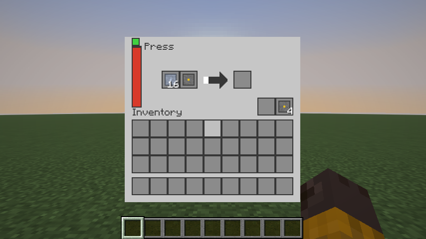

Das Fenster der Presse: Barren links, Pressform im Formslot daneben.

## Bauen

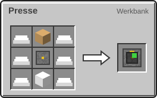

6 × Eisenbarren, 1 × [Maschinenrahmen](Erste-Schritte.md), 1 × Kolben, 1 × Eisenblock → 1 × Presse

## Die Pressformen

| Rezept | Zutaten → Ergebnis | Wo | Dauer |
| --- | --- | --- | --- |
| 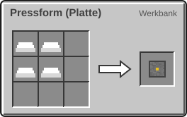 | 4 × Eisenbarren → 1 × Pressform (Platte) | Werkbank | – |
| 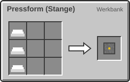 | 3 × Eisenbarren → 1 × Pressform (Stange) | Werkbank | – |
| 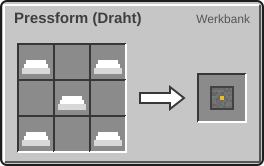 | 5 × Eisenbarren → 1 × Pressform (Draht) | Werkbank | – |

## Alle Pressrezepte

| Rezept | Zutaten → Ergebnis | Wo | Dauer |
| --- | --- | --- | --- |
| 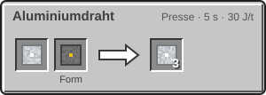 | 1 × [Aluminiumbarren](Elektroofen.md), Form: Pressform (Draht) → 3 × Aluminiumdraht | Presse | 100 t (5 s) 30 J/t |
| 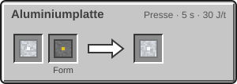 | 1 × [Aluminiumbarren](Elektroofen.md), Form: Pressform (Platte) → 1 × Aluminiumplatte | Presse | 100 t (5 s) 30 J/t |
| 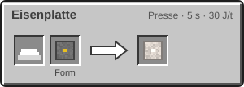 | 1 × Eisenbarren, Form: Pressform (Platte) → 1 × Eisenplatte | Presse | 100 t (5 s) 30 J/t |
| 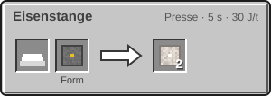 | 1 × Eisenbarren, Form: Pressform (Stange) → 2 × Eisenstange | Presse | 100 t (5 s) 30 J/t |
| 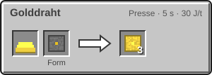 | 1 × Goldbarren, Form: Pressform (Draht) → 3 × Golddraht | Presse | 100 t (5 s) 30 J/t |
| 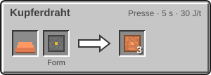 | 1 × Kupferbarren, Form: Pressform (Draht) → 3 × Kupferdraht | Presse | 100 t (5 s) 30 J/t |
| 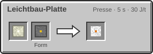 | 1 × [Magnesium-Legierung](Der-Hochtemperaturofen.md), Form: Pressform (Platte) → 1 × [Leichtbau-Platte](Der-Hochtemperaturofen.md) | Presse | 100 t (5 s) 30 J/t |
| 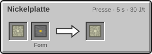 | 1 × [Nickelbarren](Der-Mars.md), Form: Pressform (Platte) → 1 × [Nickelplatte](Der-Hitzeanzug.md) | Presse | 100 t (5 s) 30 J/t |
| 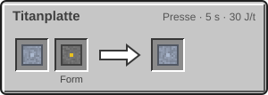 | 1 × [Titanbarren](Elektroofen.md), Form: Pressform (Platte) → 1 × Titanplatte | Presse | 100 t (5 s) 30 J/t |
| 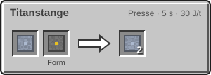 | 1 × [Titanbarren](Elektroofen.md), Form: Pressform (Stange) → 2 × Titanstange | Presse | 100 t (5 s) 30 J/t |
| 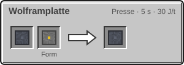 | 1 × [Wolframbarren](Der-Hochtemperaturofen.md), Form: Pressform (Platte) → 1 × [Wolframplatte](Die-Rakete-T2.md) | Presse | 100 t (5 s) 30 J/t |

> [!TIP]
> Bau mehrere Pressen und lass jede mit ihrer eigenen Form laufen. Dann musst du die Form nie wechseln. Vor allem Kupferdraht und Eisenplatte brauchst du in großen Mengen.

---

_Diese Seite steht auch im Spiel im **Ingenieurs-Handbuch**._

← [Elektroofen](Elektroofen.md) · [Fluide und Rohre](Fluide-und-Rohre.md) →
