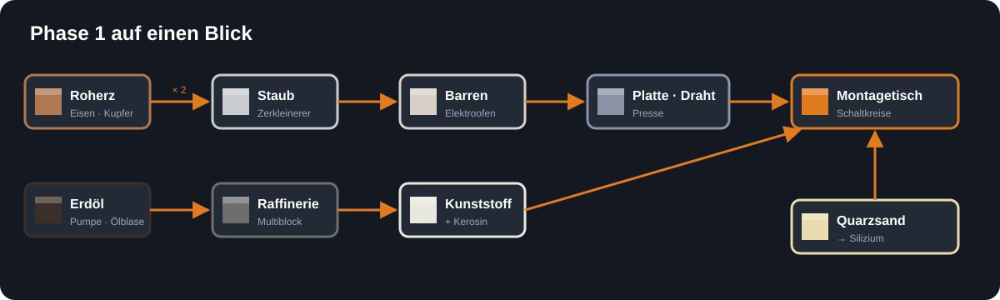

<!-- Erzeugt von tools/gen_wiki.py aus docs/handbook/ und spec/data. Nicht von Hand ändern. -->

# Infinite Horizon – Spieler-Wiki

## Neu hier? In vier Schritten zum Start

1. **[Willkommen bei Infinite Horizon](Willkommen-bei-Infinite Horizon.md)**: worum es in der Mod geht.
2. **[Installation](Installation.md)**: Mod einrichten und starten.
3. **[Grundbegriffe](Grundbegriffe.md)**: Strom, Fluide, Statuslampe, Multiblöcke, in fünf Minuten.
4. **[Erste Schritte](Erste-Schritte.md)**: der ganze Ablauf der ersten Phase, Schritt für Schritt mit allen Rezepten.

Alle Rezepte auf einen Blick stehen unter [Alle Rezepte](Alle-Rezepte.md), Hilfe bei Problemen unter [Tipps und häufige Fragen](Tipps-und-haeufige-Fragen.md).

Das Wiki zur Raumfahrt-Mod **Infinite Horizon**. Alle Inhalte stehen auch im Spiel im **Ingenieurs-Handbuch**; Rezepte und Werte kommen direkt aus den Daten der Mod und sind damit immer aktuell.

> Stand: Meilenstein 3b · Mod-Version 0.1.0

## Willkommen

- [Willkommen bei Infinite Horizon](Willkommen-bei-Infinite-Horizon.md) – Worum es geht und wie dieses Handbuch funktioniert
- [Installation](Installation.md) – Was du brauchst und wie du die Mod startest
- [Grundbegriffe](Grundbegriffe.md) – Strom, Ticks, Millibuckets, Statuslampe – alles in fünf Minuten
- [Maschinen bedienen](Maschinen-bedienen.md) – GUI, Statuslampe, Ausgangsseite, Trichter und Upgrades
- [Umwelt, Belastung und Schwerkraft](Umwelt-Belastung-und-Schwerkraft.md) – Was fremde Welten gefährlich macht und wie lange du durchhältst
- [Ausblick – was noch kommt](Ausblick-was-noch-kommt.md) – Die geplanten Phasen und Ziele (Entwicklungsstand)

## Phase 1 · Erdindustrie

- [Erste Schritte](Erste-Schritte.md) – Der ganze Ablauf der Erdindustrie, Schritt für Schritt
- [Rohstoffe und Erze](Rohstoffe-und-Erze.md) – Wo du Bauxit, Titan, Quarzsand und Erdöl findest
- [Strom](Strom.md) – Generatoren, Kabel und Akkus
- [Zerkleinerer](Zerkleinerer.md) – Aus einem Roherz werden zwei Staub
- [Elektroofen](Elektroofen.md) – Schmilzt mit Strom statt Kohle – und macht Silizium
- [Presse](Presse.md) – Platten, Stangen und Draht aus Barren
- [Fluide und Rohre](Fluide-und-Rohre.md) – Pumpe, Kupferrohr, Tank und Eimer
- [Montagetisch](Montagetisch.md) – Hier entstehen alle wichtigen Bauteile
- [Elektrolyseur](Elektrolyseur.md) – Wasser wird zu Wasserstoff und Sauerstoff
- [Raffinerie](Raffinerie.md) – Dein erster Multiblock: Erdöl wird zu Kerosin und Kunststoff
- [Upgrades](Upgrades.md) – Maschinen schneller oder sparsamer machen

## Nachschlagen

- [Alle Rezepte](Alle-Rezepte.md) – Jedes Rezept des aktuellen Stands, nach Maschine sortiert
- [Alle Items und Blöcke](Alle-Items-und-Bloecke.md) – Alles, was es gibt, und wo es herkommt
- [Deine Agentur](Deine-Agentur.md) – Agentur, Besitz von Maschinen und die Befehle dazu
- [Tipps und häufige Fragen](Tipps-und-haeufige-Fragen.md) – Kniffe, Fehlersuche und Antworten

---

_Dieses Wiki wird aus `docs/handbook/` erzeugt (`python tools/gen_wiki.py`). Änderungen bitte dort, nicht in diesem Ordner._
