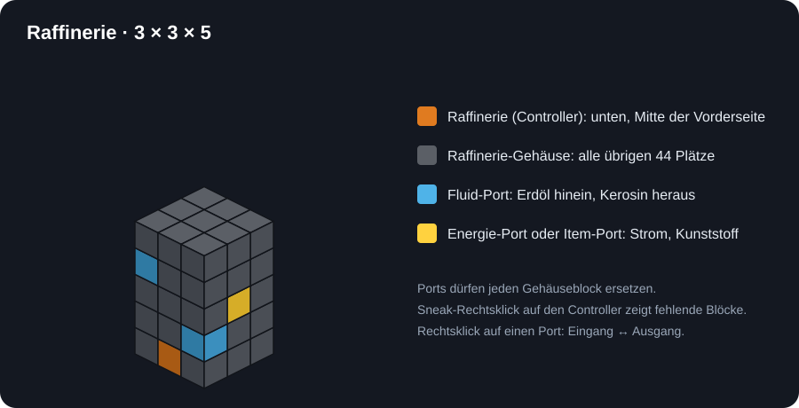
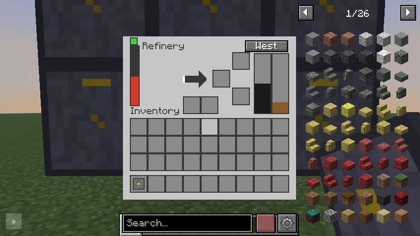
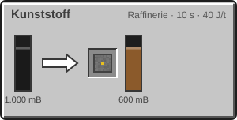
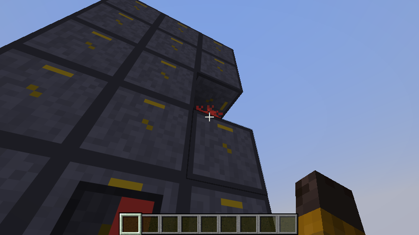
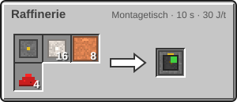
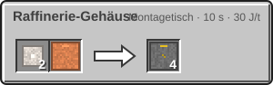
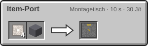
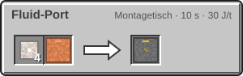
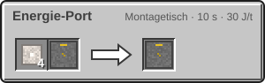

<!-- Erzeugt von tools/gen_wiki.py aus docs/handbook/ und spec/data. Nicht von Hand ändern. -->

[📖 Wiki](README.md) › Phase 1 · Erdindustrie › **Raffinerie**

# Raffinerie

Die Raffinerie ist dein erster **Multiblock**: ein Turm aus 45 Blöcken, der aus Erdöl **Kerosin** und **Kunststoff** macht. Kerosin ist Treibstoff, Kunststoff steckt in jedem Schaltkreis.

Bauplan: Der Controller (orange) sitzt unten in der Mitte der Vorderseite, Ports (blau, gelb) ersetzen beliebige Gehäuseblöcke.

| Steckbrief: Raffinerie |  |
| --- | --- |
| Verbrauch | 40 J/t |
| Dauer je Vorgang | 200 t (10 s) |
| Tanks | 16.000 mB, 16.000 mB |
| Upgrade-Slots | 2 |

Das Fenster der Raffinerie: Erdöl-Tank links, Kunststoff in der Mitte, Kerosin-Tank rechts.

## Was sie macht

| Rezept | Zutaten → Ergebnis | Wo | Dauer |
| --- | --- | --- | --- |
|  | 1.000 mB [Erdöl](Fluide-und-Rohre.md) → 1 × Kunststoff, 600 mB Kerosin | Raffinerie | 200 t (10 s) 40 J/t |

## Der Aufbau

Die Raffinerie ist **3 Blöcke breit, 3 Blöcke tief und 5 Blöcke hoch**, ganz massiv.

1. Setz den Controller (Raffinerie) auf den Boden. Seine Vorderseite zeigt zu dir.
2. Der Controller ist die **Mitte der untersten Reihe auf der Vorderseite**. Der Turm reicht von ihm einen Block nach links und rechts, zwei Blöcke nach hinten und vier Blöcke nach oben.
3. Füll alle übrigen 44 Plätze mit Raffinerie-Gehäuse.
4. Ersetze einzelne Gehäuseblöcke durch **Ports**, wo Rohre und Kabel andocken sollen (siehe unten).
5. Sobald alles stimmt, springt die Statuslampe von Rot auf Gelb.

> [!TIP]
> **Sneak-Rechtsklick** mit leerer Hand auf den Controller zeigt dir 200 t (10 s) lang mit roten Partikeln, wo noch Blöcke fehlen oder falsch sind.

Ein fertiger Raffinerie-Turm von unten gesehen. Ist er unvollständig, zeigen rote Partikel die fehlenden Plätze.

## Ports

Ports ersetzen Gehäuseblöcke und leiten nach außen an den Controller weiter. Rechtsklick mit leerer Hand schaltet zwischen **Eingang** und **Ausgang** um.

- Fluid-Port – Erdöl hinein (Eingang), Kerosin heraus (Ausgang).
- Item-Port – Kunststoff heraus (Ausgang).
- Energie-Port – Strom hinein.

| Rezept | Zutaten → Ergebnis | Wo | Dauer |
| --- | --- | --- | --- |
|  | 1 × [Maschinenrahmen](Erste-Schritte.md), 16 × [Eisenplatte](Presse.md), 8 × [Kupferrohr](Fluide-und-Rohre.md), 4 × Redstone-Staub → 1 × Raffinerie | Montagetisch | 200 t (10 s) 30 J/t |
|  | 2 × [Eisenplatte](Presse.md), 1 × [Kupferrohr](Fluide-und-Rohre.md) → 4 × Raffinerie-Gehäuse | Montagetisch | 200 t (10 s) 30 J/t |
|  | 4 × [Eisenplatte](Presse.md), 1 × Trichter → 1 × Item-Port | Montagetisch | 200 t (10 s) 30 J/t |
|  | 4 × [Eisenplatte](Presse.md), 1 × [Kupferrohr](Fluide-und-Rohre.md) → 1 × Fluid-Port | Montagetisch | 200 t (10 s) 30 J/t |
|  | 4 × [Eisenplatte](Presse.md), 1 × [Kupferkabel](Strom.md) → 1 × Energie-Port | Montagetisch | 200 t (10 s) 30 J/t |

## Materialbedarf

Für 44 Gehäuseblöcke brauchst du 11 Montagevorgänge, also 22 Eisenplatten und 11 Kupferrohre. Jeder Port spart dir einen Gehäuseblock.

> [!WARNING]
> Andere Blöcke im Aufbau sind nicht erlaubt. Auch ein einzelner falscher Block lässt die Lampe rot leuchten. Fahr im Fenster mit der Maus über die Lampe: Dort steht der erste fehlende Block mit Koordinate.

---

_Diese Seite steht auch im Spiel im **Ingenieurs-Handbuch**._

← [Elektrolyseur](Elektrolyseur.md) · [Upgrades](Upgrades.md) →
